## 2026-10-13 - Four picker corrections locally complete; SQL proposals retained

Phase 9 / Unit 6G remains active. All four approved corrections are locally implemented and independently APPROVED: selectable-result discovery/counts, error-specific selection recovery, compatible enum-only disabled reasons, and genuinely supplied edition/format display. Earlier title/scroll patches are preserved. Local verification: 491 Jest tests in 19 suites, 77 disposable SQL cases, root TypeScript and worker compilation PASS; fresh web export and actual read-only browser presentation/scroll proof PASS. This is bounded local completion, not shared release acceptance.

Active work unit: owner_edition_picker_four_corrections_local_complete_sql_proposals_retained. Exact next authorized action: Owner review of the local picker at localhost:8083 and the retained proposals. Detailed reasons still require compatible API/SQL publication; the actual browser verifies legacy fallback. Title and diagnostic SQL remain external PROPOSED / NOT_CREATED / NOT_APPLIED; title migration creation was declined. Current-scan refresh, staging/commit/push, deployment and shared writes remain held. M65-M74 are unchanged; M75 remains deferred. Tracker37 §34 owns exact scope/proof/risks; earlier dated checkpoints are historical.

## 2026-10-13 - Open Library enabled; fresh-session picker and private Add verified

Current status: `open_library_live_fresh_session_picker_private_add_verified`. Phase 9 / Unit 6G remains active. The Owner's "ok" authorized Open Library activation and one controlled authenticated fresh-session test. The specified testimage.jpeg had been uploaded before, so the app's duplicate guard prompted; the test used Proceed and created independent candidates for this session. The Search Books -> selection -> private Add path passed for one book; six other detected books remain in review. M75 remains PROPOSED / NOT_CREATED / NOT_APPLIED and deferred.

Fresh exact-project preflight matched Bookconnect_reactexpo / ahntbtktjjmvfosgkmgn, Render LIVE commit 76348f3 and Owner API ACTIVE v16/JWT enabled. One bounded registry update enabled Open Library at 2026-10-12T22:05:26.434106Z (13 October IST); only enabled/updated_at changed. Google remains enabled. Existing retention, attribution, permission and image-cache flags are preserved; no migration or deployment occurred.

The old scan 93567d47-3874-4576-b3b4-1adb044b552b was closed through the authenticated app at 2026-10-12T22:08:44.023344Z. Live readback: closed/version3, all five candidates retained, all four committed inventory rows present, unchanged candidate states/versions/links. The unfinished card is read-only session history; its exhausted job is still in_progress at 5/5. No job reset or recovery fix was performed.

Exact next authorized action: Owner review of the live proof and direction on the six remaining cards in active session 7a81bdb6-ed34-40cb-b5a9-cff85402cf48; separately decide whether to authorize the proposed M75 exhausted-lookup recovery. The new session remains active, and the existing expired 5/5 job remains untouched. Sources: picker SDD §13.14, DOC-3 §5.2.1, Unit 6G SDD §§14/23 (U6G-AC13/18/20). [Live picker and Add evidence](trackers/37-owner-edition-picker-open-library-local.md) (tracker 37 §26); earlier headers are historical.
## 2026-10-13 - Owner API v16 verified; exhausted lookup recovery pending

Current status: open_library_owner_api_v16_verified_exhausted_lookup_recovery_pending. Phase 9 / Unit 6G remains active. Render still runs reviewed commit 76348f3; phase9-owner-ingestion is now ACTIVE version 16 with JWT verification enabled. All 35 served runtime files match the reviewed upload; three additional uploaded files were type-only dependencies, as independently checked against the Deno runtime graph.

Fresh API checks: OPTIONS 200, unauthenticated POST 401. The actual authenticated Codex browser loads the scan and reads edition state. The verified frontend export was restarted at localhost:8083, managed session 96852, after the old Metro preview had stopped; the fresh tab uses the tested static bundle and correct project.

The supplied card is blocked by an existing in_progress edition request with attempt_count=max_attempts=5 and an expired lease. Live dispatcher and claim predicates exclude it, while the choices reader reports pending; the UI therefore shows Searching books indefinitely. No job, selection, selling field or provider flag was manually repaired. Open Library stays disabled.

Proposed bounded correction: a new forward M75, leaving M65-M74 unchanged, must expose exhausted expired edition requests as failed and allow an initiating-Owner controlled retry with preserved chosen metadata, selling details and accounting/audit evidence. Exact file is proposed only: 20261013000075_marketplace_phase9_edition_picker_exhausted_lookup_recovery.sql; NOT_CREATED / NOT_APPLIED. Local creation and conditional shared application await the Owner's separate authorization.

Exact next action: obtain that bounded M75 authorization, then reproduce, implement and review the correction before fresh preflight/application and the controlled live edition workflow. No Render or Owner API redeployment is needed for the proposed SQL-only correction. [API deployment and live recovery finding](trackers/37-owner-edition-picker-open-library-local.md) (tracker 37 sections 23-24); earlier dated entries are historical.

## 2026-10-12 - M74 applied and verified; Open Library disabled; Render held

Current status: open_library_m74_applied_verified_render_held. Phase 9 / Unit 6G remains active. The Owner explicitly requested completion of M74 preflight/application after the approved bounded correction. That application authority supersedes the earlier local-only gate for M74; publication, provider activation and Render deployment remain held.

Fresh preflight matched the reviewed file and both M73 function bodies/permissions on Bookconnect_reactexpo / ahntbtktjjmvfosgkmgn; the focused full-M74 SQL/security suite passed 20/20. M74 is APPLIED_VERIFIED as live version 20261012140853. Archived SQL SHA-256 FE0B13B7D10DA09AFFF71E031E6330F8568C5D05638F079551A7652172EF2FF3 matches the unchanged local file; both installed function bodies match the reviewed definitions.

Only the two private completion/registration functions changed. Their signatures/owners/ACLs/search paths and 17 other checked functions remain intact; provider-call columns/RLS/ACLs/policies, provider flags and observed business/job counts are unchanged. Open Library remains disabled with no unresolved OL attempt. One existing in_progress edition job has an expired lease; it was observed and preserved.

Exact next authorized action: independent read-only GPT-6 Luna/max aggregate prepublication review of the final Open Library diff and evidence. Compatible client/worker/Owner API rollout, separately authorized provider activation and controlled shared operational acceptance remain pending. STOP before Render deployment. No commit, push, runtime deployment, provider request, Auth/inventory/Storage write or account/configuration change occurred. [Application ledger, exact readback and scope](trackers/37-owner-edition-picker-open-library-local.md) (§15). Earlier dated checkpoints are historical.

## 2026-10-12 - Author isolation corrected locally; M74 unapplied; Render held

Current status: open_library_author_corrections_local_verified_m74_pending. Phase 9 / Unit 6G remains active. The Owner authorized "Yes, fix both and create local M74". Both aggregate P2 findings were reproduced, corrected and regression-tested; GPT-6 Luna/max approved the bounded correction. This does not replace the aggregate prepublication review.

The adapter validates edition facts before allocating complete own-author sets within the four-author budget. Nonretryable author-content failures leave only dependent rows unavailable; local M74 permits truthful finalized receipts to continue and complete without weakening mandatory-stage, retryable, egress or authority guards. Google ranking/cover and Owner UI behavior are preserved.

M65-M73 remain applied and byte-preserved. M73's archived live SQL matched its reviewed hash in this session's read-only exact-project check; OL remains disabled. M74 is CREATED_LOCAL / NOT_APPLIED. No shared mutation, provider request, browser action, staging, commit, push or deployment occurred in this correction.

Exact next authorized action: independent read-only GPT-6 Luna/max aggregate prepublication review of the final Open Library diff and evidence. M74 application needs a separate decision and fresh preflight; compatible client/worker/Owner API rollout, provider activation and authenticated operational acceptance remain gates. STOP before Render deployment. [Exact scope, commands, migration ledger and evidence](trackers/37-owner-edition-picker-open-library-local.md) (§14). Earlier dated checkpoints are historical.

## 2026-10-12 - Browser corrections verified; M73 applied; Render held

Phase 9 / Unit 6G remains active. Status: `open_library_browser_corrected_m73_applied_render_held`. The Owner authorized the bounded corrections and migration application, with an explicit stop before Render deployment.

The Response receiver, bulk-control lifetime and metadata-sheet opacity are corrected. Fresh gates: 25 client suites / 379 tests, eight actual-app browser fixture cases, 25 full-M73 SQL/worker cases, worker build / 14 structural checks and TypeScript PASS. Luna/max approved only the bounded source corrections; no independent test rerun or aggregate publication approval is claimed. No new Save step was introduced.

M73 is APPLIED_VERIFIED on Bookconnect_reactexpo / ahntbtktjjmvfosgkmgn as version 20261011224457; archived SQL SHA-256 matches the unchanged reviewed file. Open Library is installed disabled. Existing books/candidates/inventory/provider-call data, provider-call RLS/grants and M65-M72 bytes are preserved. Seven read-only actual-adapter OL GETs returned 200 with minimum start spacing 1005.37 ms; raw bodies and returned metadata were discarded.

Exact next authorized action: report this verified correction/application checkpoint and the remaining rollout prerequisites, then STOP before Render deployment. Compatible client/worker/Owner API publication and rollout, shared provider activation, authenticated shared workflow and operational acceptance remain pending. No Git publication, runtime deployment or provider activation occurred here. [Exact evidence, migration ledger and limits](trackers/37-owner-edition-picker-open-library-local.md) (§11). Earlier dated checkpoints are historical.

## 2026-10-11 - Native accounting and request spacing verified; browser handoff

Current status: `open_library_native_spacing_locally_verified_browser_pending`. Phase 9 / Unit 6G remains active and Tasks 1-8 retain their earlier bounded approval provenance. M65-M72 remain applied/byte-preserved; M73 remains CREATED_LOCAL / NOT_APPLIED and shared OL activation remains pending.

Native PostgreSQL through M73 passed 28 cases with 18 observed independent-connection lock overlaps and verified disposable teardown. The Owner-authorized scheduler correction holds the shared permit through fresh authority checks until HTTP dispatch; a compiled-factory fixture run spaced all 18 actual fetch invocations at least one second apart across three jobs. The 397-test backend gate passed. These local proofs do not establish deployed provider/browser behavior.

Next authorized action: use the separate predeployment browser inspection prompt in another session, then return its report here for the final Free-plan/configuration preflight. Do not start browser testing in this preparation session. Deployment remains held at the Owner's request; M73 application, shared provider activation, compatible runtime/client rollout, shared security/cleanup/recovery/disablement and publication remain gates. Available-model local correction review does not replace the requested Luna prepublication review, which remains separately pending at its usage limit.

[Detailed scope, evidence and pending gates](trackers/37-owner-edition-picker-open-library-local.md). Earlier dated checkpoints below are historical.

## 2026-10-11 - Local Open Library edition fallback; rollout gated

Current status: `open_library_fallback_local_review_complete_rollout_pending`. Phase 9 / Unit 6G remains active; Tasks 1-8 keep their prior approvals. The Owner authorized explicit-search fallback implementation and "Yes, create local M73". M65-M72 remain applied/byte-preserved; M73 is CREATED_LOCAL / NOT_APPLIED. OL is absent from the shared metadata registry.

Only explicit Owner lookup can use independently permitted Open Library factual editions; automatic Google winner/cache/ranking and representative-cover behavior remain unchanged. DOC-3 §5.2.1 and picker §13.14 own this cross-domain amendment; tenant, command, retention and Add invariants remain authoritative.

Next authorized action: hand off the verified local correction and detailed independent browser prompt. GPT-6 Luna/max found no remaining bounded blocker and independently passed two focused full-M73 regressions; wider gates remain root evidence. Publication/application/activation/deployment and browser/device verification remain gated; the Owner asked for a separate browser prompt first. [Scope, migration ledger, evidence and gates](trackers/37-owner-edition-picker-open-library-local.md). Earlier dated entries are historical.

# SDD 00: Phase 9 Image-Assisted Inventory Master Design

## 2026-10-09 - Task 8 independent approval and M65-M70 applied

Phase 9 / completed Unit 6G baseline. Task 8's bounded LOCAL checkpoint is
independently APPROVED; all eight tasks have local implementation/verification
evidence. [Review provenance](trackers/33-owner-edition-picker-task8-local-verification.md)
preserves earlier approval provenance and the unavailable historical 152-path
audit baseline.

**Status:** `task8_independently_approved_m65_m70_applied_runtime_pending`.
The Owner authorized steps 1-3: approval documentation, live preflight and the
six unchanged migrations. All M65-M70 are now APPLIED / catalog-verified on
Bookconnect_reactexpo / ahntbtktjjmvfosgkmgn. [Application ledger](trackers/34-owner-edition-picker-m65-m70-application.md)
records six live versions, exact source/archive hashes, function/ACL/RLS/index/
trigger readback, unchanged business counts, recovery and advisor deltas.

No Edge/worker/client deployment, registry/configuration change, provider call,
browser test, data deletion, staging, commit or push occurred. New alternatives
retention remains disabled/unverified; existing automatic provider flags remain
unchanged. Runtime/provider/browser/operational rollout gates stay pending.

Exact next action: Owner review/authorization for compatible development
Edge/worker/client rollout and provider-gated browser verification (step 4).
Earlier dated entries below retain their historical NOT_APPLIED status and
review provenance; this latest entry owns current application status.

## 2026-10-09 - Task 8 local verification review checkpoint

Phase 9 / completed Unit 6G baseline; Tasks 1-7 locally implemented.
Task 6 and Task 7's bounded corrections retain independent APPROVED provenance.
**Status:** `task8_locally_verified_pending_independent_review`.
**Active work unit:** Task 8 LOCAL verification review checkpoint.
The Owner supplied the previously pending local authorization.
[Task 8 evidence](trackers/33-owner-edition-picker-task8-local-verification.md) records 17 native PostgreSQL checks /
11 lock overlaps, exact Task 7 23 suites / 349 tests, provider/worker/contract
13 suites / 365 tests, 187 scoped SQL cases, build / 14 structural cases,
strict types, teardown and the 19-ACTIVE-ID evidence matrix.
Mocked UI requests, fixture SQL and real native locks are labelled separately.

**Exact next authorized action:** independent read-only review of Task 8's
local test, harness and verification-documentation diff. No Task 8 independent
approval or full operational completion is claimed. Remaining browser/device,
configured-provider permission, live migration/runtime, security/cleanup and
lookup/UI disablement/rollback/rollout gates are separately authorized.
M65-M70 remain unchanged / CREATED_LOCAL / NOT_APPLIED to the shared service;
production retention stays disabled. Only disposable local database/cluster
mutations occurred. No shared database/Storage/provider/deployed-worker mutation,
staging, commit, push or deployment occurred. No product requirement changed.
Earlier dated entries below retain their historical scope and review provenance.

## 2026-10-09 - Task 7 correction review approved

Phase 9 / completed Unit 6G baseline; Task 6 independently APPROVED.
**Status:** task7_corrections_independently_approved_task8_authorization_pending.
The Owner supplied an independent read-only APPROVED verdict for the bounded
Task 7 corrections: matched-details preserves edition_option/selection reference;
detected-details resets replacement identity confirmations while preserving
selling values and ordinary metadata-only manual switching.

[Independent correction-review evidence](trackers/32-owner-edition-picker-task7-ui-evidence.md#2026-10-09---task-7-correction-review-approved) records the independently
rerun 23 suites / 349 tests, strict TypeScript, continuity and diff checks.
Save assertions capture outgoing mocked-service requests, not successful server
persistence. Browser/device/provider and independent-connection PostgreSQL
proof remain Task 8 gates.

Exact next action: separate Owner authorization for Task 8 local integrated
acceptance proof and independent-connection PostgreSQL checks. Task 8 is
unstarted. Live migration/runtime/browser/provider enablement and Git
publication remain separately authorized. M65-M70 remain byte-preserved /
NOT_APPLIED; production retention is disabled. This session changes handoff
documentation only; product tests are not rerun. No database/Storage/provider
mutation, staging, commit, push, deployment or application occurred.
Earlier dated entries below retain their historical scope and evidence.

## 2026-10-09 - Task 7 bounded review corrections

Phase 9 / completed Unit 6G baseline; Task 6 independently APPROVED.
The independent Task 7 review returned CHANGES_REQUIRED (two P2 findings);
the Owner explicitly authorized these bounded local corrections.
**Status:** task7_corrections_locally_verified_pending_review.
The full-review matched-details control preserves an existing edition_option
choice; detected-details replacement resets title/author confirmations to the
replacement identity, while metadata-only manual switching preserves them.
Existing picker §§6-7 / EP-AC19, Review SDD §5 and Master MAS-18 own the fixes;
no requirement, server authority, schema or acceptance criterion is added.
Fresh recorded Task 7 Jest gate: 23 suites / 349 tests PASS, exit 0.
Exact next authorized action: independent read-only review of the two bounded
corrections and their regression evidence. Correction approval is not claimed.
Task 8 remains unstarted. M65-M70 remain byte-preserved / NOT_APPLIED; production
provider retention stays disabled. No database/Storage/provider mutation,
staging, commit, push, deployment or migration application occurred.
Earlier dated entries below retain their historical evidence.

## 2026-10-09 - Task 7 local UI completion; independent review pending

Phase 9 / completed Unit 6G baseline; Task 6 independently APPROVED.
**Status:** `task7_locally_implemented_verified_pending_independent_review`.
**Active work unit:** Task 7 local UI review checkpoint.
The explicit Owner request authorized this implementation in the existing
edition-picker worktree. The real compact card and older/full correction route
now open the existing sheet, preserve current choice/one cover and selling edits,
render original Google Books positions, and use the Task 6 server selection and
existing Save/Add slot. Fresh resume and Add all use the confirmed held choice;
no selling review or server readiness is manufactured by selection/read.

Fresh local code gates: 23 Jest suites / 345 tests PASS, exit 0; TypeScript
`--noEmit --allowImportingTsExtensions` PASS, exit 0. [Exact scope, RED/GREEN,
bounded self-review, continuity/hash closeout and limits](trackers/32-owner-edition-picker-task7-ui-evidence.md) belong
to Task 7; no independent approval or browser/live/full-feature acceptance is
claimed. Existing DOC-3 §§5.2/6, DOC-4 §§9-11, DOC-8 §5, picker §§3/6-7/13.2,
EP-D02/03/04/07/14 and Unit 6G §§11-14 own the implementation. No new requirement,
server contract, backend/worker behavior or schema is introduced.

**Exact next authorized action:** independent read-only Task 7 review of this
local modified/untracked checkpoint and mounted flow. Task 8 is unstarted.
M65-M70 remain CREATED_LOCAL / NOT_APPLIED and byte-preserved; production provider
retention remains disabled. Database/Storage/provider/browser mutation authority:
none. Nothing was staged, committed, pushed, deployed or applied. Earlier dated
entries below are historical.

## 2026-10-08 - Task 6 independent review approved

Phase 9 / completed Unit 6G baseline. Current status:
`task6_independently_approved_task7_authorization_pending`.
The Owner supplied an independent read-only APPROVED review of the final
local Task 6 checkpoint, including M70, strict DTOs, selection replay,
full/compact resume, script preservation and single/bulk Add recovery.

[Independent review evidence](trackers/02-implementation-and-verification.md#2026-10-08---task-6-independent-review-approved) records the separately
rerun 387 Jest tests, 20 M70 plus 32 historical M69 SQL cases, strict
TypeScript, worker build/14 structural checks, continuity and hash checks.
This handoff session changes documentation only; product tests are not rerun.
M65-M70 remain CREATED_LOCAL / NOT_APPLIED; production retention is disabled.

Exact next action: separate Owner authorization for Task 7, Metadata-sheet
display and interaction. Tasks 7-8 remain pending. This review does not
authorize new implementation, live application, deployment or Git publication.
No database/Storage/provider mutation, staging, commit, push or deployment
occurred. Earlier dated entries below are historical.

## 2026-10-08 - Task 6 confirmation correction local completion

Phase 9 / Unit 6G baseline; task6_locally_complete_pending_review. Existing
MAS-02/03/05/15/17 and picker §§6-7 / EP-AC11/19 govern the server-derived
confirmedByOwner response field. M70 reuses private selection evidence and
existing public signatures; no table, column, counter, queue, readiness or
retention policy is added. Client draft adoption requires current confirmation
and existing scope/version fences. Reads and selection do not manufacture a
selling review or permit Add without canonical Save.

[Correction proof](trackers/02-implementation-and-verification.md#2026-10-08---task-6-confirmation-correction-local-completion)
is local only. M65-M69 remain unchanged; M65-M70 remain NOT_APPLIED. Task 6
is locally complete pending review; Task 7 display and Task 8 operational/race
proof remain separately authorized. Earlier checkpoints are historical.

## 2026-10-08 - Task 6 client review checkpoint and confirmation gap

Existing root DOC-3 §§5.2/6, DOC-4 §§9-11 and DOC-8 §5 govern picker
§§3/6-7 and Unit 6G §§11-14. No product decision or acceptance ID is added.
The Task 6 client uses the authenticated Owner Edge and strict Task 1 DTOs,
keeps corresponding counters within identity/session/card scope, preserves
unsaved full/compact selling fields, and shares the existing Save/Add slot.
Single/Add all reconcile uncertain Add using the original command before a new
draft can supersede it. Generic/conflict reads do not adopt another edition.
Lookup and read/mount/expiry are separate actions; only explicit lookup writes
request alternatives.

The no-review current_suggestion resume case remains a required contract gap.
No Owner confirmation is inferred from a selected state, opaque UUID, non-null
selection, source tag or metadata similarity. Existing strong selected/manual
behavior remains compatible. Task 6 is incomplete; Task 7 UI and Task 8
browser/live/independent-connection proof are pending.

[Local Task 6 evidence](trackers/02-implementation-and-verification.md#2026-10-08---task-6-client-review-checkpoint-and-confirmation-gap); the narrow read-discriminant proposal is linked there. Task 5 correction APPROVED self-review is Owner-accepted, not independent approval. M65-M69 remain NOT_APPLIED and unchanged. Earlier entries are historical.

## 2026-10-08 - Task 5 independent-review correction

Existing MAS-02/03/05/15 and picker §§5-7 govern the corrected private projection. A query-current scoped choice can be read before review exists; selection does not satisfy required review or grant inventory creation authority. No workflow or product scope is added.

[Correction evidence](trackers/02-implementation-and-verification.md#2026-10-08---task-5-independent-review-correction). Locally verified; independent correction review is pending. Tasks 6-8 remain unstarted and M65-M69 remain NOT_APPLIED. Earlier checkpoints are historical.

## 2026-10-08 - Edition-picker Task 5 local completion

Task 5 implements picker §§5-8/9 and Unit 7A §§5-11 under MAS-02/03/05/06/07/15/17. Existing server-derived ownership, saved-review/version checks, create-only private inventory, idempotent replay and separate publication authority remain the governing workflow. A server-held coherent edition choice now drives review readiness, compact/detail metadata, inventory fields and the pre-insert representative-cover decision. Add and discarding that card's alternatives are atomic; selected provenance survives independently.

The existing lifecycle dispatcher performs bounded physical clearing and reports cleared/remaining/failed using one private due predicate. Removal/identity changes clear the affected state immediately; reads/selects retain immediate expiry fences. No new queue, scheduler, status mirror, counter, canonical mutation or client flow is introduced. [Task 5 evidence](trackers/02-implementation-and-verification.md#2026-10-08---edition-picker-task-5-local-completion) records 194 SQL, 406 Jest and 14 structural cases plus strict types/build. Status is task5_locally_verified_pending_review; Tasks 6-8 are separately gated. Local M69 and M65-M68 are NOT_APPLIED. Earlier checkpoints are historical.

## 2026-10-08 - Task 4 timestamp correction and self-review

Phase 9 / Unit 6G; status task4_locally_verified_self_review_complete. Owner-requested self-review found a remaining timestamp-validation P2; the Owner then authorized "fix it". M68 now rejects PostgreSQL-only era/ordinal dates and leap-second timestamps on all non-null option rows, while normalized ISO UTC and offset timestamps remain supported.

Fresh local proof: 10 timestamp cases (six rejection regressions, four valid controls); 87 completion/security/worker SQL cases; 264 Jest tests; 14 structural cases; strict graph/bootstrap TypeScript and worker build PASS. SQL proof uses disposable PGlite; real multi-connection races and live retention remain later gates.

Only M68 and its existing correction integration suite changed as production/test files. M65-M67 are byte-preserved; M65-M68 remain NOT_APPLIED. Self-review is complete; independent correction approval is not claimed. Tasks 5-8 remain unstarted. Exact next action: Owner authorization for Task 5, Exact-selection Add and lifecycle cleanup. No live service mutation, migration application, deployment or Git publication.

Earlier checkpoints below are historical.

## 2026-10-08 - Edition-picker Task 4 review corrections

- Current phase / completed baseline: Phase 9 / Unit 6G. Status: task4_locally_verified_pending_review. Active work unit: corrected Task 4 worker/SQL completion checkpoint; Tasks 5-8 remain unstarted.
- Two independent reviews returned CHANGES_REQUIRED, with three unique P2 findings (the language mismatch is shared). All three were reproduced and corrected locally; correction review is still pending. Task 3 remains Owner-accepted self-review, not independently APPROVED; Task 2's correction approval is preserved.
- Corrections: unknown query language permits an otherwise compatible exact validated ISBN; SQL contract rejection reaches the worker as nonretryable schema_invalid after committed-receipt recovery; failure transitions replay from bounded private claim evidence; every non-null option is checked against normalized metadata bounds, versions, timestamp and coherent ISBN identifiers before eligibility.
- M68 adds one nullable private failure_receipt to the existing per-card state. It contains claim/request evidence, hashes and bounded failure arguments, with no metadata, plaintext lease token or authoritative job status. Public signatures, selected metadata and selling authority are unchanged.
- Fresh local proof: 11 Jest suites / 264 tests; 77 completion/security/worker SQL cases (34 existing completion + 7 worker-to-SQL + 36 correction cases); 14 structural SQL cases; 48 existing picker SQL cases; worker build and strict graph/bootstrap TypeScript PASS. Deterministic RED preceded production corrections. No independent-connection race proof is claimed.
- Migration / external authority: the existing authorization covers local Task 4 corrections to M68 and disposable verification. M65-M67 bytes are unchanged; M65-M68 remain NOT_APPLIED. Production still has no retention verifier. No live DB/Storage/provider/browser/deployed-worker mutation, deployment or Git publication occurred.
- Fresh read-only MCP verifies Bookconnect_reactexpo / ahntbtktjjmvfosgkmgn / ACTIVE_HEALTHY. Latest Phase 9 migration remains M62 / 20260913162154; the overall tail now includes unrelated clubs_admin_primary_venue / 20261007144356. No edition-picker migrations, private state or completion RPC are live.
- Exact next authorized action: independently review the corrected Task 4 diff and regression evidence. Task 5 requires separate Owner authorization after this checkpoint; migration application and rollout remain separately gated.
- Git: codex/edition-picker at ee3a8c79429ca401d468861f2861721082ba955e, exclusive edition-picker-research worktree; 82 changed paths (45 modified / 37 untracked), zero staged. The new path is the legitimate correction integration suite; pre-existing unrelated changes are preserved.

Earlier dated checkpoints describe their historical scope and are superseded for the current handoff.
## 2026-10-07 - Edition-picker Task 4 local completion

Under picker §§4.1-4.3/5/8-9 and Master MAS-02/03/12/17, the explicitly requested edition_options worker now completes through local M68 and its typed service RPC port. The fifteen-job/three-active pool and automatic winner/cache behavior remain intact. Bounded private own-card results are atomically persisted before readiness; slim replay/recovery avoids another provider request after committed response loss. Selection, selling details and existing authority versions are preserved. Production installs no retention verifier.

Task 4 is task4_locally_verified_pending_review; Tasks 5-8 remain unstarted. Fresh proof: 259 Jest tests, strict graph/bootstrap types, required build/14 structural DB cases and 40 completion/worker DB cases PASS. M65-M67 hashes are unchanged; M65-M68 remain NOT_APPLIED. Independent review returned no verdict at the usage limit. Next action is Task 4 review; no live mutation or Git publication occurred. Earlier checkpoints are historical.

[Detailed Task 4 evidence](trackers/02-implementation-and-verification.md#2026-10-07---edition-picker-task-4-local-completion) records scope, commands and limits.

## 2026-10-07 - Edition-picker Task 4 runtime checkpoint

Local runtime/test scope is implemented; durable Task 4 completion remains incomplete pending separately authorized forward SQL. The worker now decodes the existing v2 automatic/edition_options context, routes explicit Google options jobs around local/cache/coalesced winner-only shortcuts, validates the bounded Task 3 response, preserves physical-call accounting, and reports available only after the typed controlled completion port confirms it. Production installs neither that port nor a retention verifier; explicit requests are not enabled.

Fresh evidence: Task 4 worker/recovery plus affected worker/gateway/composition and provider/automatic regressions pass 9 suites / 237 tests; strict types pass; the required structural metadata worker build and 14 disposable database cases pass. Tests use recorded responses and an in-memory port model; these results do not establish durable SQL, grants/RLS, real races or live permission.

Read [Task 4 implementation evidence](./trackers/02-implementation-and-verification.md#2026-10-07---edition-picker-task-4-runtime-checkpoint) and the [reviewable SQL proposal](./work-units/owner-edition-picker-task4-sql-proposal.md). The fresh read-only Supabase check verifies live M62, with no controlled options completion/failure operations. M65-M67 remain local and NOT_APPLIED. Next action is separate Owner authorization of one forward local migration and disposable SQL tests. Tasks 5-8 remain unstarted; no migration file was created/edited/applied and no live/external mutation or Git publication occurred.

## 2026-10-07 - Edition-picker Task 3 review corrections

Under MAS-02/15, picker §§4.1/8/13.2 and DOC-3 §5.1, the two confirmed review defects are corrected locally: safely decoded conflicting observed-ISBN identities prevent strong certainty even when disabled for selection, and Expires-only lifetime applies Date/Age before retention is permitted. This restores existing requirements; no new product or SQL scope is introduced.

The supplied Task 3 verdict remains CHANGES_REQUIRED until independent correction review. Current status is task3_corrections_locally_verified_pending_review; Tasks 4–8 remain pending and Task 4 requires separate Owner authorization. Four Jest suites / 136 tests, strict types and worker build PASS. M65–M67 are unchanged and NOT_APPLIED; no live/provider/Git-publication action occurred. [Correction evidence](trackers/02-implementation-and-verification.md#2026-10-07---edition-picker-task-3-review-corrections) records exact scope and limitations. Earlier dated checkpoints are historical.

## 2026-10-07 - Edition-picker Task 3 implementation checkpoint

The authorized Task 3 implements only picker §§3/4.1/5/8/13.2 at the provider boundary, under MAS-02/15. Explicit Google options retain original positions, safe coherent metadata, suitability and certainty evidence independently. Automatic winner/cache behavior remains unchanged. Provider headers can shorten a verified retention deadline; they cannot grant permission. Production installs no verifier before the later live enablement gate.

Tasks 1–3 are locally complete; review Task 3's diff/evidence next. Task 4 worker execution/completion remains pending separate Owner authorization. M65–M67 remain local/NOT_APPLIED; Task 3 made no SQL or external changes. [Task 3 verification](trackers/02-implementation-and-verification.md#2026-10-07---edition-picker-task-3-local-completion) records fresh tests and limitations; no full-feature acceptance is claimed. Earlier dated checkpoints are historical.

## 2026-10-07 - Edition-picker Task 2 review corrections

The Owner-authorized corrections restore picker §4.1 / DOC-3 §5.1 / DOC-4 §8: local reuse validates the complete Owner-safe metadata, a unique coherent exact text match remains a medium suggestion requiring confirmation, and ambiguous matches remain unresolved. M65/M67 are revised locally only; M65–M67 are NOT_APPLIED. The existing gateway, jobs, private-state permissions, selling fields and Add fence remain in force. No product scope or new migration was added.

Current authority, corrected handoff and verification are recorded in [the implementation evidence](trackers/02-implementation-and-verification.md#2026-10-07---edition-picker-task-2-review-corrections) and DOC-13/TRACKER. Earlier checkpoints are historical.

## 2026-10-07 - Edition-picker Task 2 local completion

Task 2 is locally complete: private per-card state, controlled read/search/select, version/expiry/ownership guards, coherent local ISBN resolution, lookup-scoped attempt history, and explicit-operation admission. Task 1 remains complete. The Owner's “ok proceed” authorized local M65–M67 creation and disposable tests; these files exist locally and are NOT_APPLIED. No live database/Storage write, deployment, staging, commit, or push occurred.

Fresh proof: 34 disposable-database tests PASS; 4 affected Owner Jest suites / 303 tests PASS; strict Owner ingestion graph type check PASS. Real independent-connection races, provider-retention permission, worker execution/completion, Add/cleanup integration, client/UI/browser and rollout proof remain Tasks 3–8. No full-feature acceptance is claimed.

Current work unit: Task 2 checkpoint review. Exact next authorized action: review the Task 2 diff/evidence; the next implementation slice is Task 3 Google result envelope after Owner authorization. Sources: picker SDD §§4.3/5–6/8–9/11; Master MAS-02/03/07/12/17. Earlier dated checkpoints below are historical.

## 2026-10-07 - Edition-picker Task 2 gateway/preflight checkpoint

Task 1 remains locally complete. Task 2 code/read-only preflight is now authorized: the strict authenticated Owner gateway and HTTP routing pass 303 affected Jest tests and a strict server type check. Database storage/commands are not implemented; local M65–M67 migration-file creation is awaiting the separate Owner approval required by AGENTS. No SQL/database/Storage/deployment/Git publication occurred. Tasks 3–8 remain pending. Current authority/status comes from DOC-13 and TRACKER; earlier checkpoints below are historical.

## 2026-10-07 - Edition-picker Task 1 contract checkpoint

The Owner authorized Task 1 on 2026-10-07. Contracts/fixtures and narrow compatibility are locally complete; Tasks 2–8 and database changes remain unstarted/unapproved. Source behavior remains picker SDD §§5–7/9/13.2. Current next action is Task 1 diff review; [implementation evidence](trackers/02-implementation-and-verification.md) supersedes earlier planning-only status below.

## 2026-10-06 - Owner edition picker draft extension

Latest Owner display clarification EP-D14: each edition option in the metadata sheet shows its own cover image from its safe URL, title, all authors, and publication date; publisher, ISBN, and language are secondary details. Selection saves the coherent chosen metadata independently and follows the usual inventory Add flow, leaving one chosen cover on the scan card. This supersedes earlier text-only option rows. Owner chose relevance order with returned order preserved and Google attribution/book links. Picker §13.2 now defines Search Books wording and bounded unavailable/ineligible rows; EP-D11/13 scope cuts remain in force.

Latest Owner scope: alternatives are obtained and saved only after an explicit Owner lookup (EP-D13); automatic scan/cache/coalesced paths keep winner/outcome-only persistence and never copy alternatives. New manual edition-number editing before and after Add, numeric overrides, and Store View edition-edit extensions are deferred (EP-D11).

The [edition-picker SDD](./work-units/owner-edition-picker-sdd.md) consolidates EP-D01..EP-D14 and extends this domain's §§3,5,7-9; MAS-14 remains the automatic local-first baseline, with explicit alternatives under EP-D07/13.

Keep one card and one chosen cover, five initial rows/Show all up to ten, an explicit lookup for local/cache/older unfinished cards, independent per-card storage, a 24-hour product retention maximum from source fetch, and cleanup after confirmed Add. Preserve chosen metadata and selling details. Provider edition statements remain coherent source metadata; no new manual number field is introduced.

Keep per-record eligibility, lookup-scoped attempts, safe receipts, minimal versions, and effective-choice cover handling. No automatic alternative store/copying, shared lifetime, or new numeric override.

Status: design_ready_pending_owner_approval. The relevance-order decision resolves provider display §13.2; written-SDD and execution-plan approval still precede implementation. Historical implemented behavior below remains baseline evidence; no runtime or migration implementation is added.

2026-10-07: the Owner requested the [eight-task implementation-plan draft](../../../superpowers/plans/2026-10-07-owner-edition-picker.md). It maps the existing SDD scope without granting code/migration/rollout authority. Review the SDD and plan together; Task 1 is the first coding unit once authorized.

**Status:** `approved_baseline`
**Version:** 1.0
**Date:** 2026-07-19
**Phase:** 9
**Implementation checkpoint (2026-08-12):** Unit 6's automatic/functional
pipeline is **PASS** through Owner Needs Review. M32-M38 are live exactly once;
metadata is deployed from approved SHA `a138baa`; and one authenticated Owner
upload automatically completed media, vision/Gemini, and six metadata jobs
without inventory/listing effects. M38 ensures a later claim performs fresh
egress after a retryable physical result while preserving same-claim and
terminal reconciliation. Native Unit 6F validation remains deferred debt:
camera/gallery physical-device parity, native recovery/reconnect, 15-card
representative-device performance, offline/reconnect, accessibility/large
text, and low-end Android resource/performance are `NOT_RUN`/`UNRESOLVED` and
none is marked PASS. The project owner accepts this deferred native-validation
risk and authorizes Unit 7 to begin. This changes sequencing only; it does not
alter Unit 6 requirements or acceptance criteria.

**Unit 6G Group 1 overlay (2026-08-21):** the Owner approved local contract/
persistence foundation for optional pre-scan defaults, one compact bounded review page,
save-then-commit Add/Add all orchestration, and a distinct durable general
candidate-removal disposition. The proposed specialization preserves mandatory
human review, independent M39 private commits, partial failure, and Unit 7C
post-commit ownership. Group 1 contracts/runtime and the forward M52 migration
candidate are locally verified; M52 application and Groups 2–4 remain gated.

**Unit 4B local checkpoint (2026-07-27):** the configuration-driven
`gemini-3.5-flash-lite` adapter is locally implemented behind the same
`SpineImageAnalyzer` contract and awaits independent review. It has made no live
provider call and is not configured or deployed in any environment.

## 1. Decision

Build Phase 9 as an AI-assisted, human-in-the-loop, deterministic inventory
ingestion pipeline. A Store Owner uploads an image of at most 15 book spines,
receives enriched candidates, corrects a minimal review form, and commits
candidates independently to private inventory and optionally to the public
marketplace.

The vision model is not an autonomous agent. It cannot call metadata providers, storage, database functions, or application tools. The application owns authorization, orchestration, validation, retries, canonical matching, duplicates, commits, projection, media promotion, and lifecycle deletion.

## 2. Source and scope

This SDD refines DOC-1, DOC-3, DOC-4, DOC-5, DOC-6, DOC-8, DOC-13, and DOC-14. The detailed decisions are recorded in [the planning tracker](./trackers/01-planning-and-decisions.md), and the live delta is recorded in [database-current-vs-target](./supporting/database-current-vs-target.md).

### Included

- Owner-only scanning pilot.
- Camera and gallery upload.
- Spine stacks with a maximum 15 books/image; current runtime requires selected
  language, while the approved target auto-detects with optional hints.
- One current image in a simple Start/Close session. Before candidate lineage
  exists, the Owner may explicitly remove that image and choose one replacement;
  append-style additional images are not allowed. Removal is logical, cancels
  only that input's active media/vision work, and does not cascade into
  candidates, inventory, listings, or immediate Storage deletion.
- Persistent asynchronous extraction and enrichment.
- Model/provider adapter contracts and bounded fallback.
- Rich book metadata plus bounded, field-specific, store-scoped linguistic
  variant proposals under [Unit 5C Lite](./work-units/05c-lite-multilingual-search-variants-sdd.md).
- Mandatory Owner review and atomic create-only per-candidate private-inventory commit.
- Five public condition values plus separate damage disclosure.
- Public damage/actual-copy media and lifecycle management.
- Bookstore-first marketplace discovery and complete public store catalogue.
- Mandatory item-level customer current-copy photo request extension.
- Quota, cost, quality, security, privacy, retention, telemetry, and recovery.

### Excluded

- Per-spine model ensembles, high-volume shelf scans, and automatic model
  switching by language. Field-level detection is part of the approved target.
- Image similarity for duplicates.
- Automatic canonical creation or automatic duplicate merge from uncertain text.
- Automatic publishing without owner review.
- Full application translation/localization.
- Promotion/coupon engine and copy-level serialization for all inventory.
- Manager/staff scanning.
- Phase 7 payment, paid orders, refunds, ledger/settlement, and Phase 8 pickup behavior.

## 3. Design invariants

| ID | Invariant |
| --- | --- |
| MAS-01 | One accepted image contains 1–15 visible spine candidates. More than 15 is rejected for rescan. Session language is a non-authoritative hint and never forces or rejects detected identity. |
| MAS-02 | Model/provider output is untrusted input. Only deterministic validated code can advance state or write data. |
| MAS-03 | Every store-owned row and media object is scoped by server-derived `store_id`; a client value cannot grant authority. |
| MAS-04 | Confirmed original-language title and author remain primary. Deterministic keys are not variants; active store-scoped linguistic variants are search-only and never duplicate/canonical evidence. |
| MAS-05 | Owner review and explicit Add to Inventory are required before a scanned candidate creates exactly one new private inventory row; scan commit never increments an existing row. |
| MAS-06 | No candidate failure blocks unrelated candidates; every candidate commit is atomic and idempotent. |
| MAS-07 | Private inventory and public marketplace data are separate. Only eligible server-projected fields become public. |
| MAS-08 | Scan, public-copy, and customer-request media are different security/lifecycle classes and cannot be repurposed by path reuse. |
| MAS-09 | Phase 9 can reach private inventory/public listing and request-photo acceptance only; it cannot create payment-provider or paid-order effects. |
| MAS-10 | Quota/cost failure never disables manual inventory entry. |
| MAS-11 | A valid private inventory commit survives public-projection failure; publication retries cannot create or increment inventory again. |
| MAS-12 | During the Owner-only pilot, the initiating Owner owns session mutation/resume. Phase 9 exposes no interactive support takeover or cross-store private-data access; recovery uses initiating-Owner retry, claimed-worker recovery, and reconciliation. Future support tooling requires separate design and authorization. |
| MAS-13 | Vision and metadata workflows depend only on versioned provider-neutral contracts; provider replacement cannot require changes to candidate storage, canonical rules, Owner review, duplicates, inventory commit, marketplace projection, or manual entry. |
| MAS-14 | One logical metadata lookup resolves locally first and makes at most one configured primary plus one allowlisted sequential secondary external attempt. An acceptable coherent primary result ends routing. |
| MAS-15 | An accepted edition snapshot comes from one coherent provider result or reviewed manual data. No provider is canonical authority and cross-provider field stitching is forbidden. |
| MAS-16 | Provider outage, ambiguity, quota/capacity exhaustion, breaker-open state, or kill switch preserves Owner/manual unmatched inventory as a successful path. |
| MAS-17 | Worker correctness is horizontally safe: durable jobs, leases, attempt numbers, idempotency and fencing—not process-local state—own authorization and accepted transitions. |
| MAS-18 | Unit 5C title and author confirmation/reconciliation is independent; no candidate-level approval activates unrelated fields. |
| MAS-19 | `p9-vision-v2` remains the strict persisted result. Optional compact Romanization/translation enrichment is independently validated, maps into the existing proposal persistence contract, and cannot invalidate otherwise valid extraction. |

## 4. Target architecture

```mermaid
flowchart LR
    Owner["Verified Store Owner"] --> App["Store Owner app"]
    App --> Gateway["Phase 9 command/query boundary"]
    Gateway --> Auth["Auth + store capability resolver"]
    Gateway --> Stage["Private media staging"]
    Stage --> Sanitize["Decode, validate, re-encode, EXIF strip"]
    Sanitize --> Jobs["Persistent orchestration jobs"]
    Jobs --> Vision["Vision adapter: primary / one fallback"]
    Vision --> Validate["Strict extraction schema validator"]
    Validate --> Canonical["Local canonical lookup"]
    Canonical --> Metadata["Metadata adapter: primary / secondary"]
    Metadata --> Candidates["Private staged candidates"]
    Candidates --> Review["Owner review"]
    Review --> Commit["Idempotent per-candidate commit command"]
    Commit --> Inventory["Private store inventory"]
    App --> StoreView["Unit 7C Owner Store View"]
    StoreView --> Inventory
    Inventory --> Projection["Separate Unit 7B safe listing projection"]
    Projection --> Market["Bookstore-first marketplace"]
    Commit --> PublicMedia["Approved public media"]
    App --> RequestMedia["Private customer request media"]
```

## 5. End-to-end workflow

1. Owner starts a session after the server verifies active Owner capability, entitlement/quota, feature flag, locality/store allowlist, and no conflicting session policy.
2. UI preselects condition, shelf/location, quantity 1, publication preference,
   and an optional language hint. First publication preference is private.
3. Owner captures or uploads an image. The app may do local guidance, but the server is authoritative.
4. Server creates a private media asset, validates signature/MIME/decode/size/pixels, re-encodes, strips metadata, hashes it, and checks replay/quota policy.
5. Quality gate checks blur, glare, resolution, framing, and count envelope. An image with more than 15 spines is rejected; it is never truncated silently.
6. A persistent job invokes the primary vision adapter with only the sanitized
   image, optional language hint, strict task/schema, and opaque correlation ID.
7. Output is locally schema-validated and bounded. The runtime persists usable
   detected-language candidates under strict `p9-vision-v2`; compact optional
   enrichment is validated independently and cannot invalidate extraction. More
   than 15 rejects the complete image.
8. Each observed candidate is looked up locally, then through sequential configured metadata providers if necessary. One coherent edition snapshot is selected.
9. Unit 5C Lite reconciles bounded provisional title/author variants against
   independently confirmed source fields. Only active store-scoped variants
   become search-eligible; deterministic keys do not become alias rows.
10. Owner reviews candidates, applies defaults, corrects only highlighted fields,
    adds a missed candidate/removes a false candidate, and saves private/publish
    intent. Legacy duplicate choices are superseded for Unit 7A and must not be
    presented as actionable commit inputs.
11. Each explicit Unit 7A commit re-authorizes the Owner/store, locks and checks
    candidate/review/metadata versions, loads the server-held saved review, and
    creates exactly one new private inventory row. It never targets or increments
    existing inventory. Unit 7B separately performs safe projection.
12. Owner closes the session only when every input is terminal. The summary separates committed, published, private, needs-review, failed, and skipped candidates.
13. Lifecycle workers delete scan/raw/staged objects by policy and record deletion evidence. Unit 7C manages committed inventory through Store View and controlled commands keyed by stable `inventoryId`; Inventory remains the acquisition/review/session/recovery workspace.

## 6. State ownership

### Session

`active -> closing -> closed`, with `expired` as a system terminal state. Leaving/backgrounding does not create a pause state. A close command fails with an owner-friendly “processing still running” result while any input is nonterminal.

### Input

`uploaded -> validating -> queued -> processing -> ready|failed|skipped`.

### Candidate

`processing -> ready|needs_review|possible_duplicate|failed -> commit_in_progress -> committed|failed`.

State labels shown in the UI may be simpler, but persisted values are versioned. State changes are server-owned and use expected version/idempotency.

## 7. Atomicity and consistency

- The session is not one giant transaction. External calls and owner review are persistent staged work.
- A candidate commit is the atomic business boundary.
- Unit 7A create-new atomically writes one private inventory row, exact reviewed
  quantity buckets, audit/event, candidate linkage, session accounting, and the
  canonical idempotency result.
- The saved reviewed quantity initializes the new row's total and available
  buckets; reserved, sold, and removed start at zero. Existing inventory is never
  read or mutated by the scan commit.
- Duplicate advice/resolution and target-inventory concurrency are outside Unit 7A.
- Unit 7A returns only a private inventory result. Unit 7B projection failure
  leaves that inventory private and retries publication idempotently without
  repeating the inventory write.
- Unit 7B projection failure is explicit and recoverable; its API cannot report
  “published” while the public projection failed.
- A committed candidate cannot commit twice under a new client retry. Its stable candidate/action idempotency identity returns the recorded canonical result.

## 8. Reliability and fallback

- Persistent jobs use bounded claims/leases, retry classification, exponential backoff with jitter, and dead-letter/escalation.
- Retry only transient network, timeout, rate-limit, and safe provider failures. Do not retry invalid images, over-cap images, policy denials, or deterministic schema rejection without changing inputs/adapter.
- Vision fallback: one whole-image fallback maximum.
- Metadata: local cache first; configured primary then secondary only when no acceptable coherent match exists or a technical failure permits fallback.
- Manual correction/unmatched inventory is a successful path, not a terminal pipeline failure.
- Exact numerical timeouts/quotas are policy-configured. Implementation baselines are reviewed with provider limits and pilot measurements rather than embedded in schema/UI.
- Exactly-once external calls are not promised. Provider request/attempt and cost-reservation lineage must detect and reconcile duplicate spend while allowing at most one accepted state transition.
- Capacity admission leaves work durably queued or retry-scheduled and cannot create retry storms. Open provider circuits do not cause scale-up traffic.
- Terminating workers stop claiming, then complete, renew, or safely release active leases; stale completion remains fenced.

## 9. Security and privacy summary

The detailed model is in [SDD 04](./04-media-security-privacy-sdd.md). Cross-domain requirements are:

- backend-only provider/model credentials;
- no model tools, database credentials, signed URLs, store/customer PII, or raw internal identifiers;
- strict output validation and context-safe rendering;
- server-generated object paths and signed upload/download authorization;
- private scan/request buckets and approved-only public derivative promotion;
- EXIF/GPS stripping before model egress;
- provider DPA/training-reuse/residency review before production;
- no raw images/payloads/prompts/signed URLs in logs, Sentry, analytics, events, or audit metadata;
- RLS plus command-level authorization and cross-tenant denial tests;
- retention, legal/dispute holds, deletion evidence, orphan cleanup, and incident kill switches.

## 10. Observability

Record bounded metrics by store/policy/adapter version:

- image accepted/rejected and reason;
- candidate count, correction categories, missed/false candidates;
- extraction/provider latency, cache hit, fallback, error class;
- cost units and quota consumption;
- metadata match strength and unmatched rate by language;
- duplicate warning/action distribution;
- commit/private/publish/failure counts;
- cleanup backlog, deletion failures, orphan count;
- public search alias hit and no-result rate;
- requested-photo fulfillment time/failure/review rate.
- queued jobs and oldest age by stage; claim latency; active leases; retry/next-attempt backlog; dead letters; processing duration;
- provider rate limiting and concurrency utilization; per-store queue concentration; worker startup/readiness duration;
- provider availability, schema validity, coherent-match quality, Owner correction delta, cost, and promotion/demotion evidence as separate scorecard dimensions.

Do not record raw images or unbounded raw model/provider text as telemetry.

## 11. Rollout

1. Recorded fixtures and migration/static tests only.
2. Internal test store with synthetic/consented images.
3. English single-store pilot, camera/gallery, private publication default.
4. English multi-store allowlist.
5. One consented language/script capability at a time using at least 100
   representative benchmark instances and reversible activation controls.
6. Public marketplace alias/search and damaged media.
7. Customer request-photo extension after the core Phase 9 commit path is stable.

Every stage has a global kill switch, adapter kill switch, store allowlist, quota controls, and manual-entry fallback.

Rollout of worker capacity proceeds from one replica to fixed multiple replicas and only then to bounded autoscaling after explicit evidence gates. Media sanitation, vision analysis, and metadata enrichment may use independent scaling policies. Autoscaling, hosting platform, replica counts, thresholds, cooldowns, pool sizes, concurrency limits, and cost ceilings remain separately authorized operational configuration.

## 12. Work-unit order

The normative unit order is in [the implementation tracker](./trackers/02-implementation-and-verification.md). Schema/contracts/security precede provider integration; owner commit precedes marketplace changes; customer photo requests follow the stable core commit/media boundary.

## 13. Documentation and development-session continuity

- Repository `AGENTS.md` is the mandatory new-session operating contract.
- `implementation/ACTIVE.md` routes to the active phase but does not own detailed status.
- DOC-13 owns global phase status; [TRACKER.md](./TRACKER.md) owns the Phase 9 milestone, active work unit, next authorized action, and gates.
- [SESSION-START.md](./SESSION-START.md) owns the ordered reading router, update matrix, and closeout transaction.
- Domain SDDs own behavior; trackers record status/evidence and cannot silently change requirements.
- The implementation tracker owns work-unit/test/migration/rollout evidence and its append-only session log.
- Any behavior/schema/security change updates its owning source/SDD/supporting documents in the same session.
- Every material session closes with an exact next authorized action, verification evidence, external-mutation statement, tracker updates, and continuity-validator result.
- Chat history, summaries, and old generic kickstart files are never completion or authorization evidence.

## 14. Acceptance criteria

| ID | Criterion |
| --- | --- |
| MAS-AC01 | All MAS invariants have automated contract/security coverage. |
| MAS-AC02 | A 1–15 spine image can produce reviewed, independently committed candidates through recorded fixtures; target language/script behavior is separately enabled and benchmarked. |
| MAS-AC03 | Model/provider/storage/network failure cannot create unreviewed inventory or a false public-success response. |
| MAS-AC04 | Store A cannot access or affect Store B sessions, candidates, media, inventory, aliases, or request photos. |
| MAS-AC05 | Manual entry remains functional with image extraction disabled/exhausted. |
| MAS-AC06 | Public discovery uses only eligible safe projections and returns every eligible matching store. |
| MAS-AC07 | Retention/hold/deletion/orphan jobs are idempotent and observable. |
| MAS-AC08 | No Phase 7/8 behavior appears in migration, function, app, event, or test scope. |
| MAS-AC09 | Initiator-only session mutation/resume is enforced, interactive support intervention is absent, and worker/reconciliation recovery cannot grant cross-store private-data access. |
| MAS-AC10 | Publication failure retains one private inventory effect and no public listing until idempotent retry succeeds. |
| MAS-AC11 | Vision completion transactionally persists one immutable analysis result, preserves repeated positions, creates only expected-language review candidates, and cannot mutate metadata, inventory, or publication. |
| MAS-AC12 | Provider replacement and primary/secondary configuration pass common adapter conformance tests without downstream contract changes. |
| MAS-AC13 | Metadata routing proves local-first behavior, at most two sequential external attempts, coherent single-source selection, and manual degradation. |
| MAS-AC14 | Fixed multi-replica tests prove safe claims, fencing, graceful shutdown, cost reconciliation, database connection safety, fairness, and improved throughput before autoscaling can be enabled. |
| MAS-AC15 | Capacity exhaustion and open circuits leave work durable without retry storms or loss of manual entry. |
| MAS-AC16 | Original title/author and field language/script survive extraction, metadata matching, Owner review, and display without silent replacement. |
| MAS-AC17 | Unit 5C activates title/author variants independently, only within store scope, and excludes deterministic keys, stale/rejected proposals, and unapproved translations from variant search. |
| MAS-AC18 | Public fallback records require a positive selling price; price-on-request remains excluded. |

## 15. Open review items

No product-blocking ambiguity remains. The following require implementation-time evidence rather than a product decision:

- model/provider selection and commercial/privacy contracts;
- pilot-measured language quality thresholds;
- exact quota/timeout/cache sizes;
- legal approval of 180-day completed request-photo retention;
- final bucket/table/function names after migration collision review.
