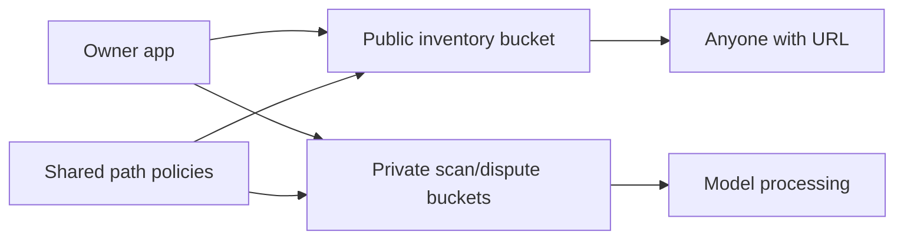
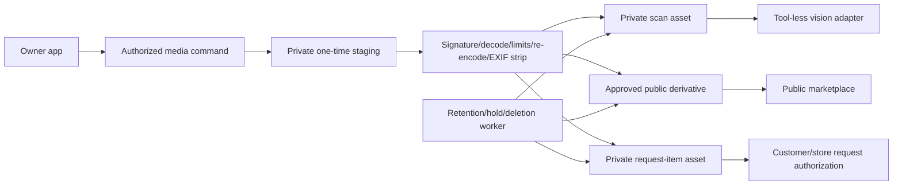

## 2026-10-11 - M72 applied; backend activation preflight

Phase 9 / Unit 6G remains feature_published_runtime_pending. Under the Owner's current step-by-step backend authorization, M72 is APPLIED_VERIFIED on Bookconnect_reactexpo / ahntbtktjjmvfosgkmgn as live version 20261010200655. Its archived SQL equals the reviewed file and its original SHA-256 is preserved. M65-M71 source bytes and existing Phase 9 function definitions/ACLs are unchanged.

Rollout order is M72, compatible Render metadata worker, then the Owner Edge API. The old worker's claim RPC has no edition-operation filter and its decoder cannot handle edition_options contexts, so the new API must not enqueue those jobs until the new worker is healthy. No edition jobs exist at this checkpoint. Owner API remains ACTIVE v14; metadata runtime remains bb91428048ca9028c5592cbbc52c982bd6843946. The Owner's explicit stop before Render deployment remains in force.

A fresh ordinary Deno check exposed extensionless imports newly reached by the API. The bounded local correction adds seven .ts suffixes in contracts/metadata.ts and contracts/providerReuse.ts, naming the same existing targets without changing metadata, ranking, cover, authorization or retention behavior. Fresh verification passed Deno check --no-lock, two existing Jest suites / 49 tests, worker build plus 14 structural tests, and whole TypeScript. GPT-6 Luna/max independently APPROVED this bounded correction at 47207b7385ee4ae37e01c48b7dba0738abb53389 and reran the same relevant gates, including emitted CommonJS import checks. The atomic non-force push succeeded and both GitHub main/codex/edition-picker read back at that reviewed source commit. Fresh source CI run 38083807305 completed SUCCESS: full repository test, TypeScript and production web-export steps passed. Fresh CI counts were not independently recounted because log download returned HTTP 403; local 49/49 and structural 14/14 counts are separately verified.

Exact next action: obtain the Owner's final Render decision, then perform one controlled manual deployment of reviewed/published source 47207b7 to the existing Free metadata service; verify its commit and health before deploying the prepared Owner API bundle with verify_jwt=true. The explicit Render hold keeps both runtime deployments unperformed at this checkpoint. Provider-result retention remains disabled without verified permission; registry flags and cache headers are not authorization. No Edge or Render runtime deployment, provider request, inventory/Auth/Storage/configuration/billing change occurred. [Exact application, rollout, artifacts and verification evidence](trackers/36-owner-edition-picker-publication-deployment.md). Earlier dated records below are historical.

## 2026-10-11 - M72 local security correction checkpoint

Existing picker §§4.3/5/9 and MAS-17 authorize only the superseded-job boundary correction. M72 is CREATED_LOCAL / NOT_APPLIED; M65–M71 are applied/byte-preserved. Its postgres-owned functions have empty search_path, private SECURITY DEFINER/public SECURITY INVOKER, and service_role-only EXECUTE. Owner/client roles cannot invoke terminal cleanup. Only a matching live claim or matching terminal replay can act; current/missing state and unrelated automatic work do not gain cancellation authority.

Eight M72 disposable cases cover service ACLs, reclaimed/wrong tokens, response-loss replay, newer/current requests, late physical-completion fencing and actual fifth-claim worker cleanup after a returned stale result. M72 SQL and privileges are unchanged by this follow-up. GPT-6 Luna/max APPROVED the bounded correction and aggregate for publication; reviewed source de97bed is on GitHub main and codex/edition-picker. These checks do not prove new native multi-connection races or live security. [Exact evidence](trackers/36-owner-edition-picker-publication-deployment.md) and [security matrix](trackers/03-auth-hardening-verification.md) preserve provider-retention denial and shared-application/Render gates. No shared privilege/configuration/data mutation occurred.

## 2026-10-10 - M71 security readback

Owner-authorized M71 applied as 20261010110835; no new table, policy, trigger, grant or data mutation.
Private selection delegate remains postgres-owned SECURITY DEFINER with empty search_path; PUBLIC/anon/authenticated/service_role execution stays revoked.
Public M70 selection remains authenticated-only. RLS/ACLs on candidate, edition-state and inventory relations are unchanged.
Security advisors retain 251 findings across seven groups; normalized comparison excludes observation timestamps and reports no new finding.
Existing findings are not a clean-security approval. New provider retention permission remains unverified/disabled.
[Exact preflight and application evidence](trackers/02-implementation-and-verification.md); no runtime deployment or operational security acceptance claimed.

# SDD 04: Media, Security, Privacy, Retention, and Recovery

## 2026-10-09 - Task 8 independent approval and M65-M70 applied

Phase 9 / completed Unit 6G baseline. Task 8's bounded LOCAL checkpoint is
independently APPROVED; all eight tasks have local implementation/verification
evidence. [Review provenance](trackers/33-owner-edition-picker-task8-local-verification.md)
preserves earlier approval provenance and the unavailable historical 152-path
audit baseline.

**Status:** `task8_independently_approved_m65_m70_applied_runtime_pending`.
The Owner authorized steps 1-3: approval documentation, live preflight and the
six unchanged migrations. All M65-M70 are now APPLIED / catalog-verified on
Bookconnect_reactexpo / ahntbtktjjmvfosgkmgn. [Application ledger](trackers/34-owner-edition-picker-m65-m70-application.md)
records six live versions, exact source/archive hashes, function/ACL/RLS/index/
trigger readback, unchanged business counts, recovery and advisor deltas.

No Edge/worker/client deployment, registry/configuration change, provider call,
browser test, data deletion, staging, commit or push occurred. New alternatives
retention remains disabled/unverified; existing automatic provider flags remain
unchanged. Runtime/provider/browser/operational rollout gates stay pending.

Exact next action: Owner review/authorization for compatible development
Edge/worker/client rollout and provider-gated browser verification (step 4).
Earlier dated entries below retain their historical NOT_APPLIED status and
review provenance; this latest entry owns current application status.

## 2026-10-08 - Task 6 confirmation security projection

Picker §§6-7/9 and existing §9 require confirmation evidence from valid private
store/session/card/query-current held choice only. M70 exposes a boolean without
selected_by/selected_at, raw provider records or internal paths. Strict client
and server request schemas reject client-authored confirmation; both response
schemas require a boolean. No service-role or client table write authority grows.

M70's reader/legacy delegates are postgres-owned SECURITY DEFINER functions with
empty search_path and no PUBLIC/anon/authenticated/service_role execute grants.
Public choices/select RPC signatures and authenticated-only grants are preserved.
Selection replies, including legacy receipts, project current authority without
rewriting stored audit JSON; a superseded/query-invalid receipt reports false.

[Security and local gates](trackers/02-implementation-and-verification.md#2026-10-08---task-6-confirmation-correction-local-completion)
include cross-store denial, private helper/public RPC ACLs and true pre-M70
upgrade preservation. This is sequential PGlite, not independent-connection race
proof. Retention permissions/configuration are unchanged and production retention
remains disabled. M65-M69 are unchanged; M65-M70 are NOT_APPLIED.

## 2026-10-08 - Task 5 independent-review correction

Existing §9 and picker §9 govern the new private phase9_edition_projection_selection(candidate) helper: scoped candidate/store/session, current query identity and valid server-held metadata. It is postgres-owned with empty search_path and no PUBLIC/anon/authenticated/service_role execution grant. No public RPC, direct table access or Add gate widens; disposable catalog and grant checks pass.

[Correction evidence](trackers/02-implementation-and-verification.md#2026-10-08---task-5-independent-review-correction). Locally verified; independent correction review is pending. Tasks 6-8 remain unstarted and M65-M69 remain NOT_APPLIED. Earlier checkpoints are historical.

## 2026-10-08 - Edition-picker Task 5 local completion

Picker §§5-9 and MAS-02/03/07/12/17 govern local M69. The public authenticated Add signature/ACL and server-resolved Owner/store/session/candidate checks remain unchanged. New resolvers, legacy delegates, saved-choice validators, metadata projections, due predicate, clearing and dispatcher functions are postgres-owned with empty search_path; PUBLIC/anon/authenticated/service_role cannot execute the private helpers. The existing trusted commit-eligibility service_role grant is restored. No new public RPC/table write grant, RLS change, bucket/media write or provider permission is introduced.

| Security/retention boundary | Actual local proof |
| --- | --- |
| Exact server selection and legacy confirmation fence | Full M69 SQL rejects stale Add and mixed selected review fields; text-only legacy Save requires controlled confirmation/manual entry. |
| Pre-insert cover authority | Own/no-cover option and manual choice cannot inherit the automatic representative cover; unchanged original selected mode retains fallback. |
| Atomic discard and response-loss recovery | Injected clear failure rolls back insertion/candidate/receipt/options; success replay inserts once and retains only chosen provenance. |
| Per-card ownership/retention | Two same-book cards share one store/session yet remain independent; immediate read/select expiry, candidate/session expiry, identity/removal clearing and slim replay are tested. |
| Bounded cleanup/recovery | Existing dispatcher clears a limited batch, accurately reports all due reasons, rolls back failed cleanup and retries next tick. |
| Private API/grants | New private helpers/dispatcher deny client-capable roles; Add keeps authenticated-only authority; existing state/completion security regressions pass. |

[Task 5 evidence](trackers/02-implementation-and-verification.md#2026-10-08---edition-picker-task-5-local-completion) records the 194-case SQL and 406-test HTTP/client compatibility gates. No real connection-race or live provider/browser/deployed-worker proof is claimed. M65-M69 are NOT_APPLIED; production still installs no retention verifier. Earlier checkpoints are historical.

## 2026-10-08 - Direct completion timestamp validation correction

Picker §§5/9, SQL proposal §3.6 and MAS-02 apply to every non-null option, including ineligible rows. M68 now requires complete ISO calendar timestamp syntax and valid clock ranges before persistence. A timezone suffix plus PostgreSQL cast is insufficient: PostgreSQL era/ordinal dates and leap-second values fail the shared TypeScript contract. Six rejection regressions and four valid UTC/offset controls pass through the actual service completion boundary.

The full 87-case completion/security/worker suite preserves existing service-only entrypoints, private-helper grants, row isolation, lease/request fences and failure replay. No grants/schema/retention permission changed. [RED/GREEN, security proof and hashes](trackers/02-implementation-and-verification.md#2026-10-08---task-4-timestamp-self-review-correction) record this Owner-authorized local correction. Self-review is complete; no independent correction approval or real multi-connection race proof is claimed. M65-M68 remain NOT_APPLIED; live enablement and Task 5 need separate authority. Earlier checkpoints are historical.


## 2026-10-08 - Task 4 correction security boundary

Picker §§4.1/5/8-9, SQL proposal §§3.6/4 and MAS-02/03/17 require normalized validation before any direct service completion stores options. New private M68 helpers enforce the pinned versions, all string/array UTF-16 bounds, timezone-bearing fetch time, valid ISBN field shapes/checksums and coherent identifier pairs on eligible and ineligible rows. Unknown query language is waived only for compatible exact ISBN evidence; supplied title/author/known-language denials remain. Helper ownership is postgres, search_path is empty and PUBLIC/anon/authenticated/service_role direct execution is revoked.

The sole new private failure_receipt is bounded to an object of <=1024 bytes and generated only by controlled failure writes. It contains hashed query/token identity, current request/generation/attempt/worker and bounded failure arguments; no provider metadata, raw alternatives, plaintext lease token or mirrored status. Existing private-table permissions prevent client reads/writes. Replay cannot bypass current actor/store/session/card/query/claim checks or authorize completion; changed arguments and reclaimed claims reject. The RPC preserves only the exact safe P9_EDITION_ROWS_INVALID code, keeps other details opaque, and the worker tries committed recovery before nonretryable schema failure. Production still has no retention verifier, and M65-M68 remain NOT_APPLIED. [Fresh security matrix, tests and hashes](trackers/02-implementation-and-verification.md#2026-10-08---edition-picker-task-4-review-corrections) cover 77 completion/worker SQL cases and the related regressions. Real independent-connection races/live permission remain Task 8. Task 4 awaits correction review; no live mutation occurred. Earlier checkpoints are historical.
## 2026-10-07 - Task 4 controlled completion security proof

Picker §§5/8-9 and existing tenant/retention rules are enforced by local M68. Its three worker RPCs are service-only invokers over postgres-owned empty-search_path definers; clients and direct writes remain denied. The job/candidate/private-state lock order preserves initiating Owner capability, authoritative store/session membership, request/query/generation, mutable/uncommitted state and lease/physical-attempt fences. Automatic bypass helpers have no direct service grant. Explicit options cannot enter automatic snapshots/cache or normalized audit payloads.

Fresh disposable cases prove grants/readback, forged identity/provenance and own-book/cover denial, selection/selling preservation, rollback/replay, cancellation/stale authority and physical retry billing. Verified retention and a future deadline capped by original fetch + 24 hours are mandatory. Local bootstrap installs the concrete port but no verifier; registry flags/headers do not grant permission. M65-M68 are NOT_APPLIED; no live mutation/provider/deployment occurred. [Security verification matrix](trackers/02-implementation-and-verification.md#2026-10-07---edition-picker-task-4-local-completion) and [ledger](supporting/database-current-vs-target.md#2026-10-07---task-4-m68-local-migration-readback) own exact proof. Real races/live permission remain Task 8. Earlier checkpoints are historical.

## 2026-10-07 - Edition-picker Task 4 runtime checkpoint

Local runtime/test scope is implemented; durable Task 4 completion remains incomplete pending separately authorized forward SQL. The worker now decodes the existing v2 automatic/edition_options context, routes explicit Google options jobs around local/cache/coalesced winner-only shortcuts, validates the bounded Task 3 response, preserves physical-call accounting, and reports available only after the typed controlled completion port confirms it. Production installs neither that port nor a retention verifier; explicit requests are not enabled.

Fresh evidence: Task 4 worker/recovery plus affected worker/gateway/composition and provider/automatic regressions pass 9 suites / 237 tests; strict types pass; the required structural metadata worker build and 14 disposable database cases pass. Tests use recorded responses and an in-memory port model; these results do not establish durable SQL, grants/RLS, real races or live permission.

Read [Task 4 implementation evidence](./trackers/02-implementation-and-verification.md#2026-10-07---edition-picker-task-4-runtime-checkpoint) and the [reviewable SQL proposal](./work-units/owner-edition-picker-task4-sql-proposal.md). The fresh read-only Supabase check verifies live M62, with no controlled options completion/failure operations. M65-M67 remain local and NOT_APPLIED. Next action is separate Owner authorization of one forward local migration and disposable SQL tests. Tasks 5-8 remain unstarted; no migration file was created/edited/applied and no live/external mutation or Git publication occurred.


## 2026-10-07 - Edition-picker Task 3 review corrections

The independent review confirmed a gap in the earlier Task 3 header-lifetime enforcement summary. Under this SDD §8 and picker §8, the local correction validates Date/Age for Expires-only responses and reduces the Date-relative lifetime by observed age. Date 00:00, Expires 01:00, Age 3500 and receipt 00:50 now permit at most 100 remaining seconds, ending at 00:51:40 UTC. Malformed or exhausted evidence denies retention; missing Date uses receipt time conservatively. max-age still applies its age-adjusted lifetime, with Expires as an absolute ceiling.

These bounds only shorten an independently verified permission/deadline and the original-fetch 24-hour product cap. Production still installs no retention verifier; fresh headers, fixtures or client flags cannot grant permission. No live provider-rights, security, tenant or database proof is claimed.

The supplied Task 3 verdict remains CHANGES_REQUIRED pending independent correction review. Fresh local proof: four Jest suites / 136 tests, strict TypeScript and worker build PASS. Both review findings were reproduced before production edits; [correction evidence](trackers/02-implementation-and-verification.md#2026-10-07---edition-picker-task-3-review-corrections) records the scope and controls. Tasks 4–8 remain pending, M65–M67 unchanged/NOT_APPLIED, and no external mutation occurred. Earlier checkpoints are historical.

## 2026-10-07 - Edition-picker Task 3 safety and retention proof

Local Task 3 restores picker §§5/8/13.2 under this SDD §8: bounded provider IDs, schema-validated same-record metadata, approved own-result book/cover URLs, unavailable placeholders and disabled incompatible rows. Unsafe covers use a safe smaller image from the same result or a missing-cover placeholder; no other record supplies fields or a cover. Raw response/debug headers/credentials are excluded from the result. Existing private/public projection remains authoritative.

Retention requires the existing OptionsRetentionEvidence from a server-only independently verified provider-rights callback. Production bootstrap has no callback, including when cache headers are positive. Client input, fixtures and registry flags never supply production permission. The adapter forwards only Cache-Control/Expires/Date/Age and the original UTC fetch time to the verifier, enforces actual provider denials/lifetimes, and caps any permitted deadline at original fetch + 24 hours. Null/unverified/expired evidence, verifier failure, cache prohibition or malformed lifetime denies storage. This is a verification seam, not proof of live provider rights or permission for durable chosen snapshots.

[Task 3 proof](trackers/02-implementation-and-verification.md#2026-10-07---edition-picker-task-3-local-completion) records 98/98 required Jest and 23/23 provider-contract cases plus strict types/build. No live security/tenant/database/browser/provider proof is claimed. M65–M67 remain unchanged/NOT_APPLIED; no migration, environment or external mutation occurred. Task 4 and later integration/enablement remain separately authorized. Earlier checkpoints are historical.

## 2026-10-07 - Edition-picker Task 2 review corrections

The Owner-authorized corrections restore picker §4.1 / DOC-3 §5.1 / DOC-4 §8: local reuse validates the complete Owner-safe metadata, a unique coherent exact text match remains a medium suggestion requiring confirmation, and ambiguous matches remain unresolved. M65/M67 are revised locally only; M65–M67 are NOT_APPLIED. The existing gateway, jobs, private-state permissions, selling fields and Add fence remain in force. No product scope or new migration was added.

Current authority, corrected handoff and verification are recorded in [the implementation evidence](trackers/02-implementation-and-verification.md#2026-10-07---edition-picker-task-2-review-corrections) and DOC-13/TRACKER. Earlier checkpoints are historical.

## 2026-10-07 - Edition-picker Task 2 local completion

Task 2 is locally complete: private per-card state, controlled read/search/select, version/expiry/ownership guards, coherent local ISBN resolution, lookup-scoped attempt history, and explicit-operation admission. Task 1 remains complete. The Owner's “ok proceed” authorized local M65–M67 creation and disposable tests; these files exist locally and are NOT_APPLIED. No live database/Storage write, deployment, staging, commit, or push occurred.

Fresh proof: 34 disposable-database tests PASS; 4 affected Owner Jest suites / 303 tests PASS; strict Owner ingestion graph type check PASS. Real independent-connection races, provider-retention permission, worker execution/completion, Add/cleanup integration, client/UI/browser and rollout proof remain Tasks 3–8. No full-feature acceptance is claimed.

Current work unit: Task 2 checkpoint review. Exact next authorized action: review the Task 2 diff/evidence; the next implementation slice is Task 3 Google result envelope after Owner authorization. Sources: picker SDD §§4.3/5–6/8–9/11; Master MAS-02/03/07/12/17. Earlier dated checkpoints below are historical.

### Read-only security advisor baseline

The exact-project security advisor read was captured before any live DDL (none was applied). Returned observations are existing baseline findings, some observed_at timestamps are 2026-10-06; they are not a post-migration security verdict. Counts/remediation: [rls_enabled_no_policy INFO 70](https://supabase.com/docs/guides/database/database-linter?lint=0008_rls_enabled_no_policy); [function_search_path_mutable WARN 8](https://supabase.com/docs/guides/database/database-linter?lint=0011_function_search_path_mutable); [rls_disabled_in_public ERROR 1](https://supabase.com/docs/guides/database/database-linter?lint=0013_rls_disabled_in_public); [extension_in_public WARN 1](https://supabase.com/docs/guides/database/database-linter?lint=0014_extension_in_public); [anon_security_definer_function_executable WARN 15](https://supabase.com/docs/guides/database/database-linter?lint=0028_anon_security_definer_function_executable); [authenticated_security_definer_function_executable WARN 151](https://supabase.com/docs/guides/database/database-linter?lint=0029_authenticated_security_definer_function_executable); [auth_leaked_password_protection WARN 1](https://supabase.com/docs/guides/auth/password-security#password-strength-and-leaked-password-protection).

Local new-boundary proof: RLS enabled, no direct client/service table privileges or private-helper execution, only three authenticated controlled RPCs, fixed empty search_path and postgres ownership, server Owner/store/session checks, strict bounded payloads and composite membership, safe public projection, claim/token/lease and stale-query denial. No unrelated baseline remediation or clean live-security claim is implied.


## 2026-10-07 - Edition-picker Task 2 gateway/preflight checkpoint

Task 1 remains locally complete. Task 2 code/read-only preflight is now authorized: the strict authenticated Owner gateway and HTTP routing pass 303 affected Jest tests and a strict server type check. Database storage/commands are not implemented; local M65–M67 migration-file creation is awaiting the separate Owner approval required by AGENTS. No SQL/database/Storage/deployment/Git publication occurred. Tasks 3–8 remain pending. Current authority/status comes from DOC-13 and TRACKER; earlier checkpoints below are historical.

## 2026-10-07 - Edition-picker Task 1 contract checkpoint

The Owner authorized Task 1 on 2026-10-07. Contracts/fixtures and narrow compatibility are locally complete; Tasks 2–8 and database changes remain unstarted/unapproved. Source behavior remains picker SDD §§5–7/9/13.2. Current next action is Task 1 diff review; [implementation evidence](trackers/02-implementation-and-verification.md) supersedes earlier planning-only status below.


## 2026-10-06 - Owner edition picker draft extension

Latest Owner display clarification EP-D14: each edition option in the metadata sheet shows its own cover image from its safe URL, title, all authors, and publication date; publisher, ISBN, and language are secondary details. Selection saves the coherent chosen metadata independently and follows the usual inventory Add flow, leaving one chosen cover on the scan card. This supersedes earlier text-only option rows. Owner chose relevance order with returned order preserved and Google attribution/book links. Picker §13.2 now defines Search Books wording and bounded unavailable/ineligible rows; EP-D11/13 scope cuts remain in force.

Latest Owner scope: alternatives are obtained and saved only after an explicit Owner lookup (EP-D13); automatic scan/cache/coalesced paths keep winner/outcome-only persistence and never copy alternatives. New manual edition-number editing before and after Add, numeric overrides, and Store View edition-edit extensions are deferred (EP-D11).

The [edition-picker SDD](./work-units/owner-edition-picker-sdd.md) consolidates EP-D01..EP-D14 and extends this domain's §§8-10; enforce Owner/store boundaries, provider rights, and separate options/selection retention.

Keep one card and one chosen cover, five initial rows/Show all up to ten, an explicit lookup for local/cache/older unfinished cards, independent per-card storage, a 24-hour product retention maximum from source fetch, and cleanup after confirmed Add. Preserve chosen metadata and selling details. Provider edition statements remain coherent source metadata; no new manual number field is introduced.

Picker §§6/8 keeps alternatives out of 30-day receipts and historical option versions. Retain stale-response/worker fencing, forged and cross-store denial, effective-choice cover provenance, expiry/replay proof, and bounded cleanup. Provider permission can shorten the product retention cap.

Status: design_ready_pending_owner_approval. The relevance-order decision resolves provider display §13.2; written-SDD and execution-plan approval still precede implementation. Historical implemented behavior below remains baseline evidence; no runtime or migration implementation is added.


> **Current local PostgreSQL verification checkpoint (2026-09-12; supersedes the prior correction-only gate):** F-01 remains retracted; F-02 and F-03 remain corrected locally. Focused Jest passed 4 suites/181 tests, including the 3 lifecycle tests, and the in-memory PGlite fixture passed 5/5. The Owner-authorized disposable PostgreSQL 18.4 harness then ran at `127.0.0.1:55461` with data directory `C:\Users\user\AppData\Local\Temp\bookconnect-u8b-pg-unit6h-verify-20260912` and PID-scoped database `bookconnect_u8b_22652`. It applied the disposable baseline and M01–M60, passed `UNIT6H_DUPLICATE_CONFIRMATION_REAL_POSTGRES_CONCURRENCY_PASS` using independent connections, and passed the existing `U8B_REAL_POSTGRES_ACCEPTANCE_PASS` regression. Teardown was verified: the database/cluster directory is absent, the port has no listener, and no matching postgres process remains. M52–M59 are unchanged; M60 remains local and was not remotely applied. No remote database/Storage or application data was touched; no deployment, dispatch change, development-data deletion, staging, commit, or push occurred. Connected Edge/Storage verification remains unrun. Prior screen act/open-handle warnings remain historical unresolved evidence and did not affect these database checks. Next: review this local PostgreSQL proof and separately authorize connected Edge/Storage verification. No product behavior or inventory duplicate policy changed.


> **Status correction (2026-09-13):** The preceding 2026-09-12 paragraph is
> historical. M60 was subsequently applied during the authorized development
> rollout; M61 and M62 were later applied once, and matching runtime/connected
> detail-projection proof remains pending.

**Status:** `approved_baseline`
**Version:** 1.0
**Date:** 2026-07-19

**2026-09-13 representative-cover security boundary:** Live M61 keeps
representative-edition cover provenance in a private immutable sidecar with
deny-by-default direct table access and a service-role-only write delegate.
Owner projections expose it only as a labelled fallback when exact selected
cover is absent. `store_inventory.representative_cover` is database-populated
only at explicit Add and immutable thereafter; canonical/public `cover_url` and
public listing projections do not receive it. M62 adds a postgres-owned,
revoked private projection helper called only by authenticated Owner detail/save
functions. It adds no service/client bypass; M62 is applied once in the verified
development project and its helper remains denied to API roles.

**Historical Unit 6H security review checkpoint — 2026-09-12:** Local static/fixture review
covered M60's canonical relationship trigger, service-only resolution, replay
ordering, exact private-object proof, cleanup/dispatch fences, and pending
confirmation protection. No additional authz/tenant bypass, Storage replacement,
Close bypass, lock-order, or retry/dead-letter bypass was confirmed. M60 was
subsequently applied under prior authorization; M61 is also live and connected
cover verification is pending. The security scan had partial coverage because
no connected runtime was available.

**Unit 7/8 closure checkpoint (repository-only 2026-08-21):** M51 makes public
eligibility and media ordering one fail-closed boundary. Every link satisfying
the shared public-media predicate must have a unique non-null `public_order` in
`1..3`; link approval and later asset-lifecycle transitions are both guarded.
Pending/rejected links and private/staging assets may retain NULL ordering. M51
was not applied live.

**Live implementation checkpoint (2026-07-27):** M11/M12/M13, Owner Edge intake, and separate free-plan media/fixture-vision workers are live-verified. They enforce server paths, content-hashed completion, immutable service-only source snapshots/evidence, initiating-Owner/store/purpose/session/source binding, opaque token plus attempt fencing, repeated lease revalidation, re-encode/strip/hash, and canonical replay. M13 required no `SECURITY DEFINER` wrapper: current `service_role` grants safely support 13 postgres-owned, empty-`search_path`, fully qualified static `SECURITY INVOKER` delegates with execute revoked from all client roles. Detailed deployment and fixture evidence is in [tracker 06](./trackers/06-fixture-pipeline-deployment-evidence.md).

**Unit 4B local checkpoint (2026-07-27):** the Gemini adapter is implemented behind
the existing provider-neutral analyzer seam with server-only configuration, strict
structured output, bounded normalized usage/cost evidence, sanitized error classes,
and no raw prompt/response/image/credential logging. It has made no provider call
and is not deployed or selected in any live environment.
**Metadata retry security correction (live once 2026-08-10):** M38 adds
one postgres-owned, fixed-search-path private helper and replaces the existing
service-only public metadata-context wrapper. It exposes only a bounded claim
attempt number, grants no client execution, and does not widen table, payload,
credential, provider, store, or candidate access. Live readback confirms empty
`search_path`, postgres ownership, and postgres/service-role-only execution.
**Unit 7C M46 security checkpoint (live once 2026-08-16):** The bounded
private-Save correction gates append-only public revision insertion on the
server-derived `v_public_changed` value. M46 preserves postgres ownership,
`SECURITY DEFINER`, empty `search_path`, authenticated/service execution, and
anonymous denial for the Owner Save function. The exact M01→M46 disposable
proof and authenticated private-only Save reproof passed; no private field was
returned, no historical revision was rewritten, and no Edge redeploy occurred.
**Legacy Marketplace RPC security checkpoint (live once 2026-08-17):** M47
revokes `PUBLIC`, `anon`, `authenticated`, and `service_role` execution on
`phase9_storefront_catalogue(uuid,integer,jsonb)` and
`phase9_listing_detail(uuid)`. Pre-change role calls returned the full
projection-row shape including `inventory_id`; post-change calls fail with
`42501`. Repository search found no application or service dependency, and
the current v2 JSON discovery functions remain unchanged and callable by
customer roles. This applies the §9 rule that customer reads use bounded safe
commands/projections.
**Trusted-role compatibility follow-up (live once 2026-08-17):** M48 restores
only `service_role` `EXECUTE` on those two exact legacy signatures while
retaining `PUBLIC`, `anon`, and `authenticated` denial. Repository search, all
12 live Edge Functions, and the live SQL function-definition scan found no
caller; this is an intentional trusted-role compatibility allowance. Direct
projection-view access remains denied to customer roles, and v2 JSON RPCs remain
the customer path.
**Unit 6G lifecycle command checkpoint (live once 2026-08-29):** M54 preserves
the initiating-Owner/store boundary and adds one locked active-and-unexpired
session fence to the current final Save/Add/Remove RPCs after completed replay
reconciliation. Closed/closing/expired reads expose no mutation capability.
The new internal helpers are postgres-owned, fixed-empty-search-path, and denied
to `PUBLIC`, `anon`, `authenticated`, and `service_role`; public function
grants remain unchanged. Connected closed-candidate calls failed with
`P9_STATE_CONFLICT` and zero durable effects.
**U8B local security evidence (2026-08-20):** The repository-only M49 proof
keeps Q07 internal and customer-denied, grants Q08 only to the intended public
customer roles, and keeps the actual-copy helper service-role-only. The helper
and Q08 use `SECURITY DEFINER` with an empty `search_path`; real PostgreSQL
acceptance also verified the `extensions` pgcrypto placement, Q07 denial, Q08
allow, and absence of private `inventory_id` in the DTO. This is disposable
source/acceptance evidence only: no Supabase grant, function, Storage, Vault, or
database object was changed.
**Unit 7A security checkpoint (local, unapplied 2026-08-12):** M39 adds one
authenticated-only create command with server-derived Owner/store authority,
current candidate/review/metadata revision fences, fixed object qualification,
atomic audit/event/idempotency effects, and non-enumerating denials. It revokes
execute on the unsafe M05 commit signature from `PUBLIC`, `anon`,
`authenticated`, and `service_role` while preserving the legacy object. Local
PGlite proves cross-store/actor denial, rollback, replay/concurrency, canonical
immutability, and private media/listing isolation. Live ACL/RLS/function
readback remains pending because M39 is not applied. See
[tracker 29](./trackers/29-unit7a-create-only-commit-evidence.md).
**Unit 4B security correction (local, unapplied):** M14 registration is a
service-only atomic egress fence. It rejects stale/expired/superseded claims or any
job/reference/correlation, owner/token/attempt, store/session/input/media,
purpose/privacy/status mismatch before returning a private download handle and
before Gemini invocation. Attempt evidence excludes prompts, images, raw provider
responses, credentials, and raw lease tokens.
**M16 ACL correction checkpoint (2026-07-28):** M14
`vision_provider_attempts` and the three M15 persistence tables are confirmed
RPC-only mutation boundaries. Supabase default privileges nevertheless gave
`service_role` broad direct DML. M16 explicitly revokes all six mutation
privileges per table, preserves SELECT/RLS/ownership and fixed-search-path RPCs,
and was independently approved. M16 is live once as `20260727231217`, but
PostgreSQL 17.6 retained MAINTAIN (`service_role=rm/postgres`). The SELECT-only
boundary remains gated on a separately authorized forward M17 and live readback.

**M17 live ACL closeout (2026-07-28):** M17 is live once as
`20260727233457 marketplace_phase9_maintain_acl_correction`. PostgreSQL 17.6
readback proves `service_role=r/postgres` on the M14 provider-attempt table and
three M15 metadata tables: SELECT only, no MAINTAIN or direct mutation; RLS,
ownership, client denial, and 13 fixed-search-path RPCs remain intact. See
[tracker 10](./trackers/10-m17-acl-correction-evidence.md).
**M18/M19 live security checkpoint (2026-07-29):** M18 `20260729004216` and
M19 `20260729020008` are live once: RLS/client denial, service SELECT-only/
no-MAINTAIN, fixed-path RPC-only mutation/read, accepted-envelope replay
fencing, zero residue, and unchanged aliases/search passed. Unit 5C-5/5C-6 extends the same private/RPC-only/SELECT-only/no-MAINTAIN pattern to Owner decisions and rollout evidence; M24-M28 are live, anonymous/Owner private evidence access is denied, and M29 remains absent.
**Implementation checkpoint (2026-07-22):** the approved private-table, named-boundary, upload-capability, media-registry, and Storage boundary contracts are implemented in M02, M03, M05, M06, and M08 and pass isolated/live security checks. Forward M10 restores only the three anonymous discovery RPCs, makes the allowlisted projection invoker-safe, and removes direct role access; request-photo, internal-helper, and private-table boundaries remain closed. M01-M08/M10 are live-verified; M09/auth/runtime remain untouched.

## 1. Decision and evidence basis

Use a server-mediated media boundary: private staging and scan processing, approved-only public derivatives, and a separate private customer-request-photo domain. Treat every image, model response, metadata response, path, and signed URL as untrusted or capability-bearing data. Enforce authorization against the final store/entity identity and make deletion/hold behavior a persisted lifecycle, not a best-effort client cleanup.

I inspected the verified live Supabase project, relevant storage policies, bucket settings, inventory/listing policies and trigger, current advisor output, and the repository storage migration. The evidence supports structural containment rather than adding more client upload rules to the current shared bucket policy.

## 2. Observed, inferred, and proposed

### Observed

- `image-extraction-inputs` is private, 10 MB, JPEG/PNG/WebP.
- `inventory-photos` is public, 5 MB, JPEG/PNG/WebP.
- Shared marketplace policies allow active store administrators to upload/update/delete directly under a store-ID first path segment.
- Private reads include seller verification, order dispute evidence, and extraction inputs, with store-owner or selected platform-role access.
- `order-dispute-evidence` is private but is not customer request-item scoped.
- Legacy `listing-photos` is public, uses user-ID path ownership, and has a broad SELECT policy. Supabase advisor flags enumeration.
- Public buckets bypass download RLS for anyone holding the object URL.
- The current `photos text[]` inventory field has no purpose, approval, hash, retention, or deletion state.

### Inferred

- Direct owner writes to a final public bucket cannot prove server-side signature/decode/re-encode/EXIF controls before publication.
- Reusing a public object path for scan, damage, and request evidence would collapse incompatible privacy/retention rules.
- Store-path RLS alone does not authorize a customer to one request photo or prevent an owner from deleting active dispute/request evidence.
- Signed URLs are capabilities and can outlive auth changes until expiry; deletion is the reliable revocation action when immediate cutoff is required.

### Proposed

- One-time, purpose-bound upload authorization to private staging.
- Server validation and sanitized derivative creation.
- Separate scan, approved public-copy, private request-photo, and restricted dispute evidence purposes.
- Typed media registry/link tables and persisted deletion/hold state.
- No direct client promotion of unvalidated bytes to public inventory media.

## 3. Security invariants

| ID | Invariant |
| --- | --- |
| MED-01 | The server derives the final store/entity/purpose for every upload, read, promotion, link, and delete. |
| MED-02 | Store A cannot obtain an upload/download/delete capability for Store B media. |
| MED-03 | A customer can access only private request photos for their own request item and only during the allowed lifecycle. |
| MED-04 | Platform roles receive only the media purposes their function requires; finance/reviewer roles are not ambient media administrators. |
| MED-05 | Storage RLS is a backstop; command authorization is checked before issuing a signed capability. |
| MED-06 | No unvalidated upload becomes public or reaches a model/provider. |
| MED-07 | The model receives sanitized image data and no tools, secrets, PII, or reusable storage capability. |
| MED-08 | Model/provider output cannot construct a path, URL, query, command, or rendered active content. |
| MED-09 | Raw media/payloads/prompts/signed URLs do not enter logs, Sentry, analytics, events, notifications, or audit metadata. |
| MED-10 | Every object has a purpose-specific retention class, deletion state, and optional legal/dispute hold. |
| MED-11 | Public damaged-book media is deliberate, sanitized, approved, and limited to three images. |
| MED-12 | Customer request media is private, newly captured after the request, and limited to three images. |

## 4. Architecture options

### Option 1: Strengthen current direct bucket policies

Keep direct owner uploads and add more path/purpose conventions. This has the smallest migration, but validation still happens after the client has placed bytes in a final bucket, purpose can drift into filenames, public promotion remains easy to misuse, and request-customer authorization becomes policy-heavy. It is acceptable only as a short-lived compatibility bridge.

### Option 2: Server-mediated staging and purpose-bound promotion — recommended

The server authorizes one upload to private staging, validates/re-encodes it, then creates a purpose-specific media record and copies/promotes only a sanitized derivative. Public damage/copy images enter a final public bucket; request photos remain private and are served through a freshly authorized short-lived capability.

This adds a processing step and lifecycle worker but centralizes the controls most likely to drift: path ownership, file validation, EXIF removal, public/private classification, request linkage, and deletion.

### Option 3: Keep all media private and proxy every read

This provides the strongest uniform revocation/access control, but every public cover/copy read adds authorization/proxy/CDN complexity and cost. It becomes preferable if public actual-copy media later carries meaningful per-viewer restrictions. It is disproportionate for ordinary public listing images today.

| Dimension | Option 1 | Option 2 | Option 3 |
| --- | --- | --- | --- |
| Security | improves local policy but purpose drift remains | strongest proportionate boundary | strongest access control |
| Performance | lowest processing overhead | one upload processing/promotion step; public reads fast | every read authorized/proxied |
| Memory/storage | possible duplicate staging ad hoc | bounded sanitized derivative and lifecycle metadata | private origin plus proxy/cache burden |
| Reliability | fewer components but inconsistent validation | worker/retry needed; failures contained before publish | proxy becomes public availability dependency |
| Operability | policy sprawl | lifecycle/cleanup metrics required | highest service/CDN operations |
| Migration | smallest | moderate and reversible by feature flag | largest |

I recommend Option 2 under the current constraints. Option 3 should be reconsidered only if public copy photos become sensitive rather than public listing content.

## 5. Before and after trust boundaries





| Change | Before | After | Security consequence | Cost |
| --- | --- | --- | --- | --- |
| Upload authority | broad purpose through shared path | one-time purpose/entity capability | narrows confused-deputy/path abuse | command and staging flow |
| Public bytes | owner can upload final bytes | only sanitized derivative promoted | blocks unsanitized public content | processing/copy latency |
| Request access | dispute/store path oriented | request item/customer/store scoped | least-privilege evidence access | new link/state tables |
| Lifecycle | path/manual convention | persisted retention/hold/delete state | auditable cleanup/recovery | worker/alerts |

## 6. Upload validation

Server-side controls, following the [OWASP File Upload Cheat Sheet](https://cheatsheetseries.owasp.org/cheatsheets/File_Upload_Cheat_Sheet.html):

- allow only business-required JPEG/PNG/WebP inputs;
- do not trust extension or `Content-Type` alone;
- verify signature and decode safely;
- enforce configured byte, dimension, and total-pixel limits before full processing;
- generate random application filenames/paths;
- reject multiple/hidden formats and malformed decoders;
- re-encode to a known-safe derivative;
- strip EXIF, GPS, thumbnails, comments, and unnecessary metadata;
- reject animated/multi-frame PNG or WebP rather than selecting a frame implicitly;
- compute SHA-256 and record detected MIME/dimensions/bytes;
- enforce per-store/session/request image-count and rate limits;
- quarantine/delete failed inputs by policy and never publish them.

Implementation baseline should retain the live 10 MB scan limit and 5 MB public derivative limit unless measured pilot evidence justifies change. Pixel/dimension limits must be explicit in the implementation plan.

## 7. Storage and paths

Proposed logical buckets (final names require collision review):

- `marketplace-media-staging`: private, short-lived, no broad owner listing;
- `image-extraction-inputs`: private sanitized scan inputs;
- `inventory-photos`: public approved derivatives only, no broad listing policy;
- `order-request-photos`: private customer request media;
- `order-dispute-evidence`: restricted dispute artifacts, separate from ordinary request photos.

Paths are server-generated from immutable IDs, for example:

```text
<store_id>/<purpose>/<entity_id>/<media_id>.<ext>
```

The path is not the authorization record. The database media row and final linked entity/purpose are authoritative.

Supabase private bucket access must follow RLS or server-created signed access. Official references:

- [Storage access control](https://supabase.com/docs/guides/storage/security/access-control)
- [Private and public bucket behavior](https://supabase.com/docs/guides/storage/buckets/fundamentals)
- [Serving private assets and signed URLs](https://supabase.com/docs/guides/storage/serving/downloads)

## 8. Model and provider security

Multimodal image content can contain indirect prompt injection. The containment follows [OWASP LLM01:2025](https://genai.owasp.org/llmrisk/llm01-prompt-injection/) and [LLM05:2025](https://genai.owasp.org/llmrisk/llm052025-improper-output-handling/):

- no tools/function calling;
- no secrets or broad internal context;
- strict task and output schema;
- bounded candidate/string/array values;
- deterministic output validation and plain-text encoding;
- reject model URLs, commands, HTML/Markdown/SQL/path fields;
- parameterized database/provider operations constructed by code;
- human approval before inventory/public side effect;
- adversarial fixtures with visible/hidden image instructions;
- least-privilege provider worker identity and egress allowlist where supported.

Metadata-provider cover URLs are accepted only from configured HTTPS provider/host rules or through a reviewed image proxy/cache. Invalid/unsafe URLs fall back to an approved image or placeholder.

Provider provenance does not imply reuse permission. The adapter policy independently marks each normalized field as matching-only, storable, publicly displayable, image-cacheable, attribution-required, and expiry/revalidation-bound. Mobile clients cannot widen those rights.

The first fixture-backed vision runtime uses an opaque sanitized-media reference and a platform-owned resolver. Only that resolver can map the reference to private bytes; the analyzer never receives a bucket, object path, signed URL, capability, store/session/input authority, or credential. Canonical `p9-vision-v2` observations use positive allowlists and closed warning codes. Raw provider responses and prompts are not persisted; immutable evidence contains only bounded canonical fields and sanitized provider/model/version provenance.

Unit 5C Lite does not widen this boundary: its optional untrusted sidecar has no URL/path/capability/tool/query field or public authority, cannot invalidate extraction, and private scans remain ineligible as marketplace images. Unit 5C-1 enforces that boundary through strict unknown-key, byte, string, provenance, source-association, language/script, and proposal-limit validation without retaining raw provider output or enabling generation.
All vision transitions first prove the exact current job-row claim. If the input/session/media relationship is then missing or invalid, only that claimed job is resolved non-retryably with the bounded `P9_VISION_RELATIONSHIP_RECONCILIATION_REQUIRED` code and a hashed completing-claim fingerprint. No unverified related row is changed, the lease is cleared, exact replay is bounded and idempotent, and stale/conflicting attempts have no effect.

## 9. Authentication, tenancy, and grants

- Verify JWT at the server boundary.
- Resolve active Owner capability from server records; do not authorize from route/local storage/store ID.
- Resolve final media/session/candidate/inventory/request ownership in the same command.
- Every store-owned media/table row contains `store_id` and RLS.
- Customer request reads additionally bind `auth.uid()` to the order request/item.
- Phase 9 grants no interactive support takeover or cross-store private-data read. Recovery is initiating-Owner retry, claimed-worker recovery, and reconciliation; future support tooling requires separate action-specific design and authorization.
- Trigger/helpers are not executable by client roles.
- Callable RPC/Edge commands validate the actor internally, pin `search_path`, have explicit grants, and return bounded safe data.
- Service role remains server-only and is never accepted from the mobile client.
- Every new API-exposed table has RLS; raw attempts/jobs/usage/cost/lifecycle tables remain service-only.
- Revoke default `PUBLIC` privileges and default function `EXECUTE`; grant `anon`/`authenticated` only named minimum operations.
- Place privileged helpers outside `public` where practical, schema-qualify every reference, pin `search_path`, and deny direct client execution.
- Maintain one explicit table/function/role grant matrix; Owner/customer reads come from bounded safe commands/projections.

## 10. Privacy and vendor governance

- Shelf images may unintentionally contain people, addresses, documents, or location metadata; framing guidance and EXIF stripping reduce but do not eliminate this.
- Privacy notice must explain image processing by selected model/metadata vendors and operational retention.
- Send only the sanitized image and bibliographic clues necessary for the task.
- Vendor contract/DPA must prohibit training, marketing, or unrelated reuse unless a separately approved policy/consent exists.
- Complete cross-border/data-residency/subprocessor review before production extraction.
- Support data-principal/grievance/deletion handling through platform operations.
- Legal/privacy review must align retention with the applicable DPDP implementation timeline. Official source: [MeitY DPDP Rules 2025](https://www.meity.gov.in/documents/act-and-policies/digital-personal-data-protection-rules-2025-gDOxUjMtQWa).

## 11. Retention classes

| Class | Default | Hold/exception |
| --- | --- | --- |
| Failed/unattached staging | 24 hours | security quarantine with restricted access and explicit expiry |
| Scan input | within 24 hours after session close | active incident/security hold only |
| Raw model/provider payload | persistence disabled by default | separately approved, purpose-bound diagnostic capture only; mandatory deletion within 7 days |
| Unresolved normalized candidate | 30 days | explicit owner/platform review extension |
| Public damage/copy photo | listing active + 30 days | order/dispute/legal dependency |
| Unpaid/cancelled/rejected/expired request photo | 30 days | dispute/security/legal hold |
| Completed transaction request photo | 180 days | longer dispute/legal requirement; legal-review gate |
| Dispute evidence | resolution + 30 days or normal longer rule | legal/security hold |
| Audit/deletion metadata | at least 1 year baseline | policy/legal review; no image bytes/signed URL |

Retention values are policy data, not mobile constants.

Provider/model credentials and secrets cannot enter client and build bundles, prompts, fixtures, notifications, logs, telemetry, errors, documentation, Git, or model context. Non-secret provider and model identifiers remain permitted as bounded provenance and incident-correlation fields.

Raw provider/model payload persistence is disabled by default. Any exception requires separately approved, private, schema-bounded, positive-allowlist diagnostic capture that excludes credentials, secrets, signed URLs, reusable capabilities, PII, raw media, or unrestricted prompts/responses. Diagnostic records have a maximum seven-day deletion deadline and use idempotent deletion, bounded retries, alerts, and failed-deletion reconciliation.

## 12. Deletion, holds, and recovery

**2026-09-08 Unit 6G correction:** The corrected worker no longer deletes based
on its upload flag. Live M57–M59 implement the persisted
[receipt/output-intent design](./supporting/unit6g-media-completion-correction.md):
server-derived intent precedes upload; uncertain outcomes retain bounded
reconciliation evidence; same-attempt reuse verifies Storage metadata and actual
bytes; and only a fenced service cleanup claim authorizes object deletion.
M57–M59 are live as `20260908073203`, `20260908073308`, and
`20260908073425`; matching runtime deployment and scheduling remain gated.

- Lifecycle worker selects due assets under lease, rechecks active links/holds, deletes object, then records `deleted_at`, reason, attempt, and object result.
- Deletion is idempotent; already-missing object is a success with evidence.
- Legal/dispute/security holds record type, authority, start/release, and prevent scheduled deletion.
- Orphan scan finds storage objects without valid media rows and media rows without objects; it never auto-deletes a potential held object without classification.
- Cleanup failures retry with backoff, alert at age/backlog thresholds, and expose an ops queue.
- Public deletion accounts for CDN propagation. Private signed URLs use short TTL; deleting the object is the revocation mechanism for urgent cutoff.
- Backup/point-in-time recovery can restore database metadata without restoring deleted object bytes. Recovery procedures must not silently republish private/expired media.

## 13. Logging, audit, and telemetry

Allowed:

- media ID/purpose/store ID (appropriately protected), bytes/dimensions/detected MIME/hash prefix where policy permits;
- validation result/code, adapter/version, latency/cost, lifecycle status;
- actor/action/entity/idempotency/outcome.
- for vision schema failures only, a code-owned sanitized field path plus one
  closed failure category; observation values, generated key names, and raw
  exception messages remain forbidden.

Forbidden:

- image bytes/base64;
- raw provider/model payload or full prompt;
- signed upload/download URL/token;
- provider secret/key;
- customer phone/address;
- unrestricted title/description in error telemetry;
- EXIF/location data.

Audit is append-only from normal clients and records sensitive reads/promotions/deletes/holds. Phase 9 defines no interactive platform override.

## 14. Abuse, moderation, and incident controls

- store/user/IP policy rate limits and quotas;
- exact replay protection and bounded retries;
- prohibited/counterfeit/pirated listing moderation remains before publication;
- content/decoder anomaly alerts;
- per-provider, per-language, per-store, and global extraction kill switches;
- ability to disable public media promotion while preserving private inventory/manual entry;
- vendor credential rotation and incident correlation by adapter/prompt/schema version;
- documented breach/incident escalation before production.

## 15. Validation plan

- cross-tenant Store A/B upload/read/promote/link/delete denials;
- customer A/B request-photo access denials;
- platform-role least privilege;
- traversal, forged path/store ID, MIME spoof, polyglot, malformed/decompression, over-byte/pixel, EXIF/GPS fixtures;
- public bucket enumeration denial;
- unapproved staging/scan/request objects never publicly downloadable;
- model image prompt-injection and malicious output fixtures;
- log/Sentry/event/notification privacy scans;
- signed capability expiry/final entity reauthorization;
- retention, hold, delete replay, missing-object, orphan, CDN/revocation behavior;
- advisor review after every DDL/storage change.
- unknown JSON key, integer overflow, negative money/quantity, malformed BCP 47, Unicode control/bidi, stale upload authorization, and cross-purpose media-ID denial;
- direct authoritative-table write, private-helper execution, `search_path` poisoning, and storage enumeration denial;
- publication failure/private survival, request-photo duplicate exclusion, pagination grouping, malformed public projection, worker double-claim/lease expiry, provider cost race, and cleanup-versus-hold race.

## 16. Acceptance criteria

| ID | Criterion |
| --- | --- |
| MED-13 | Uploads are authorized to a final store/entity/purpose and use server-generated paths. |
| MED-14 | Signature/decode/limits/re-encode/EXIF stripping occur before model egress or public promotion. |
| MED-15 | Only approved sanitized derivatives enter public inventory media. |
| MED-16 | Private scan and request media cannot be retrieved publicly or through another tenant/customer. |
| MED-17 | Model/provider credentials and service role are absent from the mobile bundle and model context. |
| MED-18 | Raw content and capability tokens are absent from logs/telemetry/events/notifications. |
| MED-19 | Retention/holds/deletion/orphan cleanup are persisted, idempotent, observable, and tested. |
| MED-20 | Post-migration Supabase advisor results are reviewed and every new notice is remediated or explicitly justified. |
| MED-21 | Phase 9 grant matrices revoke ambient privileges and prove authoritative operational tables/helpers cannot be directly used by client roles. |
| MED-22 | Provider fields are stored/displayed/cached only when adapter policy permits, with attribution and revalidation enforced. |
| MED-23 | Vision claim/context/persist/fail operations are service-only and validate job kind, store relationships, attempt, owner, token hash, and lease expiry before any effect. |
| MED-24 | Canonical image/observation evidence contains no raw response, prompt, media path/URL/capability/token, arbitrary provider metadata, or client-visible operational identifier. |
| MED-25 | Storage, public display, image caching, attribution, and revalidation are allowlisted per field and adapter/version before persistence or projection. |
| MED-26 | Query coalescing/cache reuse excludes secrets, raw media, PII, store-private fields, and policy-incompatible cross-store reuse. |
| MED-27 | Provider shadow evaluation and promotion require separately approved privacy, licensing, retention, cost, and access controls. |
| MED-28 | Provider/model credentials and secrets cannot enter client/build bundles, prompts, fixtures, notifications, logs, telemetry, errors, documentation, Git, or model context; non-secret provider/model identifiers remain permitted. |
| MED-30 | Unit 5C sidecar content is independently bounded/validated and has no tool, query, storage, inventory, publication, or public-media authority. |
| MED-29 | Raw provider/model payload persistence is disabled by default; any separately approved diagnostic capture is private, schema-bounded, positive-allowlist based, excludes credentials/secrets/signed URLs/reusable capabilities/PII/raw media/unrestricted prompts or responses, and is deleted within 7 days through idempotent deletion, retries, alerts, and failed-deletion reconciliation. |

## 17. Residual risk

No architecture can guarantee a multimodal model ignores every injected instruction or extracts every script correctly. The recommended design contains impact by giving the model no authority, validating outputs, requiring owner approval, and keeping commits server-controlled. Public image caching and legal retention are also operational risks; short private capabilities, deletion evidence, holds, and launch review make them manageable rather than invisible.

### 2026-08-09 M33 implementation alignment

The new reservation helper is owned by `postgres` and has no direct
`service_role`, `authenticated`, or anonymous execution grant. The existing
service-only media finalizer remains the only runtime caller and still enforces
the worker, attempt, lease-token, expiry, store, input, session, capability, and
sanitized-media fences before the helper can act. This closes the MED-23
cross-seam gap without exposing a new RPC or weakening M14 provider egress.
The helper and one-time repair additionally require an active session and bind
the sanitized media uploader to that session's initiating Owner, preventing
malformed historical state from being made provider-egress eligible.
