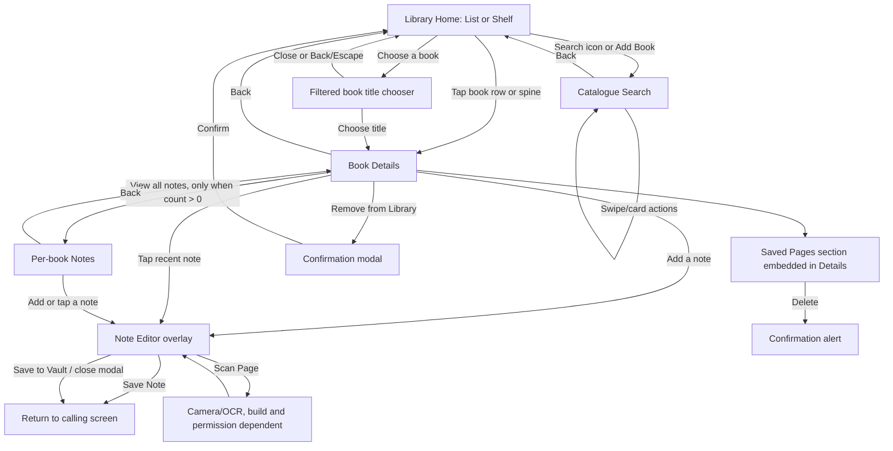

# Library Screens and Interaction Map

**Reviewed:** 2026-10-03 (R1–R5 Home corrections and R2 entrance-contrast follow-up; other routes retain their earlier evidence)
**Worktree:** `Bookconnect4_library` / `codex/library-cover-shelf`  
**Purpose:** Trace each current Library route and interactive control to its code-wired result, including no-op controls and missing states. This is the source-of-truth map for planning the Stitch flow; it does not define new product behavior.

## Scope and evidence

This map covers the Library route stack, its rendered Library/search/note components, and the app-level tabs visible while using Library. Controls are traced from current source. The app was manually opened during the 2026-10-01 review, but most individual controls and all external service outcomes were not exercised end to end. “Code-wired” therefore describes the handler and intended route/state transition found in source, not a claim that every service call was live-verified.

The currently configured Library routes are:

| Route | Screen / surface | Entry points |
|---|---|---|
| `/(tabs)/library` | Library Home, with List and Shelf modes | App-level Library tab; back/fallback destinations |
| `/(tabs)/library/search` | Catalogue Search / Find and Add Books | Home magnifier; Home `+ Add Book` |
| `/(tabs)/library/[bookId]` | One book’s details and management | Tapping a list row or shelf spine |
| `/(tabs)/library/notes` | Notes for one book | Book Details “View all” notes action, shown only when the book already has notes |

Saved Pages is an embedded Book Details section, not a route. The Note Editor, manual-book-entry form, filter/sort sheets, and delete confirmations are overlays/alerts, not routes. No Saved Page detail route, global notes route, local-library search route, or reading-stats route currently exists.

## Route flow

## 1. App-level navigation around Library

`app/(tabs)/_layout.tsx` explicitly declares five visible destinations: **My Library**, **Exchange**, **Marketplace**, **Clubs**, and **Profile**. Marketplace store detail is explicitly hidden from the tab bar (`href: null`). These app tabs are shared around the Library stack; they are not a second Library navigation system.

| App tab | Destination |
|---|---|
| My Library | `/(tabs)/library` |
| Exchange | `/(tabs)/exchange` |
| Marketplace | `/(tabs)/marketplace/index` |
| Clubs | `/(tabs)/clubs` |
| Profile | `/(tabs)/profile` |
| Marketplace Store Detail | `/(tabs)/marketplace/store/[storeId]`; hidden from the tab bar and entered from Marketplace flows |

The 2026-10-01 manual browser review showed nine bottom-tab items, including raw route labels `marketplace/cart`, `marketplace/requests/index`, `marketplace/book/[listingId]`, and `marketplace/requests/[requestId]`. This differs from the five visible tabs in the static layout. Record it as a runtime navigation discrepancy to reproduce and resolve; do not design those route labels as Library destinations.

## 2. Library Home (`/(tabs)/library`)

List and Shelf are two modes on this one route. They use the same fetched collection and active filter. The user’s last mode is stored in AsyncStorage key `library_viewMode`; the component initializes as List, then reads the saved mode after mount. The filter selection is in memory and is not persisted by this screen.

| Visible control / element | Current behavior | Result / route | Status or caveat |
|---|---|---|---|
| Shelf / List labeled view buttons | Select `viewMode` and save it to AsyncStorage; selecting the active mode is a no-op | Same Home route, chosen renderer | Selected state is visible and exposed to accessibility. Available in normal/error headers. Keyboard selection and reload persistence checked. |
| Magnifier / Search books | Pushes `/library/search` | Search screen | Code-wired. |
| `+ Add Book` | Calls the same catalogue handler as the magnifier | Search screen | Shown in both normal List and Shelf. Hidden in the Home error header. Both entry routes checked; catalogue had its existing offline state. |
| All / Reading / Completed / Wishlist filter chips | Set active filter; recompute collection and chip count | Same Home route, filtered List or Shelf | Before the collection in both modes; compact chips wrap at narrow widths. `Wishlist` filters ownership=`wishlist`; it is not a reading status. `Want to Read` remains a book status without a Home chip. |
| Compact collection summary | Shows actual filtered item count and active-filter label before the collection in both views | None; informational | Count changes are announced politely. Shelf still retains its existing total-library tile below the cabinet. |
| List book row / cover | Opens that user-book entry | Book Details for its `userBookId` | Code-wired. There are no separate row-level edit or overflow buttons. |
| Pull down on List | Refetches library query | Same List view | The bounded FlatList owns vertical scrolling, its header contains Home controls, and its RefreshControl invokes the query refetch. Structural/callback tests and web scroll ownership checked; native pull-refresh remains unverified. Shelf mode has no refresh control. |
| Shelf entrance | Moves the opaque cabinet from 20px below its settled position over 800 ms | Same Shelf view | Labels and their opaque regions do not fade. Reduced motion starts at zero translation and schedules no entrance movement. SDD-05 §17 and paused-progress regressions own the correction; native rendering remains unverified. |
| Shelf horizontal drag/scroll | Scrolls both book rows together on one track; rows start against the left wooden side with brass support at each nonempty row's free end; wood and planks stay continuous | Same Shelf view, later books become visible | Indicator appears on overflow. Filtering resets scroll and brush state. Saved pages determine 24–44px widths (32px fallback), independent of viewport/row size; small 1–3px gaps and shared offsets keep brush mapping aligned. |
| Shelf book spine: press | Press-in lifts/tilts the book, plays the short `tak` sound and light haptic (unless reduced motion), and updates the contextual caption; release routes on `onPress` | Book Details | Code-wired; press/caption and tap-versus-release behavior have component coverage. No `onLongPress` exists, so the planned reading-stats quick look is not present. |
| Spine hover or keyboard focus | Below the cabinet, the existing chooser control displays the active spine's saved full title and available authors, plus Browse; long titles wrap and a missing author is omitted | Same Shelf view; Browse still opens the title chooser | Source-wired. The authenticated web check confirmed the focus caption and existing book detail route. A standalone pointer-hover run, native press/reduced-motion rendering and screen-reader announcement remain NOT_RUN. No facts, queries or routes are added. |
| Choose a book | Opens a bounded title chooser with the current filtered entries, full titles and available authors | Modal on Shelf | Shown below a nonempty cabinet. Opener/Close are ≥44×44px; separate full-width book buttons are ≥64px high. Supplies larger activation targets alongside 24–44px physical spines; no expanded overlapping spine hit regions. |
| Title chooser book / Close / Back or Escape | Book activation closes and opens that entry's details; dismissal returns to Shelf; data/filter changes close stale contents | Existing Book Details or Shelf | Web keyboard focus trap/return and correct Dune ID checked; native modal/Back behavior has source/unit coverage, without a device claim. No statistics or writes. |
| Finger sweep / pointer hover / keyboard focus | Temporarily lifts the spine; touch brush uses measured viewport origin and each shared book width/height against the left side; touch haptic ticks are rate limited | Same Shelf view | Backing above shorter books and gaps do not resolve to a book. Reduced motion disables transforms/ticks. Only activation opens details. Decorative supports add no input stops. Native tactile quality remains unverified. |
| Shelf empty-filter state | Shows “No books on this shelf” and a hint within the two-tier frame | None | Header Search/Add and filter controls remain available. Empty rows have no decorative brass bookends. |
| Floating Shelf/Search/Notes/Wishlist/Profile pill bar | Removed from Library Home in the vertical unit | None | Unused component remains in the repository; app-level tabs provide navigation. |
| Current Read card | Shows the first actual non-wishlist reading entry; activation opens that entry's details | Book Details for its user-book ID | No progress field is supplied. With no reading entry, shows an informational next-chapter empty message. |
| In your library tile | Shows `books.length` | None | Replaces the unsupported sample New Notes count; includes the same entries as the All chip. |
| Wishlist tile | Shows actual wishlist ownership count; activation selects the Wishlist filter | Same Shelf view, Wishlist selected | Uses the existing filter, without a new query or mutation. |
| Library loading state | Shows a centered spinner | None | No buttons are rendered until the query resolves. |
| Library error `Try Again` | Calls the library query’s `refetch` | Same Home route | Code-wired. Error header retains Search and labeled view choices, but hides `+ Add Book`. |
| Empty List state | Displays empty-library or empty-filter copy | None | The Home header still contains `+ Add Book` for an empty collection. No action exists inside the empty-state panel itself. |

Current filter keys are `all`, `reading`, `completed`, and `wishlist`. The `reading` and `completed` filters exclude wishlist-owned entries. There is no dedicated “Want to Read” chip even though the details screen offers that status.

## 3. Catalogue Search (`/(tabs)/library/search`)

This page searches Google Books with cached/Open Library fallback behavior. It does not search the user’s local collection. Search results stay on this route; result cards do not navigate to a result-detail page.

| Visible control / element | Current behavior | Result / route | Status or caveat |
|---|---|---|---|
| Back arrow | `navigateBackOrFallback` to Library Home | Home | Code-wired. |
| Search text input | Updates query; after 2 characters while focused, loads suggestions; after 3 characters, auto-searches when online; submit also searches | Same Search screen; suggestions or results replace content | Code-wired. Search begins after debounce; no explicit submit button is visible. |
| Clear `×` | Clears query, results, pagination and suggestions | Same Search screen, discovery/recent state | Code-wired. |
| Search suggestion row | Selects the suggestion, closes dropdown, performs search, and may save a recent query | Same Search screen, results | Code-wired. Dropdown includes up to 3 recent terms and API suggestions when available. |
| Recent-search chip | Re-runs that query | Same Search screen, results | Code-wired. The recent-search list is shown when the query/results are empty. |
| Recent-search `×` | Removes that term from local recent history | Same Search screen | Code-wired. It is nested inside the chip; ensure both hit targets behave distinctly in the UI. |
| Active filter chip `×` | Removes just that filter and reruns current query | Same Search screen, updated results | Code-wired. Chips appear only for active genre, language, or price filters. |
| Filter button | Opens bottom-sheet Filter modal | Overlay over Search | Code-wired when results exist. Choices: genre, language, price. Genre values include All, Fiction, Non-Fiction, Mystery, Romance, Sci-Fi, Fantasy, Biography, History, Self-Help, Business; languages All, English, Hindi, Spanish, French, German; prices All, Free, Paid. |
| Filter modal option | Changes modal-local selection | Filter modal | Local draft only until Apply. |
| Filter `Reset` | Clears local draft filters | Filter modal | Does not itself rerun search; Apply is needed. |
| Filter `Apply Filters` | Commits local filters, reruns the query when query is nonempty, closes sheet | Same Search screen, updated results | Code-wired. |
| Filter backdrop / system close | Closes the modal | Search screen | The modal draft is not applied. Source does not explicitly reinitialize its local draft on each reopen; verify whether canceled selections reappear. |
| Sort button | Opens Sort Results sheet | Overlay over Search | Code-wired when results exist. |
| Sort option | Applies one of Relevance, Highest Rated, Newest First, Title A–Z and closes sheet | Same Search screen, reordered results | Code-wired; sorting is local over fetched results. |
| Sort backdrop / system close | Closes sheet without selecting a new sort | Search screen | Code-wired. |
| Book-card `Add` | Adds catalogue book to user library; invalidates library query; shows success/error alert | Stays on Search screen | Code-wired. Button shows busy state. “Added” is passive status for books already in library. |
| Book-card heart / Wishlist | Toggles wishlist membership, refreshes wishlist and library data | Stays on Search screen | Code-wired with haptic feedback and error alerts; successful toggle has no visible confirmation. If already in the full library but not a wishlist item, it reports “Already in Library.” |
| Swipe to reveal Add to Library action | Reveals the right-side action; commits add on open, then closes row | Stays on Search screen | Code-wired. Existing library item shows disabled/gray `In Library`. |
| Swipe to reveal Wishlist action | Reveals the left-side action; toggles wishlist on open, then closes row | Stays on Search screen | Code-wired. Label changes to Remove Wishlist when saved. |
| Preview eye button | Opens external preview URL | External browser/link | Only rendered when a preview link exists. Missing URL or open failure yields an alert. |
| Share button | Opens platform share sheet with title/author/link | System share sheet | Code-wired. |
| Pull to refresh | Repeats the current query from page zero | Same Search screen | Code-wired while online with a nonempty query. |
| Scroll to list end | Loads next result page if `hasMore` | Same Search screen, appended results | Automatic pagination; no explicit Next button. |
| `Try Again` in error state | Repeats current search | Same Search screen | Code-wired. |
| `Add it manually` in no-results state | Opens Manual Entry modal, pre-filling title from query | Manual Entry overlay | Only shown after a nonempty query returns no results. |
| Manual Entry title / author fields | Edit required title and optional author | Manual Entry overlay | Code-wired text inputs. |
| Manual Entry `Cancel` / system close | Closes and clears title/author draft | Search screen | Code-wired. Tapping outside the modal is not wired to close it. |
| Manual Entry `Save to library` | Validates title, creates basic book, refreshes library/wishlist, closes modal, clears search, shows success/error alert | Search screen | Code-wired. Empty title produces “Title required.” It does not navigate to the new book’s details. |
| Offline banner | Explains that catalogue search needs a network; cached-result notice can show after cached response | None | Banner is passive. During the 2026-10-01 manual run the Search page showed its offline message; no query was submitted. Localhost preview has a special offline bypass in source. |
| Initial discovery / no-results copy | Explains search or no matches | None | Initial discovery state may show Recent Searches. No-results state offers manual entry. |

Each result card itself is not a pressable detail link. Its available actions are Add/Added, Wishlist, Preview when available, Share, and swipe actions.

## 4. Book Details (`/(tabs)/library/[bookId]`)

| Visible control / element | Current behavior | Result / route | Status or caveat |
|---|---|---|---|
| Back arrow | Returns to previous route, with Library fallback | Previous route/Home | Code-wired. |
| Cover, title, author, metadata | Displays book information | None | No action. Metadata is conditional when source data exists. |
| Want to Read / Reading / Completed | Immediately writes selected reading status and invalidates library/detail queries | Same Book Details screen | Code-wired, disabled during that mutation. No explicit success/error feedback is wired for mutation failures. |
| Owned / Lent Out / Borrowed / Wishlist | Immediately writes selected ownership | Same Book Details screen | Code-wired, disabled during that mutation. Conditional sections update after query refresh. No explicit success/error feedback is wired for mutation failures. |
| Available for Lending switch | Writes lending availability | Same Book Details screen | Only shown for ownership=`owned`. No explicit success/error feedback is wired for mutation failures. |
| New / Like New / Good / Fair / Poor condition | Immediately writes condition | Same Book Details screen | Only shown for ownership=`owned` or `lent_out`; disabled during mutation. No explicit success/error feedback is wired for mutation failures. |
| 1–5 rating stars | Immediately writes selected rating plus current review/privacy values | Same Book Details screen | Code-wired, disabled during mutation. No visible “clear rating” control. |
| Your Review text field | Edits draft text; saves automatically on blur | Same Book Details screen | No explicit Save button. Save failures show an alert. |
| Public Review / Private Note toggle | Flips `review_is_public` and saves current rating/review | Same Book Details screen | Code-wired. Label calls a private review “Private Note”; reading-note records are managed separately. |
| Community Reviews list | Shows public reviews, loading, empty, or unavailable message | Same Book Details screen | Current cards are informational; no visible review actions or retry button. |
| `View all` in My Notes | Opens per-book Notes with `userBookId` and title params | Notes route | Only rendered when note count is greater than zero. |
| Recent note card tap | Opens that note in Note Editor for editing | Note Editor overlay | Up to the three newest notes are shown. |
| Recent note long press | Opens Note Options; Edit opens editor; Delete opens a second confirmation; Cancel dismisses | Alert/editor overlay | Code-wired. The note card has no visible overflow button, so long-press is the only options menu. |
| `Add a note` | Opens blank Note Editor | Note Editor overlay | Available even when there are no notes. |
| Saved Pages cards | Show page number, word count, updated date, excerpt | None | Cards are not pressable; no page-reading/detail route exists. |
| Saved Page `Delete` | Opens confirmation alert; confirm deletes the page and refreshes the list | Same Book Details screen | Code-wired. Delete failures show alert. Query error is not separately rendered and may look like empty state. |
| `Remove from Library` | Opens confirmation modal | Confirmation overlay | Code-wired. |
| Remove modal `Cancel` / system close | Dismisses modal | Book Details | Disabled while removing. |
| Remove modal `Remove` | Removes user-book entry; invalidates library and returns to previous/Home | Library Home | Code-wired. Failure shows an alert. |
| Detail loading state | Shows centered spinner | None | No controls until load completes. |
| Book-not-found/error state `Go Back` | Returns to previous/Home | Previous route/Home | Code-wired. There is no detail retry button. |

The Book Details page is currently one long scroll, not three tabbed subpages. Status/ownership/condition, rating/review, community reviews, My Notes, Saved Pages, and removal are all on it.

## 5. Per-book Notes (`/(tabs)/library/notes`)

| Visible control / element | Current behavior | Result / route | Status or caveat |
|---|---|---|---|
| Back arrow | Returns to the associated Book Details when `userBookId` exists; otherwise falls back to Library | Book Details/Home | Code-wired. |
| Book title subtitle | Identifies the current book | None | Informational. This route is per-book, not a global notebook. |
| Note/tag counts | Shows total and counts by category | None | Informational text, not clickable filters. |
| Quote / Reflect / Distill / Apply tag chips | Filters the displayed notes; tapping selected chip clears the filter | Same Notes screen | Code-wired. Chips are only shown when notes exist. |
| Note card tap | Opens the selected note prefilled in Note Editor | Note Editor overlay | Code-wired. |
| Note card long press → `Edit` | Opens the selected note in Note Editor | Note Editor overlay | Code-wired. |
| Note card long press → `Delete` | Opens delete confirmation; confirm deletes and refreshes notes/counts | Same Notes screen | Code-wired. Cancel keeps note. |
| Note card long press → `Cancel` | Closes Note Options | Same Notes screen | Code-wired. There is no visible overflow affordance. |
| Pull to refresh | Refetches notes | Same Notes screen | Code-wired; the refresh indicator is statically `false`, so visible progress feedback may be absent. |
| Floating `+` button | Opens a blank Note Editor | Note Editor overlay | Code-wired. |
| Empty state | Shows “Start capturing your thoughts” or empty-filter copy | None | FAB remains available. |
| Loading state | Shows spinner | None | Code-wired. |
| Query error | Error is not consumed/rendered as its own state | Appears as empty notes because data defaults to `[]` | **Missing error state:** this can mislead a reader into thinking no notes exist. |

`src/components/notes/NotesList.tsx` is exported but is not rendered by either current Library route; its helper-level filter behavior is not an additional live screen/control in this map.

## 6. Note Editor overlay

Used from Book Details and Notes. `Save` creates/updates a `reading_notes` record; `Save to Vault` writes a separate saved-page record. Saving one does not implicitly save the other.

| Visible control / element | Current behavior | Result / route | Status or caveat |
|---|---|---|---|
| `Cancel` / header close | Calls `onClose` | Returns to the screen that opened the modal | Code-wired. No unsaved-changes confirmation is shown. |
| Tap backdrop / system close | Calls `onClose` | Returns to the caller | Same unsaved-content loss risk as Cancel. |
| Quote / Reflect / Distill / Apply tag chips | Selects note category and updates field label/placeholder/description | Same editor | Code-wired. |
| Passage / Your thoughts field | Edits note content | Same editor | Quote uses italic passage styling. 500-word limit; Save disabled for empty/over-limit content. |
| Page number field | Edits optional note page number | Same editor | Numeric keypad, max 5 characters. Positive-page validation is specifically enforced by Save to Vault; note Save parses this optional value. |
| `Save` | Saves/updates the note, invalidates notes, closes editor on success | Return to caller | Busy indicator during save; failure is reported by caller alert and editor remains. |
| EN / HI / KN / ML language chips | Selects OCR language hint | Same editor | Language choices affect Scan Page only. |
| `Scan Page` | Requests camera permission, launches camera, OCRs and prefills content; OCR result selects Quote | Back to editor with captured text | If content exists, asks before replacing. Expo Go reports scan unavailable and advises manual paste/Dev Build. Permission denied and OCR errors use alerts; cloud Indic fallback availability is not proven in this local UI review. |
| `Save to Vault (page N)` | Upserts saved page at entered page number, invalidates vault query, closes editor | Book Details Saved Pages section | Only rendered with user/book context; disabled until page number and content are present. Requires positive page. Vault cap is 800 words/4000 characters; an overlong page is trimmed and reported after save. |
| Word counter / truncation message | Displays count and whether OCR text was capped | None | Informational. |

## 7. Saved Pages section (embedded on Book Details)

| Visible control / element | Current behavior | Result / route | Status or caveat |
|---|---|---|---|
| Page number, word count, date, excerpt | Displays saved text metadata and excerpt | None | Informational only. Tapping a page card does nothing. |
| `Delete` | Opens confirmation alert; confirm deletes the saved page and invalidates the vault query | Same Book Details screen | Code-wired. No edit/open action is implemented. |
| Empty message | Says “No saved pages yet. Save from NoteEditor.” | None | No direct Add/Scan button in this section. User must use `Add a note` to open the shared editor. |
| Loading state | Shows a small spinner | None | Code-wired. |
| Query error | Not displayed distinctly | Can fall through to the empty state | **Missing error state** in the current component. |

## 8. Current dead ends and follow-up checks

These are part of the map because they affect what a reader believes a control does:

1. **Resolved in the vertical unit:** inactive Shelf pill navigation is no longer rendered by Home.
2. **Resolved in the vertical unit:** fixed `65%`, `12`, and `148` are removed. Current Read and Wishlist now have actual-data destinations; total library count replaces the unavailable notes metric.
3. **List and Shelf share filtering, but Wishlist and Want to Read are different fields.** Home has a Wishlist ownership filter and no Want to Read reading-status filter.
4. **Search result card body has no detail navigation.** Only the explicit controls and swipe actions work.
5. **Manual Add and catalogue Add stay on Search.** Success does not open the newly added book’s detail page.
6. **View all Notes disappears at zero notes.** The Add a note action remains, but there is no empty-state route to the full Notes page.
7. **Saved Pages has no open/edit/page-detail action and no direct Add action.** Creation is indirectly routed through Note Editor.
8. **Notes and Saved Pages query errors lack dedicated UI.** Their empty states can be mistaken for successful empty data.
9. **OCR paths are build/service dependent.** Expo Go blocks native OCR; the cloud Indic fallback is not confirmed as available in the current development environment. Manual paste/edit is the available fallback.
10. **The app-tab runtime showed four raw Marketplace route labels** in the 2026-10-01 manual browser review, although static `app/(tabs)/_layout.tsx` lists five app tabs plus one hidden store route. Recheck the running build before accepting the global navigation as correct.
11. **Resolved in the vertical unit:** Home uses supported Ionicons `book-outline`; the old `menu-book` type diagnostic is gone.
12. **Book status/ownership/condition/lending writes have no explicit mutation error UI** in their current handlers. The controls are wired to service calls, but a failed write can lack reader feedback.

## Source index

- Routes: `app/(tabs)/_layout.tsx`, `app/(tabs)/library/_layout.tsx`, `app/(tabs)/library/index.tsx`, `app/(tabs)/library/search.tsx`, `app/(tabs)/library/[bookId].tsx`, `app/(tabs)/library/notes.tsx`
- Home/shelf: `src/components/library/LibraryHeader.tsx`, `LibrarySummary.tsx`, `LibraryFilterBar.tsx`, `LibraryBookList.tsx`, `LibraryShelf.tsx`, `BookSpine.tsx`, `LibraryPillNav.tsx`, `LibraryBentoGrid.tsx`, `src/features/books/utils/libraryShelf.ts`
- Detail/vault: `StatusSelector.tsx`, `OwnershipSelector.tsx`, `ConditionPicker.tsx`, `RatingInput.tsx`, `DeleteBookModal.tsx`, `VaultPagesList.tsx`
- Search: `src/components/search/SearchBar.tsx`, `SearchSuggestions.tsx`, `RecentSearches.tsx`, `FilterModal.tsx`, `SortModal.tsx`, `BookCard.tsx`, `SwipeableBookCard.tsx`, `WishlistButton.tsx`, `ManualEntryModal.tsx`
- Notes/editor: `src/components/notes/NoteCard.tsx`, `TagSelector.tsx`, `NoteEditor.tsx`

## Handoff

This map documents source-traced app behavior for design and implementation planning. Current user authorization and sequencing are recorded in the [Library tracker](./TRACKER.md) and owning SDDs; that authority is limited to each stated work unit and does not authorize database changes, deployment, staging, or commit. Proposed pages and transitions absent from the source above must be labeled as proposals.

## 9. Stitch prototype progress (2026-10-02)

Project: [BookConnect Library prototype](https://stitch.withgoogle.com/projects/2331124625547392526). The active prototype contains 22 screens: 17 earlier drafts/experiments plus five refined alternatives (`Library Home — List (Refined)`, `Library Home — Shelf (Horizontal Stacks)`, `Book Notes — List (Refined)`, `Find Books — Results (Refined)`, and `New Note — Editor Sheet (Refined)`). The mismatched `Library Home — Shelf (Refined)` editor image was removed from this prototype’s screen list; it is not the active Shelf destination.

### Preview routes verified

| Source control | Destination | Evidence and limit |
|---|---|---|
| Refined List `Shelf` / Horizontal Stacks `List` | The other home mode | Both directions activated in Stitch Preview; this is prototype navigation, not app-code behavior. |
| Refined List `Search` / `Add Book` | `Find Books — Results (Refined)` | Both actions were connected to the refined catalogue results screen. |
| Refined Search Back arrow | `Library Home — List (Refined)` | Preview returned to the refined List screen after the destination was reapplied. |
| Refined Search `Filter` | Existing `Find Books — Filter Sheet` | Preview opened the filter sheet over catalogue results. |
| Refined Search `Sort` | Existing `Find Books — Sort Sheet` | Preview opened the sort sheet. |
| Refined Notes `Add note` | `New Note — Editor Sheet (Refined)` | Preview opened the editor. Its copy and sample value still need correction. |

### Design content that is not approved as data

- List (Refined) repeats the Library label and Search control across its top and content bars.
- Shelf (Horizontal Stacks) correctly displays flat, horizontal piles resting on continuous planks with the next stacks peeking in from the right. Its collection/category labels are generated mock copy and need to become data-bound or be removed. Long-press was not verified; no stats card appears in the resting view.
- Notes (Refined) includes sample entries and page numbers. Treat them as illustrative; counts and page numbers must come from saved records.
- Search Results (Refined) includes an unverified “7 editions” total and edition metadata. Use provider-returned values only.
- New Note Editor (Refined) still shows unsupported “Permanent Reading Vault / Archival Sync / Indexed” claims and a hard-coded page number. The in-place AI edit did not visibly change the rendered screen. Do not use that copy as an implementation specification.
- Earlier Details, Saved Pages, offline, manual-add, and confirmation screens remain prototype drafts; not every control or empty/error state was rechecked in this pass.

This records a visual prototype and six checked navigation behaviors. It does not change the source-traced route/action map above, prove app parity, validate catalogue data, or implement long-press, scrolling, save, OCR, deletion, or database behavior.

## 10. Horizontal shelf implementation handoff (2026-10-02)

The 2026-10-02 user-directed Horizontal Stacks handoff remains a separate planned implementation option; the later approved vertical Unit 3 checkpoint is recorded in SDD-05 §18 and the Library tracker. Exact Stitch screen `b64af6d9e5b140358fab35e66b30926f` was inspected through its rendered source and standalone preview. Its two tier scrollers are independent; upper-tier keyboard movement was verified, but touch/trackpad smoothness was not. Clicking a visible book did not navigate. Authored source contains no book-tap/long-press handler, dynamic book placement, or filter logic; the List/Shelf script only changes selected styling. These findings do not describe or prove app parity for the later vertical changes in §2.

[HORIZONTAL-SHELF-IMPLEMENTATION.md](./HORIZONTAL-SHELF-IMPLEMENTATION.md) maps the source to actual app requirements: List/Shelf switching, actual filtered entries -> unique flat-book placement, independent tier browsing, book tap -> existing Details, press feedback/cancel, and long press -> truthful cached book quick look -> Close/View details. Sample categories, duplicated volumes, fixed progress, and unsupported analytics must not become user data. Source capture and scrolled screenshot are linked there. Application implementation and parity verification are pending.

## 11. Arrange interactions and shared order (2026-10-03)

**Vertical implementation is included in the scoped local commit containing this handoff; horizontal remains pending.** [SDD-05 §§20–21](./SDD-05-library-reading-room.md#20-arrange-shelf-shared-order-separate-dragging-2026-10-03) owns architecture and LIB-ARR01–05; the [Library tracker](./TRACKER.md) owns verification. Home shows Arrange shelf when Shelf has at least two entries and storage has loaded successfully.

| Control/input | Result | Architecture/requirement |
| --- | --- | --- |
| Arrange | Switch to All books and start a full Library-ID draft | Disable filters, mode/catalogue actions; LIB-ARR01/02/05 |
| Tap a spine or use the full-width chooser | Select a book without opening Details; show its title and Earlier/Later controls | Tap then drag selected spine; chooser reaches off-screen entries; LIB-ARR04 |
| Scroll before pickup | Browse to a book to move | Layout-local native scroll behavior; LIB-ARR03 |
| Drag and successful drop | Show a placement marker, then move the selected ID before the target ID | Separate geometry/gestures per layout; one semantic move; LIB-ARR01/03 |
| Hold dragged book near an edge | Reveal off-screen targets progressively | Vertical shared track; horizontal active tier only; LIB-ARR03 |
| Earlier/Later (keyboard or tap) | Move selected book one canonical position, including across the row boundary | 44px controls and existing chooser; LIB-ARR04 |
| Undo | Reverse one completed move, consume that snapshot | Does not save or leave Arrange; LIB-ARR02 |
| Cancel | Discard the unsaved draft and return to browsing | No order-storage write; LIB-ARR02 |
| Save | Write versioned Library IDs to account-scoped AsyncStorage; exit on success | Same-device/browser persistence; failure retains draft for retry; LIB-ARR02/05 |
| Try again after load failure | Reload saved order; editing stays blocked until loading succeeds | Prevent overwrite of unread/corrupt preference; LIB-ARR05 |
| Gesture cancellation | Clear the active drag without changing draft/history | Normal details/quick-look/brush do not compete in Arrange; LIB-ARR04 |
| Future Shelf-style switch | Project the same draft/order into the other layout | Clear gesture measurements, retain shared draft/Undo; no implicit Save; LIB-ARR01/02 |

Save is the only durable order write. An addition/removal cancels the draft with feedback; new IDs append to surviving saved IDs during reconciliation. Leaving Library cancels an unsaved draft. Exiting Arrange restores book Details and brush feedback. Searchable destinations, extended Undo, horizontal gestures and cross-device sync are deferred. No route, migration or database mutation is added.
