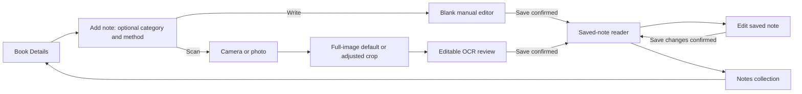

# SDD-06 — After-book-entry Library UI implementation

Date: 2026-10-18
Revision: 0.24 behavior baseline retained; persistence availability reconciled 2026-10-18
Status: manual-note source saving enabled after bounded connected acceptance; DB correction 20261017083830 retained; full native/SDD06-07 acceptance pending
Work unit: library_sdd06_release_acceptance_web_verified_native_deferred

**Release acceptance attempt — 2026-10-18:** [Checklist and evidence](./evidence/sdd06-release-acceptance-2026-10-18/README.md). Owner authorized acceptance, then explicitly deferred emulator work after native sign-in was reached. Fresh 31 suites/402 tests, scoped TypeScript and web export PASS; actual 8083 long-note create/reload/edit, dirty Back/focus, image preparation/crop discard and keyboard filtering PASS within the recorded scope. One synthetic note created/edited/deleted; original one-note baseline preserved. RA-W01 shared tab-label contrast remains OPEN (4.02:1 selected, 3.27:1 inactive at 10px); global tab behavior is outside the leaf-route scope. Existing W01 remains. Native camera/picker/OCR-to-save/TalkBack/large text/hardware Back and complete SDD06-07 acceptance are not established; deferral is not a release waiver. No source/gate/migration change or publication. Next authorized action: use enabled local notes; native acceptance waits for owner resumption/sign-in, and shared-shell contrast needs scoped correction before unqualified accessibility sign-off.

**Current persistence availability — 2026-10-18:** Owner requested enabling saving after the safety correction. [Connected acceptance receipt](./evidence/sdd06-note-save-enablement-2026-10-18/README.md): all four default gates now true after real signed-in category/null, CAS/conflict, duplicate/reconciliation, metadata/validation/anonymous denials and cleanup checks. B04/B05 -> explicit confirmed B08 -> B09 edit -> reload -> delete was exercised through normal web UI; optional category/page persisted as null. Real committed-write loss was injected at the adapter boundary and reconciled by GET without another write. R01–R04/R09–R17 persistence-related criteria have bounded connected evidence, not full native/release sign-off. Fifteen notes/capture suites 182/182, isolated PostgreSQL 34/34 and scoped TypeScript PASS. New native/physical-device/TalkBack/SDD06-07 acceptance remains open. Earlier hold/application-stop statements below are historical; this owner instruction supersedes that stop for the completed enablement and synthetic cleanup only. No new migration or deployment.

**Book Details review-write final review — 2026-10-17:** two independent read-only reviews ran: Codex gpt-6.1-sol xhigh and opencode space-bunny-free max. Both confirm RR01/RR02 are closed, with no F01–F03/FR01/TR01–TR03 regression. Corrections applied:
- An untouched (clean) review blur no longer writes. This closes a confirmed race where a blur in the gap between a refetch's cache update and its re-render could overwrite newer confirmed text, and it removes the false "Review saved!".
- "Review saved!" now fires from the review mutation's own success handler, so a text save superseded by a later visibility or rating action still confirms exactly once.

**Accepted limitation:** review text that was typed but not blurred is not saved when the user navigates away or the book/actor identity changes. Autosave remains blur-only and durable drafts stay out of scope (see the "Out of scope" list). No behavior or acceptance criterion changed otherwise.

**Latest persistence application — 2026-10-17:** [Exact application/readback receipt](./evidence/sdd06-forward-correction-application-2026-10-17/README.md) records owner-authorized one-time MCP application as **20261017083830**, with live/local SHA256 equality and catalog/grant/function/policy/constraint/FK verification. Earlier [independent review and 34/34 local proof](./evidence/sdd06-forward-correction-independent-2026-10-17/README.md) remain dated acceptance evidence. No connected note-write/API/native tests or gate enablement occurred. All four source gates remain false; app/product behavior baseline 0.24 unchanged. **Stop after this application stage, as instructed; no further work authorized.**

**Historical persistence preparation checkpoint — 2026-10-17 (superseded by the review above):** [Receipt](./evidence/sdd06-forward-correction-local-2026-10-17/README.md) records the earlier 31-case candidate and confirmed ACL/grant-option guard correction. Its hash/unit/results remain historical evidence. Use the latest review/fix receipt for the current 313-line artifact and 34/34 result. Product decisions remain unchanged; shared application, connected tests and gate enablement are still separate.

**Current bounded reconciliation correction:** [Receipt](./evidence/sdd06-reconciliation-corrections-2026-10-16/README.md) records owner-requested RR01/RR02 confirmation and local fixes. Text confirmations require the current draft's exact request and unchanged revision, are consumed once before terminal mutation GC, and cannot replay across refetches or same-mounted book revisits. Stable mutation observation is selected synchronously by current actor/book/generation. Failed drafts and all retained B01 actions remain. Fresh proof, final review and limits are recorded in receipt; exact next action independent final reconciliation review. Persistence ON HOLD/four gates false; F04–F06/native/release and marketplace authority unchanged.

**Previous owner-approved review correction:** [Field/session receipt](./evidence/sdd06-review-field-session-corrections-2026-10-16/README.md) records one field per retained-review action, affected-row confirmation, account-generation/token/abort fencing, edit-revision preservation and shared pending feedback. Failed text remains visibly unsaved; unrelated actions cannot implicitly retry failed fields. First regression run 17 RED/2 PASS; final six suites/116 tests, scoped compiler including the corrected app tests and fresh export PASS. Read-only MCP verifies existing columns/own-row policies; no live write/schema change. Exact next action: independent review of this bounded correction and its real-SDK/synthetic-HTTP evidence. F04–F06/native/full release and held note persistence remain open. Earlier overlays below are historical.

**Current two-review reconciliation:** [Triage receipt](./evidence/sdd06-two-review-triage-2026-10-16/README.md) confirms three additional local defects through mounted diagnostics: old-actor queued dispatch/confirmation lacks a session fence, newer text typed back to the prior baseline can be overwritten, and inherited pending work lacks busy feedback. No fix or acceptance-policy change in this review. Retaining failed text/retrying latest requested field intent is not automatically rejected; rollback policy needs an explicit decision before changing it. Exact next action: select bounded TR01–TR03 correction and independent review. Prior original-FR01 proof remains applicable; F04–F06/full release and persistence acceptance remain open.

**Current FR01 correction:** [Queue-lifetime receipt](./evidence/sdd06-fr01-queue-lifetime-fix-2026-10-16/README.md) records pending review values read from the existing exact actor/book mutation queue across Book Details unmount/reopen, confirmed privacy labels and submission-bound settlement. Four lifecycle REDs are now GREEN; five focused suites/61 tests, the exact archived reproduction, scoped compiler and export PASS. Full compiler retains the same 37 diagnostic headers; whole Jest/browser/native were not rerun. Exact next action: independently review the bounded FR01 diff/receipts. F04–F06 and full release/persistence acceptance remain open. Prior overlays below are historical.

**Current owner-authorized correction:** [F01–F03 receipt](./evidence/sdd06-f01-f03-corrections-2026-10-16/README.md) records confirmed privacy feedback, serial queued review writes preserving pending rating/visibility and newer text, B01 notes-first hierarchy and named ≥48dp Back. Five focused suites/53 tests, scoped compiler/export pass; actual browser uses synthetic transport. Named inline My review/Book options/Community reviews/Book information sections implement B01 destinations without new routes. Product acceptance criteria unchanged; F04–F06, real persistence and full native/accessibility acceptance remain open. Exact next action: owner reviews this bounded correction/evidence. Prior overlays below remain historical.

**2026-10-16 independent review overlay:** [Complete matrix/findings](./evidence/sdd06-independent-review-2026-10-16/README.md). Overall implementation is partial: retained-review privacy failure is mounted-reproduced; B01 hierarchy/Back accessibility and related verification debt remain open. Latest automatic-crop native receipt matches current source and saved pixels independently; no new device execution/full release acceptance. Fresh manual/capture tests, scoped compiler and export pass; broader failures are classified in report. No behavior/acceptance change or fix. Persistence ON HOLD, gates false. Current review unit `library_sdd06_complete_independent_review_complete_findings_open`; next action owner reviews F01–F06 and chooses correction scope. Receipts below remain historical, not implementation authority.

Current automatic-crop handoff: the owner selected automatic detection of the printed text area with manual adjustment behind one optional **Adjust crop** action. The normalized photo is analyzed locally once, valid text boxes determine a padded crop, and that crop is transformed before its matching detected text can be reviewed. Manual crop changes require fresh OCR of the transformed selection. Rotation invalidates cached text; unsupported surfaces retain photo preparation with an explicit availability message. The [automatic-crop receipt](./evidence/sdd06-auto-crop-2026-10-15/README.md) records 67 focused tests, scoped TypeScript, actual Android text-box detection, exact automatic/manual crop pixels, one-pass cached review and fresh manual OCR. It also names the broader Jest failures and native limits. Exact next action: owner review of this implemented behavior/evidence; broader release and persistence gates remain pending.

Historical capture/browser handoff through revision 0.19: [capture/OCR receipt and requirement checklist](./evidence/sdd06-capture-ocr-2026-10-11/README.md). Owner-authorized local SDD06-05/06 source implements system intake, oriented crop, on-device editable review, replacement checkpoints and revision-bound partial acceptance through the retained coordinator; this does not close SDD06-04, authorize migration/shared writes/cloud OCR/gate enablement/publication, or complete release. The independent Sol/medium review’s SOL-01/02 findings and the same-session WEB-01/02/03 corrections are recorded in the receipt. Parent’s historical 16 suites/205 tests (pre-Sol) and post-WEB-04-fix 5 suites/63 tests passed; current scoped TypeScript and fresh export pass for those epochs. The Android emulator separately passed six pixel checks, cropped/rotated English recognition, post-dispatch cancellation and edit identity restoration with synthetic fixtures. Luna’s 11/11 browser baseline applies to earlier build e65. On build 7ee, Luna confirmed WEB-05 (at CSS zoom 200% and 390×844 the B05 form ScrollView had zero height and Scan text was covered by Save/Cancel; WEB-04’s crop fix could not be reached) and same-Sol continuation failed because `gpt-6.1-sol` was unsupported. On 2026-10-14 the owner authorized this session as alternate bounded executor (rev 0.18) and waived the same-Luna rerun (rev 0.19): `note-compose.tsx` flex fix was exported to `entry-fdf8fbc020559039f64614ae54e9af59.js` and verified across 16 suites/213 tests, scoped TypeScript, parent Playwright history 7/7, WEB-05 geometry 1/1 (`ch 70 / sh 601`), WEB-04 crop zoom 1 & zoom 2 (`ch 373 / sh 1857`), browser matrix 4/4, dark/reduced-motion 1/1, review-state zoom 1/1, and the SDD06-07 a11y target-size starter (`web07-a11y.spec.ts` 1/1). Exact next action: await owner authorization for the next slice (remaining SDD06-07 release verification/contrast/native checks or resuming the held persistence forward-correction unit). Native picker/camera UI, native accessibility, persistence, and complete SDD06-07 release sign-off remain pending.

Historical held persistence handoff: [preflight](./evidence/sdd06-live-session-review-2026-10-11/LOCAL-CORRECTION-PREFLIGHT-2026-10-11.md), [delete-test correction receipt](./evidence/sdd06-live-session-review-2026-10-11/DELETE-CORRECTIONS.md) and [forward correction plan](./MANUAL-NOTE-FORWARD-CORRECTION-PLAN.md) preserve the earlier work. Persistence correction remains ON HOLD by the owner. Its old migration-CLI action is suspended for this capture/OCR unit and is not the current next action. No fresh database read or mutation is claimed here; the original migration, plans, all four false gates and their acceptance gates remain preserved.

Persistence verification supplement, 2026-10-17: [approved existing SQL harness](./evidence/sdd06-persistence-safety-verification-2026-10-17/README.md) passes 17/17, distinguishing sixteen old-candidate checks from one exact-applied-variant defect reproduction. SELECT-only analysis also identifies server all-whitespace acceptance and U+FEFF word-count divergence. The forward plan now requires server validation consistent with the existing meaningful-text/500-word client contract and existing-row revalidation. This does not change categories/page/limits or accept a correction; no new migration or gate enablement. Correction preparation/application remain separately scoped, and the current Book Details review is unchanged.

## 1. Purpose, authority and scope

Implement a coherent experience after the reader opens a book: Book Details, that book’s notes, category selection, typing, photo capture/crop/OCR, review, explicit save, reading and editing. This SDD converts the discussion into implementation contracts; it does not assert that Stitch screens are wired or that app code already implements them.

The current user decision overrides older specifications. This document owns the current proposed behavior, page contracts, decision ledger, implementation sequence and acceptance criteria. Stitch is supporting visual reference only; its copy, layout, routes and index cannot override this SDD. SDD-02 documents existing notes behavior; SDD-03 owns the separate OCR roadmap. Their persistence constraints remain effective until separately verified and changed. OPTION-B-NAVIGATION-CONTRACT retains exact Stitch node IDs and historical design-route evidence. Where static artwork or older route recommendations differ, implement the SDD contract within an authorized slice and record the deviation from the visual reference. Do not regenerate Stitch screens to resolve specification conflicts or treat artwork as implemented behavior.

In scope: selected-book pages B01–B16, shared UI components, navigation/session state, preservation/recovery, and verification plan. Out of scope: shelves, opening a book, search, global tabs, clubs, marketplace, cloud OCR, new standalone passages, durable drafts, swipe review, reminders and action/question tracking.

This is a notes-first phase within the broader after-book-entry experience. It does not complete the original Notes & passages roadmap. The earlier owner-pasted task deferred standalone passage creation and retained optional categories; these are existing scope decisions, not new approval questions. Existing Saved Pages access remains available as specified in B01. Numbering is deferred until the basic journey works and retained as a planned feature; its later semantics remain unresolved.

The owner subsequently explicitly authorized local implementation in the reviewed conversation, limited to manual-note units SDD06-02–04 before OCR. Earlier documentation-only restrictions remain historical; migration-file creation, application and database test writes are still distinct authorization boundaries. A recommendation to proceed to a connected prototype must not be interpreted as permission to build it. The two unfinished mock HTML/CSS files created under that mistaken interpretation were removed; no mock deliverable remains. App/dependency edits, migration creation/application, database/Storage writes, deployment and Git publication require their own scoped authority. That explicit local implementation instruction has now been received; no database mutation or publication authority is inferred.

Stitch reference: https://stitch.withgoogle.com/projects/12974171775283639004
Current index node: 1d460d8d09844e6c98ac1e493c2ad938. Exact B01–B16 IDs remain in OPTION-B-NAVIGATION-CONTRACT.md. Stitch is visual evidence; the specifications below govern implementation proposals. Do not copy clipped layouts, gallery labels, sample content or engineering annotations into the product.

## 2. Fixed product decisions and open gates

| Topic | Direction | Release gate |
|---|---|---|
| Categories | Quote, Thought, Takeaway, Action, Question; offered before input, optional, changeable before save | Fresh live schema accepts all five values and NULL; application writes enabled 2026-10-18 (`1e4924a`) after the forward correction and connected API acceptance passed |
| Input methods | Write note or Scan text; neither silently saves | Both must carry selected category and book |
| New manual note | Blank text; no existing/sample content | No default Thought or Quote |
| OCR | Camera or gallery, automatic text-area crop, optional crop/rotate/reset, editable result | Isolated Android automatic/manual crop proof passes; full picker/device/accessibility acceptance remains pending |
| Page | Optional; blank is null | Supplied page must be a positive whole number |
| Saving | Explicit Save note or Save changes; reader opens after confirmed success | Uncertain writes require reconciliation |
| Numbering | Defer until the basic journey works; retain as a planned feature | Later reader purpose, scope, prefixes, reassignment/deletion and storage decisions; no numbering infrastructure in this baseline |
| Dirty exits | Approved contextual Keep / Discard protection, including meaningful capture work | Implement and test all exit paths; distinct from durable OCR U3 recovery |
| Limits | No persistent counter; preflight the existing 500-word note cap | Inline actionable feedback before dispatch; server checks remain final enforcement |
| Saved Pages/Vault | No new passage creation in this phase | Keep the existing labeled Book Details section, current excerpt browsing and confirmed deletion accessible |
| Copy | Approved secondary reader action; copy only the note body | Implement clipboard success/failure feedback; add no category, page, title or author silently |

Question or No category must never be silently mapped to reflect or another category. UI-only demos may use explicit mock data. The live category check accepts Question and NULL. Application writes for all five categories and no category were enabled on 2026-10-18 (`1e4924a`), after the database correction `20261017083830` and connected API acceptance (Library tracker, "Note saving enabled — 2026-10-18"). Hiding counters does not authorize bypassing limits or truncating a note silently.

### 2.1 Decision ledger and provenance

The [review evidence receipt](./evidence/sdd06-review-2026-10-09/README.md) preserves the earlier reviews, owner task and read-only database evidence. Reviewer recommendations are inputs, not implementation authority. The owner's 2026-10-09 review supplies the six bounded decision recommendations and four qualifications; its following correction limited that earlier unit to incorporating them into the SDD. Those six choices alone did not authorize coding. The owner subsequently instructed implementation in the reviewed conversation, as recorded below. Routine visual refinements remain specified targets to validate without another product-approval cycle. Earlier owner instructions already made categories optional and deferred standalone passages/cloud.

| ID | Decision / recommendation | Status and consequence |
|---|---|---|
| D06-01 | Start at the already-open book; retain Option B selected-book organization | Settled design scope; shelves/book entry/global navigation excluded; local manual coding subsequently authorized under D06-15 |
| D06-02 | Notes-first creation; new standalone passages and cloud OCR deferred | Settled by earlier owner-pasted task; does not remove existing saved material or complete the broader OCR roadmap |
| D06-03 | Five named categories before input; optional Skip/No category; changeable before save | Settled design behavior; the live constraint accepts Question/null; application writes enabled 2026-10-18 (`1e4924a`) after the correction and connected API acceptance |
| D06-04 | Page optional; explicit save; manual editor blank; OCR editable and category-preserving | Settled design behavior; save/identity contracts need runtime evidence |
| D06-05 | Compact category Change control after the initial chooser; automatic printed-text crop with optional Adjust crop | Owner explicitly superseded the full-image default on 2026-10-15 and selected printed-text bounds; full image remains an explained fallback when bounds are absent |
| D06-06 | Keep editing / contextual discard for unsaved fields and meaningful capture work | Recorded planning choice; no durable restart recovery implied |
| D06-07 | Replacement scanning only; one checkpoint immediately before the current attempt | Accepted; cancel/failure restores that checkpoint; another scan creates a new checkpoint, no accumulated undo history; cancel scan differs from discard whole note |
| D06-08 | Bounded uncertain-save status, explicit Check status and informed Leave | Accepted with operation-scoped restriction; other new notes remain available; leave/reopen/restart defined in section 5.2; retry/reconciliation remain technical gates |
| D06-09 | Keep existing Saved Pages list/excerpt/delete access on Book Details | Existing scope-preservation requirement and B01 layout target; not a new approval question |
| D06-10 | Defer numbering until the basic journey works; retain planned feature; swipe remains deferred | Numbering sequencing accepted; its later semantic/storage decisions remain recorded, not canceled |
| D06-11 | Preserve OCR U0–U6; use SDD06-01–SDD06-07 for this UI plan | Documentation correction; OCR U3 still means durable unfinished-capture recovery and remains pending |
| D06-12 | Preserve draft, compare conflicting edit and explicitly replace | Accepted; original save and replacement both require an atomic expected-version check at the write; no check-then-unconditional-update |
| D06-13 | Copy note body as secondary reader action | Accepted; no silently added metadata; clipboard failures reported honestly |
| D06-14 | Android with verified English scanning first | Proposal only; device book-page evidence and audience fit required; does not restrict the entire notes feature/app; preserve wider language/platform roadmap |
| D06-15 | Implement the accepted three slices, finishing/reviewing manual notes before OCR | Owner's subsequent explicit implementation instruction, recorded 2026-10-10; local SDD06-02–04 authorized. Evidence-led preflight, accessibility during each slice and provisional complexity retained. Migration creation/application, test writes and publication still require separate authority |
| D06-16 | Contextual failed-scan checkpoint recovery; discoverable pending entry; protected conflict choices; real persistence acceptance | Owner's explicit review constraints, recorded in sections 5–7. Selected book's Notes supplies account-scoped in-memory re-entry; Keep editing / protected Use saved version / version-checked Replace preserve the draft. Simulations remain scaffolding; no durable recovery or scan implementation inferred |
| D06-17 | Retained review actions write one field, confirm the affected row, and fence session transitions; retain failed text without implicit retries | Owner explicitly confirmed and authorized the proposed two-review corrections on 2026-10-16. Text blur writes review text; rating and visibility actions write their own field. Later unrelated writes do not retry failed fields. Revision-based input preservation and shared queue feedback retain the original FR01/B01 behavior. No note-write gate, migration or shared-write authority follows |

The six bounded choices are recorded for this phase. Numbering details are later decisions; OCR release platform/language scope remains a proposal for its slice. Verified technical gaps need preflight and evidence, not repeated product approvals. A future authorized mock can demonstrate intended behavior without claiming technical acceptance; creating one is outside this session.

## 3. Source-backed current versus target

The 2026-10-09 Supabase inspection was a pre-manual-persistence snapshot on branch `codex/library-cover-shelf`; it is historical and is not the current live baseline. Fresh read-only Supabase MCP verification on 2026-10-11 confirmed `Bookconnect_reactexpo` / `ahntbtktjjmvfosgkmgn`, `ACTIVE_HEALTHY`, PostgreSQL 17.6.1.063. The applied `20261010221843` SQL and current catalog are recorded in the [local correction preflight](./evidence/sdd06-live-session-review-2026-10-11/LOCAL-CORRECTION-PREFLIGHT-2026-10-11.md). No note bodies, credentials or unnecessary personal data were read; no live writes were attempted.

| File / existing behavior | Required target change |
|---|---|
| app/(tabs)/library/[bookId].tsx: Book Details embeds notes preview/editor and Saved Pages | Reorganize after-book hierarchy; Add note opens chooser; saved preview opens reader; preserve existing book-management actions |
| app/(tabs)/library/notes.tsx: list/filter, Add opens editor, card opens editing | Distinct collection/read/edit; explicit loading/error/empty branches; chooser entry |
| src/components/notes/NoteEditor.tsx: default reflect; OCR prefill/result sets quote | Session initializes category from chooser; recognition never changes it |
| NoteEditor camera launch immediately recognizes asset.uri | Separate intake and crop preview; local detection supplies automatic bounds and matching text; manual adjustments are transformed before fresh OCR; transform failure never adopts the original-image result |
| NoteEditor includes cloud and Save to Vault; OCR error strings recommend cloud | Every reachable note/OCR entry and error must honor cloud deferral, including retained legacy screens. Remove reachable cloud retry and cloud-directed fallback copy during the authorized OCR slice; do not preserve them under a generic legacy exception. Existing Saved Pages browsing/deletion is separate from new vault creation |
| notesService.ts: quote/reflect/distill/apply, required tag, no display sequence | Adapter/schema audit needed for Question/No category/numbering; preserve legacy stored tags |
| notesService.ts: newest-first list, returned inserted/updated record | Reuse ordering and confirmed record response; make mutation lifecycle unambiguous |
| NoteEditor close invalidates capture without dirty guard; save errors use alerts | Central exit/save state; retain entered values; contextual recovery; avoid duplicate alerts from editor and parent |
| Existing library Stack: index/search/[bookId]/notes | Add scoped leaf routes only; do not change shelf/global tab behavior |

Fresh live state (2026-10-11; exact stored SQL and catalog evidence linked above): `reading_notes` has ten columns, nullable `tag` allowing quote/reflect/distill/apply/question, nullable positive `page_number`, server revision fields, nine validated constraints and five indexes including its UUID primary key. Its RLS is enabled (not forced); four permissive policies target `PUBLIC`, but each checks `auth.uid()` and a matching owned parent. `user_books(id,user_id)` is unique and the note has a composite ownership FK. `anon` has no table privileges; `authenticated` has table-wide SELECT/INSERT/UPDATE/DELETE. An enabled invoker BEFORE INSERT/UPDATE trigger sets insert metadata and increments version on edits, but it does not preserve `created_at` on UPDATE. The revision function keeps default PUBLIC execution ACL. The live schema therefore already supports all five/NULL categories and server versioning, while its grants, policy role targets and trigger metadata behavior differ from the correction target. An aggregate read found two notes, zero missing parents, zero owner mismatches, zero null/invalid tags, zero invalid pages and zero null timestamps; it cannot establish timestamp authenticity. No note contents were fetched. Real role/API behavior and concurrent persisted writes remain unverified.

The current note policies include an explicit owned-parent check, so the earlier concern that the policies only checked `user_id` is stale. The fresh ACL readback found no `anon` table privileges and no authenticated TRUNCATE/REFERENCES/TRIGGER privilege; authenticated users do have table-wide row write grants, including metadata columns. The policy target remains `PUBLIC` rather than `authenticated`. Catalog evidence identifies the metadata-integrity and least-privilege correction, but does not substitute for real authenticated Auth/PostgREST denial and compatibility tests. No live privilege repair or security acceptance is claimed.

## 4. Runtime page architecture

Sixteen B IDs are design states, not sixteen routes. Gallery sheets B11/B12/B13/B16 contain mutually exclusive examples, never multiple phones in the running app.

Target route structure for the next authorized implementation; not existing:

- Keep /(tabs)/library/[bookId] for B01 and /(tabs)/library/notes for B02/B03/B10.
- Add /(tabs)/library/note/[noteId] for B08, backed by authenticated record lookup.
- Add /(tabs)/library/note-compose for the B04/B05/B06/B15/B07 wizard and B09 edit mode. This route owns the transient session and step reducer.
- B11 is an inline editor error state; B12 and B14 are accessible dialogs. B13/B16 are wizard recovery states. No extra global tab or top-level feature entry.
- Give each wizard step its own presentation component. Shared NoteForm serves B05/B07/B09; it must not reset text on ordinary rerenders/step changes.
- Do not place note text, image URI/base64, category draft or OCR result in URL parameters. Route params identify book/note/session; in-memory state owns values. Direct entry without valid session redirects to chooser or displays recoverable unavailable state.

Illustrative components under src/components/notes: a flow host, chooser, shared form, intake/crop views, reader, collection states and contextual recovery/dialog components. Names and decomposition are implementation choices. Required boundaries are one authority for transient session state, reusable note fields, separate capture/crop/recognition responsibilities and one validated save lifecycle. Do not freeze extra components or duplicate session fields merely to mirror sixteen artboards.

## 5. Session and mutation contract

Required state concepts: authenticated actor/book; create/edit mode; creation/reader origin and collection filter/list anchor; persisted note identity/baseline for edits; current step; working text/category/page; capture source/crop/orientation; scan return context and replacement checkpoint; request generation; incomplete-result revision/acceptance; save operation identity, submitted payload and outcome. Model each fact once. A scan return context is separate from creation origin: it identifies B04, B05, B07 or B09 and the exact state to restore.

UI category mapping: Quote->quote, Thought->reflect, Takeaway->distill, Action->apply; Question and no category map to `question` and `NULL`. The live constraint accepts those values. Application writes were enabled on 2026-10-18 (`1e4924a`) after the database correction `20261017083830` and connected API acceptance. Do not rename existing stored tags just to match display labels.

State machine: chooseInput -> compose OR capture -> crop -> recognizing -> review / noText / incomplete / processingError. Compose/review/edit -> saving -> confirmed reader / definite failure / uncertain reconciliation. No category/scan/crop action creates a saved record.

Rules:

1. Book/user identity is validated before reads and writes; missing/wrong-book/unauthorized note never renders stale cached content.
2. Step changes preserve active text/category/page. New session resets once; closing/reopening does not accidentally revive another book’s draft.
3. Starting a scan from B05, B07 or B09 captures exactly the editor contents immediately before that attempt: text/category/page, partial-result state, focus/scroll, mode/noteId and originating step. That is the sole restoration checkpoint for this attempt. Confirm replacement of nonempty manual/saved text or user-edited recognition; unchanged OCR Scan again already communicates replacement. Never append silently. Nonempty recognition presents a candidate in B07 in the original mode, retaining the checkpoint. A failed scan displays contextual recovery while retaining that checkpoint; Back or Cancel scan restores it, not universally B07. Canceling the attempt restores its checkpoint. Starting another scan replaces the checkpoint with the then-visible editor contents; no accumulated undo history. Save alone persists candidate text. Cancel scan restores the editor; Discard note abandons the whole new-note session; Discard changes abandons edits and returns to the persisted note. These actions must never be conflated.
4. Each recognition request has a generation token and abort handle. Cancel, new scan, logout, user/book change and unmount invalidate it; late results cannot update current UI.
5. Save freezes the submitted payload, disables duplicate submission and shows Saving…. Open the saved reader only after the returned record confirms success; do not clear before success. Informed Leave under section 5.2 remains available for an unresolved operation without pretending it was canceled.
6. Definite failure retains values and exposes B11. Transport interruption after dispatch may be uncertain; use section 5.2, not definite-failure Retry. Existing client has no verified reconciliation support; design alone cannot guarantee duplicate safety.
7. On confirmed create, use the returned record ID and replace composer with one B08 reader; its return destination is this book's B02 collection. Preserve existing filter/list context when creation began there; use All for a fresh Book Details creation. creationOrigin governs abandoning an unsaved draft, not the post-save reader destination. A pre-existing note opened directly from B01 still returns there. On confirmed edit, update and return to the original B08 instance if present, otherwise replace with one reader for the same noteId and return context. Do not push a second reader from saving an edit or leave a resubmittable editor behind. This does not restrict normal browsing to one reader globally. Invalidate/seed preview, count, collection and record queries; edit does not increment count.
8. Query keys must be scoped consistently to authenticated actor and book. Audit current consumers before changing keys; invalidate both preview and collection/count paths.
9. Track unsaved field changes and capture work separately. A selected photo, crop adjustment or rotation can be meaningful even with no note text. Recognized text is unsaved content. Navigating a retained step is not abandonment. Category-only selection on a fresh B04 need not trigger a discard dialog; leaving an editor or capture that would lose meaningful work uses the approved contextual B12 protection. No restart recovery is promised.
10. Back means previous retained step; Cancel means leaving the applicable note or scan flow. Do not mechanically display both when they perform the same action. Recognition Cancel invalidates the result and stays on crop; it does not imply the native engine stops computing immediately. Auth change invalidates UI completion and clears account data, but does not claim to cancel a dispatched server write. Uncertain saves have an explicit informed-leave policy, not an indefinite dismissal block.
11. Keep capture state bounded: one current attempt/candidate and one restoring checkpoint, not recursively nested histories for every rescan. Preserve only the source references needed for that checkpoint/current crop; release superseded app-owned resources safely. Account/book changes invalidate both. This adds no image archive or durable draft.

Repeated-scan example: manual draft A is the checkpoint for Scan 1, which produces B in B07; canceling that attempt restores A. Starting Scan 2 from the current B establishes B as the new sole checkpoint. Canceling/failing Scan 2 or rejecting its candidate C restores B, not A. In saved-note edit mode the persisted original stays unchanged until a version-checked Save changes succeeds. This is the accepted D06-07 rule; native execution remains unverified.

### 5.1 Transition and exit invariants

These are target transition rules incorporating accepted B12/D06-07 policies. A step transition never persists a note.

| Situation | Return / resulting state | Preserved or discarded values |
|---|---|---|
| Fresh B04 -> Write or Scan, no category selected | B05 blank or B06 | null category; book/origin; no forced Skip click |
| B05 Back to B04 and choose the other input | B04 retains working state; scan confirms replacement if text exists | Text/category/page/checkpoint; no blank reinitialization |
| Picker dismissed from B06, B15 or recovery | Exact launching state | Previous image/crop and editor checkpoint; never claim a capture |
| Initial B04 scan canceled before meaningful work | B04 | Chosen category/book; no text save |
| Replacement scan canceled/failed from B05 | B05 | Exact typed note/category/page/focus; not an OCR-review destination |
| Replacement scan canceled/failed from B07 | Previous B07 | Exact recognized/edited text, metadata and partial acknowledgement |
| Replacement scan canceled/failed from B09 | B09 | Same noteId, stored baseline and unsaved edits; never create mode |
| Crop Back to intake / recognition Cancel | B06 with capture retained / B15 with crop retained | No discard dialog for retained work; canceled request invalidated |
| Exit would lose a chosen image/crop but no text | Capture-context B12 | Keep scanning preserves capture; Discard scan removes only that attempt and restores its checkpoint |
| Leave new note or saved edit with unsaved fields | Note/edit B12 | Keep editing preserves fields; discard returns creation origin / persisted original B08 |
| Replacement result arrives | Candidate B07 in original create/edit mode | Replace candidate text only; prior checkpoint retained until adopted/discarded; category/page/noteId unchanged |
| New note Save confirmed | One B08 replacing composer, then Back to this book's B02 | Returned record; existing collection filter/anchor or All for B01 creation; unsaved creation origin no longer governs reader Back |
| Existing note Save changes confirmed | Original B08 or one replacement B08 | Same record identity; refresh list/preview; no count increment or duplicate route |
| Long-note reader -> Edit -> Cancel/Save -> Return | Exact reader then previous collection context | Reader position plus filter/list anchor; field edits never overwrite baseline on refetch |

Acceptance R18: exercise B05/B07/B09 origins separately; cancel/failure/late results restore the editor immediately before that scan, including correct mode/identity. Repeated attempts replace rather than stack checkpoints. Cancel scan and discard whole note have different consequences. Append is unavailable in this baseline.

### 5.2 Bounded uncertain-save behavior

Proposed UI timing, pending validation: after 15 seconds without a definite response, change from Saving to Save not confirmed; perform at most one bounded status read (10 seconds), then present a stable unconfirmed state. These are UI thresholds for review, not a claim that the server has timed out or rolled back. Check status is explicit; no endless polling, blind insert retry or permanent spinner.

Keep the submitted payload/operation identity immutable until resolved. Fields remain readable/selectable. Prevent redispatch of that same unresolved operation; this is not a global lock on creating other notes. Check status targets the same authenticated actor/book/record or logical create ID. No matching row alone proves neither failure nor rollback. A duplicate-safe create may allocate a stable UUID once, but current client support and payload/ownership matching require implementation and tests. Edit identity alone does not provide concurrency protection.

After the bounded check offer Check status and informed Leave: We couldn't confirm whether this note / your changes were saved. Leaving won't cancel the request. Leaving may lose text still in this editor; if the request succeeds, its saved result is available in this book's Notes. Do not label the outcome unsaved/canceled or promise restart recovery. A late response may resolve its account-scoped operation but cannot reopen a departed editor or display another account's content.

| Lifecycle | Required behavior |
|---|---|
| Leave editor, same app session | Keep operation identity/submitted payload in an account-scoped in-memory coordinator for explicit recheck; allow independent new notes; do not resurrect the old editor automatically |
| Reopen that operation while memory remains | Show the retained submission and its actual known/unconfirmed outcome; Check status refers to the same operation, not a fresh create |
| Reopen saved note while its edit is unresolved | Show current confirmed data and a contextual pending-operation notice when known; reconcile that edit before issuing another write to that same note; other notes remain usable |
| Restart/process loss | In-memory submission/draft is lost; no automatic replay, recovered-text claim, or account-wide lock. Freshly read saved Notes. A saved matching record is evidence only when identity/payload are verified; absence is not proof the prior request failed |
| Retry after definitive rejection | Revalidate current fields; use the verified safe-operation strategy. Unknown outcomes never get a blind Retry with a new create identity |
| Account change | Clear prior-account UI/payload/recheck access; no cross-account continuation. A dispatched server write may still complete under its original identity |

While memory remains, the selected book's Notes exposes an account-scoped pending-submission entry; a failed fresh status/book read must not hide the retained payload or that entry. Implementation must establish how a prior operation can be identified/reconciled after restart, or explicitly report that its outcome cannot be reconstructed. Any minimal operation receipt is a technical design choice with scoped privacy/storage validation, not automatic authorization for durable drafts. Never use inability to reconcile as a permanent lock on unrelated note creation.

Acceptance R17: unknown saving is operation-scoped; leave/reopen/restart follow the table, independent notes remain usable, no automatic replay or false durable recovery, and no blind duplicate retry. Safe reconciliation/retry remains a technical release gate; a mock cannot prove server behavior.

### 5.3 Conflicting-edit writes

Both normal Save changes and an explicitly confirmed replacement must compare the expected record version atomically at the actual write. A read/check followed by an unconditional update is insufficient. Version token or equivalent conditional-write mechanism must be server-enforced and verified; current notesService does not provide it.

On conflict preserve the draft and show the latest saved version for comparison. Offer Keep editing without writing; protected Use saved version requires explicit discard confirmation and a fresh confirmed read (read failure retains the draft); Replace saved version requires explicit confirmation. Explicit replacement submits against exactly the version the reader compared. If another change arrives before replacement, the write conflicts again, refreshes the comparison and preserves the draft; it never overwrites the unseen newer version. Deleted/unavailable records do not become newly created notes implicitly. Only confirmed successful writes update the original reader/list/count.

Acceptance R21: prove a change racing with Save and another change racing with explicit replacement both reject stale writes and retain the draft. A local revision-token simulation demonstrates the interaction only; actual atomicity needs persistence evidence.

## 6. Page-by-page implementation contracts

### B01 — Book Details

Layout: local Back to Library header; cover/title/author and directly reachable reading status; Add note primary; Notes entry/count and recent saved previews. Keep Saved Pages as a clearly named secondary section. My review has a visible entry with rating/review/visibility together; ownership, conditional lending/condition and removal use named Book options. Community reviews and bibliographic information retain explicit destinations. Do not put all these responsibilities behind an undefined management collapse. Use actual book data and neutral note-body styling; category alone does not identify which words were written by the author.

Actions: Add note opens B04 with origin B01. Notes opens collection; saved preview opens B08 with readerOrigin B01. Back uses existing Library fallback. Retain reading status; ownership; applicable condition/lending availability; personal rating; review text and explicit Public/Private review visibility; community review loading/error/empty/read states; metadata; and confirmed book removal with verified deletion consequences. Do not confuse a private book review with a reading note, or change those management semantics during this UI change.

Retained book-review writes share a queue scoped to actor, book and authenticated identity generation. Text blur submits only review text; rating and visibility actions submit only their selected field. Queue order preserves successful earlier changes without building later whole-review payloads. A rejected field is not implicitly retried by an unrelated action. Failed text stays visible and marked unsaved; another text blur can explicitly retry it. Reopening during an in-flight text save restores the latest queued text, while rating/privacy displays show confirmed server values and shared busy feedback. Rating, text and visibility controls can queue further explicit actions consistently.

Each text confirmation consumes only the current draft's exact submitted or inherited request, with an unchanged edit revision; it cannot replay merely because a local revision number repeats after revisiting a book. A clean editor adopts later confirmed refetch text. Inherited confirmations are consumed before terminal mutation garbage collection can remove their history. Queue text and busy snapshots must match the current actor, book and authenticated generation even when the same component remains mounted. Every text edit advances a local revision, including typing back to the prior confirmed text. A completion cannot replace text edited after that submission. Confirmations require the returned affected row to match actor/book identity and valid review-field types. Dispatch captures the current actor's token, aborts on identity loss, rejects queued work from an earlier identity generation and fences cache/alert/refetch adoption after account changes. A same-actor token refresh retains the generation; A→logout→A does not. This adds no durable drafts, process-restart recovery, cross-device concurrency or guarantee of undoing a request already accepted by the server.

States: book loading, unavailable/not authorized, notes-preview loading/error/empty/populated. Preview failure never displays zero as a confirmed count. Minimum legacy preservation: keep Book Details' labeled Saved Pages list accessible, including current page metadata/excerpts and confirmed delete. Its failed load must not look empty, and its empty copy must not direct readers to a deferred Save to Vault action. Current VaultPagesList shows three-line excerpts, not a full saved-passage reader; this phase does not claim to add full passage reading/editing/creation. Existing reliability defects are tracked regressions/technical debt, not accepted merely because an entry is preserved.

Acceptance R01: selected-book identity survives every entry; new note never opens an existing record; management actions remain reachable and shelf layout unchanged.

Acceptance R20: inventory each retained management and legacy entry above against source; verify access, privacy feedback and current supported behavior before replacing Book Details. Passage deferral never becomes silent removal of existing access.

### B02 — Populated Notes collection

Layout: Back to Book details, selected-book heading, Add note; All and five category filters; newest-first saved-note list. Each card has category when present, readable snippet and page only when supplied. Uncategorized is absence of classification, not a sixth category; All includes those notes, and this baseline adds no separate uncategorized filter. Reader entry must be labeled; edit is reached through reader. No unapproved sort/favorite or provisional numbering.

States: initial loading, refreshing with existing content, populated, filtered-empty, true empty B03, initial-load failure B10, refresh failure retaining loaded notes. Filtered-empty offers Show all notes and does not imply book has no notes.

Actions: Add->B04(origin B02); card->B08; filters stay here; Back->B01. Restore filter and list anchor after viewing/editing; a newly saved category outside active filter must not silently clear the filter or appear lost. Reader shows success; collection can explain active filter.

Acceptance R02: distinguish failed/empty/filtered-empty; returning preserves context; create/update refreshes preview/count/list consistently.

### B03 — True empty collection

Render as B02 state, not separate route. Selected book, No notes yet, concise explanation and Add note. No invented saved sample or zero-state error. Add->B04(origin B03); Back->B01.

Acceptance R03: shown only after a successful read returns no notes. A load failure cannot trigger it.

### B04 — Category and input

Layout: Add note with one return control when Back and Cancel would have the same consequence; selected-book context once; Category(optional), five compact single-selection options, secondary Skip category, then Write note and Scan text. Avoid five explanatory paragraphs. Initially no option is selected. Both input methods are available immediately; choosing either without a category carries null, so classification is not a prerequisite. Skip also makes that choice explicit. Check/border and accessible selected state accompany color.

Actions: choose updates session only; fresh Write->blank B05; Scan->B06. Back/close returns exact creationOrigin with contextual protection if this revisited chooser holds meaningful work. Revisiting from B05 preserves text/category/page; Write resumes that draft rather than blanking it. Switching to scanning captures that editor as the checkpoint and uses approved replacement confirmation.

Acceptance R04: all five choices precede input methods, optional category persists, neither branch writes or forces Quote/Thought.

### B05 — Manual note editor

Layout: Add note; Back to options and a distinct Cancel note where needed; book context once; compact Category: selected value or No category with Change; labeled Note text multiline field; Page(optional); one keyboard-aware Save note area. Change opens the same optional category picker without navigating away or resetting fields. Fresh sessions are blank. Do not repeat all five category choices around the writing area or include sample text, OCR result, vault actions, counters or engineering copy.

Actions: Back->B04 with values; Cancel note uses B12 contextual protection; Save validates then coordinator. Empty/whitespace Save is disabled. Validate supplied page as a positive whole number within the verified integer API range; show nearby feedback without coercion. Preflight the known 500-word note cap before dispatch. Over-limit text remains intact with contextual feedback such as Remove 37 words to save; no persistent counter is needed. Scan text is a secondary method change using B05 checkpoint, not a blank new note. No silent truncation.

Acceptance R05: fresh editor blank; keyboard never hides Save; selected category/page sent exactly; confirmed success opens B08; failure stays editable.

### B06 — Camera/photo intake

Layout: Scan text; book/category context once; Capture page and Choose photo, with concise guidance and contextual unavailable feedback. Do not show a fake live viewfinder if using the system camera. Use Back to the scan origin and Cancel scan only where its effect differs; avoid duplicated identical exits. No torch, save action or unsupported privacy/engine assurances.

Implementation choice: existing ImagePicker camera is a system capture UI. Embedded viewfinder requires a separate camera component/dependency decision; do not draw a fake functioning viewfinder. Start with system capture adapter if approved, while preserving the same intake/cancel contract.

Actions: capture/gallery selection->B15. Returning/canceling this scan goes to its recorded B04/B05/B07/B09 origin, with the capture-work guard if abandoning meaningful work. Picker dismissal returns to its launching state. Initial camera refusal can offer Choose photo or Write note instead; failure during a replacement returns to the exact originating editor. Wrong category/mode or blank-editor resets are forbidden.

Acceptance R06: permission refusal does not trap user or erase text; only a successfully selected photo starts local automatic text detection; picker cancellation starts no recognition and retains the origin; cancellation never claims a photo was selected. Unsupported surfaces allow photo preparation without attempting an unavailable native engine.

### B15 — Automatic crop preview (before text review)

Layout: Prepare photo; book/category; the chosen image with an automatically selected printed-text region. Detect the union of valid local text boxes and add padding equal to 2% of each image dimension, clamped to the oriented image. Display the outline and one optional **Adjust crop** action. Corner handles, accessible edge buttons and the reset action appear only after that action is opened. Rotate and Choose another photo remain reachable. The primary action is **Review recognized text** when the matching automatic result is ready, or **Recognize text** after a manual crop change. Long instructions cannot push the action offscreen.

Implementation: retain source dimensions and orientation. After successful intake, one on-device OCR pass over the normalized source returns text and validated text-box frames. Derive the automatic crop, map it to oriented source pixels, and successfully transform it before retaining that result for review. Reuse the text from this same detection pass while its photo and automatic crop match; do not run a redundant second pass. A manually adjusted crop is transformed first and its temporary URI is passed to fresh OCR. Rotation updates crop coordinates and invalidates cached text so recognition can improve after rotation. Reset returns to the detected text region; when no detected region exists, it explicitly selects the full image. Missing text-box frames leave a full-image preview with an explanation and optional adjustment. Transform failure stays on crop with an error and adopts no original-image result. Browser/Expo Go/unlinked engines keep photo preparation available with scanning unavailable.

Actions: Back->B06 retaining the photo/crop; Cancel scan->recorded checkpoint using capture-work protection where applicable. Picker dismissal retains the current crop and matching result. Automatic detection shows progress on this step and can be canceled. Review recognized text->B07/B14 using the matching detected result; a manual recognition progresses to B07/B13/B14/B16. Recognition/detection Cancel invalidates only that request and stays on crop; hardware Back during processing has the same effect. Cancel scan abandons the attempt and restores its checkpoint, including its automatic crop/result. A gesture abandoning the entire note uses contextual note/edit protection; these scopes remain distinct.

Acceptance R15: independently verify transformed pixels/dimensions against known crop/rotation/orientation fixtures before evaluating OCR accuracy. Prove real local text boxes select the automatic padded region, detailed controls start collapsed, and unchanged automatic review reuses exactly that photo's result. Manual adjustment must run fresh native OCR on the transformed selection URI. Rotation, replacement and cancellation cannot reuse obsolete text. Missing-bound recovery is explicit; transform failure never adopts the source result. OCR quality alone is not crop-correctness proof. Reset/cancel/new image and owned-resource expiry remain verified without claiming deletion of a gallery original.

### B07 — OCR text review

Layout: Review scanned text; selected-book context; the same compact category Change control, text field, optional page and validation/save structure as B05/B09. Save note in create mode or Save changes in edit mode is primary; Scan again secondary. Category is not a six-option panel here. Valid recognized text may be saved unchanged immediately; no required correction chore.

Actions: Back->B15 retaining the current candidate and crop. Cancel note for initial creation follows B12; Cancel scan in replacement context restores its originating B05/B07/B09 checkpoint, with a guard if abandoning meaningful candidate edits. Scan again uses the current B07 as its new replacement origin and explains replacement when text exists. Candidate results retain category/page/mode/noteId. Save uses the shared coordinator and only the current reviewed text.

Acceptance R07: no forced editing chore/autosave/default Quote; canceled/failed replacement restores the correct editor and values; incomplete-result acknowledgement is bound to the exact current text/result revision as B14 specifies.

### B08 — Saved-note reader

Layout: Read note and contextual Back; selected-book attribution once; small category/page metadata only when present; selectable full note body; Edit note and secondary Copy text. Use a quieter hierarchy than the editor. Quote classification does not authorize wrapping the whole body in quotation marks or attributing personal commentary to the book's author. The single body has no structured excerpt/commentary boundary; render it neutrally. Copy only that body, without silently adding book/author/category/page; report clipboard success/failure honestly. No bookmark/favorite or provisional number.

Actions: Edit->B09; Back->readerOrigin. A newly created note returns to B02 with preserved filter/anchor or All when created from Book Details. An existing preview opened directly from B01 returns to B01; an existing list note returns to B02. Editing preserves that reader destination and reading position; no stale composer remains in Back history. This is the target navigation contract, not a claim that it is wired in the app.

States: loading, missing/deleted/unavailable, read failure with retry; do not display another book's cached note. Preserve existing Delete note through a labeled contextual action and confirmation, with pending/error feedback and count/list refresh. Its proposed placement is a reader menu; it is never a swipe default. Placement is reviewed visually; preserving the current supported capability does not require silently adding or removing a feature.

Acceptance R08: reads saved data rather than draft; missing page omitted cleanly; long text selectable/scrollable; return/edit keeps correct record identity.

### B09 — Edit saved note

Use the same NoteForm: Edit note, one return control when both exits do the same thing, book context once, compact category Change, persisted text and optional page, Save changes. Initialize once from the original record; query refresh must not overwrite unsaved edits. During the OCR slice, secondary Scan text records B09 as the return context and retains edit mode/noteId; it is not a new-note creation path.

Actions: unchanged Back->B08; dirty exit->B12. Save updates the same noteId through the atomic expected-version contract in section 5.3, then returns to the existing reader without stacking duplicates. Clearing page sends null. Category change is a normal field edit, subject to supported persistence; no numbering allocation is part of this save. Conflict/reconciliation support must be verified before claiming safety.

Acceptance R09: definite rejection preserves current edits and does not claim a committed update; confirmed success refreshes B08/collection/preview; stale normal and replacement writes reject atomically under R21.

### B10 — Notes load error

Inline collection state with book, Couldn’t load your notes, Retry, Back to Book details. Retry resolves populated/true-empty or retains error. Refresh failures keep previous content with nonblocking banner instead of replacing it with B10.

Acceptance R10: error is not empty, no stale cross-book content, Retry targets same user/book and cannot create data.

### B11 — Definite save failure

Inline error on the originating NoteForm; not a new route. New-note message: This note wasn’t saved. Your text is still here. Edit message: Your changes weren’t saved. Your edits are still here. Claim the stored version is unchanged only when the failure classification proves the update did not commit. Keep one retry-capable save area: its action can read Try saving again / Retry changes. The banner does not add a second Retry beside an unchanged Save button. Fields remain editable; no extra Keep editing button is needed when the reader is already in the form.

Retry uses the verified operation strategy and revalidates the current payload. If fields change after a definite rejection, invalidate the prior submitted payload and treat the next Save as a new intent. Ambiguous transport failures use section 5.2. Inline validation/failure must not jump focus or displace the note body unexpectedly; leaving still applies the dirty policy.

Acceptance R11: no data loss, duplicate alerts or optimistic success; uncertain outcomes cannot show this definite-failure copy.

### B12 — Contextual unsaved-exit dialog

Approved behavior: new note Discard this note? / Your note hasn’t been saved. / Keep editing, Discard note. Saved edit Discard changes? / Your changes haven’t been saved. / Keep editing, Discard changes. Never imply another device's saved version has not changed.

Keep editing restores originating screen/focus/values. Discard new note returns creationOrigin; edit discard returns B08 with current confirmed saved data. Discard never deletes a saved record. Dismiss/backdrop/hardware Back defaults to Keep editing. Unknown saving uses section 5.2 informed Leave rather than claiming a draft is definitely unsaved.

Capture-only protection: Discard this scan? / Your selected photo and crop adjustments will be lost. / Keep scanning, Discard scan. Restore the editor immediately before this attempt. Exiting the entire note uses note/edit wording explaining both field and capture losses. Destination and discard scope are explicit; resetting crop, canceling recognition or moving to a retained step is not whole-note discard.

Acceptance R12: both contextual wordings match actions; no exit bypass; no promise of durable recovery.

### B13 — Recognition completed with no text

Keep the capture context and render No text recognized with concise quality guidance. If the current source exists, primary Adjust photo returns to B15; secondary Write note instead is available only for a first scan. Ordinary Back returns to the scan origin, rather than a third recovery button. Choosing a new photo remains on B15/B06. If the source is gone, primary Choose another photo substitutes for Adjust photo. Do not present five equally weighted recovery actions or repeat recognition on an unchanged image without reason.

Replacement uses contextual Back to note/review/edit and restores the correct B05/B07/B09 checkpoint; it never opens a blank editor. Picker dismissal stays in recovery. No-text cannot replace valid prior text with an empty string.

Acceptance R13: distinct from technical failure; initial/replacement routes preserve required state; no unwanted save.

### B14 — Incomplete OCR result dialog

The OCR review boundary is 20,000 Unicode code points, counted with Array.from; it is not the 500-word saved-note cap or the deferred vault's 800-word/4,000-character rule. Overflow opens an accessible Some text may be missing warning with Use incomplete text and Keep editing. Both return to editable B07 and neither saves. Keep editing leaves a visible incomplete-result warning and no acknowledgement.

Bind acceptance to the current result/text revision. Any text/result change clears it; a complete replacement result clears overflow. Pressing Save with an unaccepted partial result reopens B14 explicitly rather than leaving an unexplained disabled Save. Accepting then allows the reader to press Save again; acceptance itself never dispatches a save. The 500-word/page/content checks still apply. Preserve a replacement checkpoint so rejecting a partial candidate can return to the prior editor. Manual mode changes do not silently erase partial provenance on the same text.

Acceptance R14: heading/buttons fit large text; background editor cannot receive clicks/focus during modal; acceptance never creates record and cannot carry across result revisions.

### B16 — Technical OCR processing failure

Classify technical outcomes before choosing recovery. Image-specific failure can show Choose another photo as primary and Write note instead as the first-scan alternative; ordinary Back returns to the recorded scan origin. Native engine/script unavailable offers manual writing for a first scan, or Back to the existing editor for replacement; another photo is not presented as a fix for an unavailable engine. Authentication/identity invalidation uses the account boundary, not an image-quality explanation. No unverified same-image Retry, cloud retry or cloud-directed copy.

Replacement preserves prior fields/mode/noteId and restores the exact B05/B07/B09 editor. Explain failure of this scan without implying the prior note was lost. Picker cancel retains context. Cancellation is not displayed as processing failure. Reachable legacy OCR error strings that recommend cloud must be neutralized in the same authorized integration slice.

Acceptance R16: technical/no-text/incomplete outcomes are distinct; failed replacement never destroys prior work; unavailable-engine recovery offers a usable editor path without promising that a different image enables OCR.

## 7. Shared UI and accessibility contract

Reuse current theme system rather than hardcoded colors per page. Literary Parlor direction: readable warm-paper surfaces and forest-green primary action. Extract shared spacing/type/radii/tokens after checking existing theme; mock sample titles/people never ship as content. Dark theme needs explicit palette parity, not inverted screenshots.

Use four related page families. Matching colors alone does not establish consistency:

| Family / IDs | Stable structure | Purposeful difference |
|---|---|---|
| Book overview / collection: B01/B02/B03/B10 | Local navigation, selected-book context once, named note entry/actions, stable loading/error areas | Overview summarizes and retains book responsibilities; collection browses/filter notes |
| Compose / review / edit: B05/B07/B09 with B04 as entry | Same field order: context, compact category Change, dominant text body, optional page, local feedback, one save area | Blank / recognized / persisted text; Add note / Review scanned text / Edit note; Save note / Save changes |
| Intake / crop / recognition: B06/B15 | Same book/category context, dominant image/work area, one forward operation, contextual return | System intake differs from adjustable crop; recognition is a transient state, not a new destination |
| Reading / contextual recovery: B08 with B11/B12/B13/B14/B16 attached to their task | Quiet reading body; recoveries keep the affected form/capture context and one prioritized next action | Read mode removes edit chrome; dialogs explain a concrete consequence and restore focus |

Navigation control positions and meanings stay predictable. Keep book attribution once at the appropriate strength; a long title must not be repeated in the header, context strip and card. Text gets useful space before decoration/metadata. Secondary metadata must remain readable, not faint. Known validation stays near its field; saving/status feedback occupies a stable area rather than replacing the page. Quote/Thought colors identify purpose, not ownership of individual sentences. Without a structured excerpt/commentary model, use neutral note text and avoid invented author quotations.

The form's primary action remains reachable with keyboard, safe area and large text; the exact footer treatment is validated in the implemented slice at native sizes instead of copied from a clipped artboard. Do not reduce font sizes merely to fit category panels or explanations. Reuse one dialog pattern with contextual labels and safe dismissal.

Use real native TextInput and accessible single-selection controls, selectable reader text, 48dp minimum interactive targets, non-color selection/error cues, measured contrast, dynamic text and safe-area insets. Category rows wrap/scroll without truncating labels. Scrollable form plus keyboard-aware footer; validate numeric input as a whole string, not permissive parseInt of 24abc. Announce saving/error/success and restore focus after dialogs. Focus only when appropriate; chooser must not trigger keyboard.

Use FlatList for collection, stable record IDs, natural text scrolling, no horizontal swipe requirement. Respect reduced motion; transitions explain moving forward/back but never delay input or conceal an error. Disable duplicate actions while pending; dialogs have focus trapping/restoration and cancel-safe defaults. No engineering/runtime assurances inside reader copy.

### 7.1 Connected journey validation during implementation

The owner retains an SDD-first approach with Stitch as visual reference only. The owner authorized local manual-note implementation after this documentation handoff. Validate the manual journey as a connected slice, carrying entered text/category/page between views; check visual consistency, keyboard, large text, focus and contrast during each slice, with SDD06-07 consolidating release evidence and regressions. If mock state is used during that work, label it honestly and do not claim persistence or native behavior. No additional Stitch screens, broad design cycle or separate prototype is required before the bounded implementation slice.

Manual path: B01 -> B04 -> B05 -> confirmed-save simulation -> B08 -> B09 -> B08 -> B02 -> B01. Also start at B02/B03 to prove filter/collection-return behavior, and open an existing B01 preview to prove its different contextual Back. The reader-to-edit-to-reader path must not add another reader/composer to Back history. The owner's 2026-10-11 sequence authorizes local B04/B05/B07/B09 -> B06 -> B15 -> B07 now, preserving mode and identity while persistence correction is held. The same B08 save destination remains gated.

This is the representative create journey. Existing-note entry, scan replacement and all recovery/return variants follow the explicit contracts above; the diagram does not add routes or imply persistence has been tested.

| Validation group | Required evidence during the authorized slice | Acceptance question |
|---|---|---|
| P01 Manual skeleton | Native-size implemented views plus connected entry/write/read/edit/return interactions | Can a reader start writing without classifying first, and understand which book will receive the note? |
| P02 Shared hierarchy | Same data/content across manual, review, edit and reader; compact metadata; one primary action | Does editable content differ clearly from saved content without repeating book context or crowding the text? |
| P03 Manual variants | Long title/note; no category/page; category Change; keyboard-open and large-text examples; empty/filter-empty/load error; invalid page/over-limit; definite/uncertain save; contextual exit | Do actions remain reachable, mistakes recoverable and saved/unsaved/unknown outcomes distinguishable? |
| P04 Capture extension | Full-image default, adjusted crop/rotation, recognition progress/cancel, B13/B14/B16, replacement from B05/B07/B09 | Can the reader scan quickly and abandon an unsuccessful replacement without losing earlier work? |
| P05 Review/handoff | One screen/state checklist with actual links, evidence type and PASS/FAIL/NOT_RUN | Which visual/interaction decisions are accepted, and which require real persistence/device evidence? |

Use one sample book and representative notes consistently across test views, plus long-content variants; the sample or real record being read/edited must match the note just saved in that same test. Errors/empty states reuse the family shell instead of looking like another destination. Dark-theme parity is required if supported in this release, with an explicit deferred-release decision otherwise.

Five uncoached tasks: (1) start a note without selecting a category; (2) choose/change Question and leave page blank in the simulated flow; (3) save/read/edit/return to the same note; (4) find a note after returning to a filtered collection; (5) recover from a failed save or canceled replacement scan. Record hesitation, wrong destinations, uncertainty about whether saving happened, unexpected field loss and duplicate-route Back behavior. A mock UI pass proves design comprehension only; it does not prove database acceptance, native keyboard/accessibility or OCR performance.

Acceptance R19: review native-size implemented family views and connected transitions against this SDD; do not accept the journey from board thumbnails or palette similarity. Stitch remains reference-only. Its last cleanup retained 16 source screens plus one index and removed all five stale prototypes; this documentation revision makes no additional browser changes.

## 8. Numbering decision package

Numbering is approved for deferral until the basic journey works and retained as a planned feature. Before its later slice choose per-book/per-category/global scope, prefixes, No category representation, reassignment/clearing, text-only edits, deletion/reuse and stable references. Backend must verify uniqueness/atomic allocation/concurrent saves/idempotency. Do not derive authoritative labels from array index or count+1; display number is never record identity.

In the later numbering slice establish the reader task: referencing a note elsewhere, distinguishing similar notes or navigating a sequence. Record identity already exists. Q1/TH1/TK1/A1/QS1 are examples, not settled prefixes. No numbering allocation service/schema is part of the baseline. Revisit first-release numbering only if the owner explicitly changes the recorded deferral.

## 9. Implementation sequence and completion gates

| Unit | Deliverable | Depends on | Done evidence |
|---|---|---|---|
| SDD06-01 | Documentation handoff: bounded decisions, four qualifications, page contracts and next-session scope | Current SDD-only instruction | B01–B16 contracts retained; six decisions and four clarifications traceable; technical gates explicit; no prototype/app completion claim |
| SDD06-02 | Shared family tokens/fields/reader, one session authority and mutation lifecycle scaffold | SDD06-01 handoff and explicit implementation scope | Component/transition previews with honest mock state; no persisted-success claim |
| SDD06-03 | Minimal B01/B04 entry and B02/B03/B10 collection; retained management/Saved Pages access | SDD06-02 | Selected-book navigation, empty/error/filter distinction and list-restoration checks |
| SDD06-04 | B05/B08/B09/B11/B12 manual create/read/edit vertical | SDD06-03; verified category/exit/reconciliation/owner-binding gates | Authorized create/read/update proof, legacy compatibility, clear failures/safe exits and no duplicate route/record |
| SDD06-05 | B06/B15 camera/gallery/full-default crop/rotation | SDD capture contract; chosen native adapters | Independent crop pixel/coordinate tests and Android camera/picker/rotation/cancel proof |
| SDD06-06 | B07/B13/B14/B16 OCR using the same form/session/save | SDD06-04/05 | Native crop-to-recognition-to-save proof; exact return contexts, partial loop, cancellation/late results and cloud exclusions |
| SDD06-07 | Release accessibility, large text, keyboard/theme/resource checks; regressions and handoff | SDD06-03–06 | Actual acceptance matrix; residual risks/support matrix; owner review; no unknown capability presented as PASS |
| Later / scoped deferrals | Numbering deferred until basic journey works; durable recovery/swipe/cloud/new passages outside this scope | Later numbering rules; separate scopes for other roadmap work | Numbering remains planned; wider roadmap not marked complete |

SDD06-01 documentation handoff is complete. Local SDD06-02–04 source/interaction scaffolding is implemented under the subsequent explicit instruction; real persistence, security and native visual/accessibility acceptance remain pending. SDD06-05/06 source is present, locally checked (16 suites/213 tests, scoped TypeScript, Android emulator pixel/English/cancellation proof), and parent-browser verified on `fdf8fbc0` under the 2026-10-14 owner waiver (history 7/7, WEB-05 geometry 1/1, WEB-04 crop zoom 1 & 2, matrix 4/4, dark/reduced-motion 1/1, review-state zoom 1/1). SDD06-07 has completed its parent-browser target-size starter (`web07-a11y.spec.ts` 1/1); full SDD06-07 release sign-off, native camera/picker/TalkBack/hardware-Back/device checks, and persistence remain pending. No completed manual release or production scan-to-saved-note feature is claimed. The old SDD-06 U0–U6 labels are superseded only within this document; SDD-03 OCR U0–U6 retain their meanings/statuses. OCR U0 preflight is complete, OCR U1 has local corrections and a bounded historical offline English service proof but still has acceptance gaps, and OCR U2–U6 remain pending. In particular OCR U3 durable unfinished-capture recovery is not completed by an in-session exit dialog or by SDD06-04. Any OCR subset verified here updates only matching criteria after evidence; it cannot close the wider hybrid/passage/search/recovery roadmap.

Implementation groups into three reviewable slices: manual notes (SDD06-02–04), photo capture/OCR (SDD06-05–06), then release verification (SDD06-07). Do not require sixteen isolated mock pages before the manual vertical. Technical category/reconciliation/security work is preflighted narrowly before functional writes; clearly labeled mock previews may proceed within an authorized slice without claiming those gates passed. A scaffolding unit cannot mark the feature complete.

## 10. Verification matrix and handoff

Current acceptance caveat (2026-10-11): mounted confirmed-delete/cache/late-result regressions are restored through an explicitly authorized simulated adapter; production gate-closed behavior is tested separately. Focused 142/142 PASS does not establish connected deletion/persistence/security/native acceptance. The different live artifact still needs the [forward correction plan](./MANUAL-NOTE-FORWARD-CORRECTION-PLAN.md); gates remain false. [Correction receipt](./evidence/sdd06-live-session-review-2026-10-11/DELETE-CORRECTIONS.md).

| Test | Requirements | Observable pass |
|---|---|---|
| Open book -> Add -> category -> Write | R01/R04/R05 | Blank text; category carried; page optional; no write before Save |
| Save -> read -> list -> edit | R02/R08/R09 | Same authenticated record; count/list refreshed; list context restored |
| Confirmed delete with retained same-note readers and an old confirmation | R02/R08/session rule 1 | Record cache becomes null; retained readers lose body/edit/copy controls; unrelated operations/remount/late confirmation cannot restore deleted content. Mounted simulated transport proof only |
| Fresh reader version followed by unrelated operation or older first confirmation | R02/R08/R09/R17 | Confirmation effects apply once per QueryClient/account lifetime; newer observed version is retained through remount and composer refresh. No server concurrency proof inferred |
| Question/Skip persistence | R04/R05/R09 | Correct verified storage values; unsupported paths gated, never remapped |
| Invalid text/page/limit failure | R05/R09/R11 | Inline feedback; no truncation/write; text retained |
| Empty/filter-empty/load failure | R02/R03/R10 | Three distinct states with useful exits |
| Dirty exits in all modalities, including image/crop work | R12/session rules | Keep editing/scanning preserves context; approved discard has explicit scope/destination |
| Gallery/camera permission/picker cancel | R06/R15 | No trap, no fake capture, exact origin preserved |
| Automatic text crop/optional manual adjustment/rotate/reset | R15 | Native text-box bounds and independent selected-pixel proof; matching automatic result reused once; manual changes OCR the transformed URI; rotation invalidates text; transform failure adopts nothing |
| OCR normal/no-text/partial/error | R07/R13/R14/R16 | Correct state; explicit save only; category preserved |
| Replacement from B05/B07/B09; cancel/error/late result | R07/R13/R16/R18 | Exact editor/mode/noteId/fields restored; canceled/obsolete result ignored |
| Save repeated tap/definite error/uncertain/leave/reopen/restart | R11/R17/session rules | One operation identity; independent notes available; bounded recheck/informed leave; no replay, global lock or durable-draft claim |
| Concurrent changes before Save and explicit replacement | R09/R21 | Atomic expected-version rejection at both writes; draft preserved; comparison refreshed for unseen newer version |
| Create-save versus edit-save stack | R08/R09/session rules | One reader; old editor cannot resubmit; edit preserves record and count |
| Pending edit re-entry -> retry -> uncertain -> Leave -> re-entry -> Leave, with another reader for the same note | R08/R09/R17/session rules | Exact original reader key survives retry/remount; fields retained; no third write or retained composer. Mounted QueryClient/StackRouter simulation passes; native position remains unverified |
| Incomplete accept -> edit -> Save loop | R07/R14 | Warning reopens after revision change; acceptance never dispatches Save or bypasses note limits |
| Long text/keyboard/TalkBack/large text/reduced motion | All | Reachable actions, readable/selectable content, correct focus/announcements |
| Existing book-management and Saved Pages regressions | R01/R20, D06-17 | Retained functions remain accessible; field-specific review writes preserve successful earlier changes, retain failed drafts without implicit retries, confirm affected rows, preserve newer input revisions and fence account transitions; shared busy feedback survives re-entry; RR01/RR02 exact-request/refetch/identity/GC regressions in the reconciliation receipt |
| Actor/book owner binding and table privilege boundary | Source preflight/session rules | Authorized own-book round trip and denied foreign-book/bulk-privilege proof before release; no catalog-only acceptance |
| Connected visual/family review | R19 | Current native-size frames/variants and exact transitions reviewed; simulated versus actual evidence explicit |

Meaningful tests belong at reducer/adapter/crop/mutation boundaries and user flows, not tests mirroring styles. Reuse existing NoteEditor/OCR suites where behavior remains; update tests for intentional category/session changes. Expo Go cannot prove native ML Kit; use representative Android development build. Web screenshots do not prove native capture/accessibility.

Next-session reading: root AGENTS protocol -> Library TRACKER -> this SDD/decision ledger -> [capture/OCR receipt](./evidence/sdd06-capture-ocr-2026-10-11/README.md) and current review/build evidence -> affected mounted capture/session source. Read the preserved [persistence contract](./MANUAL-NOTE-PERSISTENCE-PLAN.md), [local verification](./evidence/sdd06-persistence-local-2026-10-10/README.md), [correction preflight](./evidence/sdd06-live-session-review-2026-10-11/LOCAL-CORRECTION-PREFLIGHT-2026-10-11.md) and ledger as held context, not renewed implementation authority. The old candidate is not the applied SQL and must not be replayed. All four gates remain false. Exact current next action: await owner direction on the next authorized slice — either remaining SDD06-07 release verification (full contrast sweep, card-press browser check, TalkBack/hardware-Back/physical-device/iOS matrix) or resuming the held persistence forward-correction unit. No persistence correction, migration, shared write, cloud OCR or publication is authorized without explicit instruction. Preserve unrelated changes and Stitch; native visual/accessibility acceptance remains pending.

### Revision receipt

#### Revision 0.19 — owner waiver: parent browser closeout (WEB-05, WEB-04, matrix) and SDD06-07 starter recorded

Owner directed on 2026-10-14 to proceed without the same-Luna retest, accepting parent browser verification and independent review (`APPROVED_WITH_CORRECTIONS` with P2/P3 closed). On deterministic export `entry-fdf8fbc020559039f64614ae54e9af59.js` (`12,602,316` bytes, SHA-256 `44385526C264522517B923A8670D4D6037795ACEE77C88096CD4A7588B75A2D0`), parent Playwright verified: history Back/Keep/Discard/Forward + enlarged zoom 7/7; WEB-05 geometry 1/1 (390×844 zoom 2, form scroller `ch 70 / sh 601` vs Luna red `ch 0`, Scan below fold not footer-hit); WEB-04 crop zoom 1 & zoom 2 (1/1 + 1/1, crop scroller `ch 373 / sh 1857`, Rotate/Reset/Choose-another reachable and unintercepted); rest-of-matrix 4/4 (keyboard Space/Enter radios, Back 48×48 at 1280×900 and 390×844, 501-word Save guard with zero writes, collection count/body); dark + reduced-motion B05 1/1; populated review-state B05 zoom 2 1/1; and SDD06-07 starter target audit 1/1 (`web07-a11y.spec.ts`, all B04/B05 controls named and ≥48px, zero sub-44 targets). Focused Jest 16 suites/213 tests, scoped TS, continuity, local links and diff checks PASS. B07/B13/B16 web journeys remain `NOT_RUN` by design because web OCR is truthfully unavailable (`Write note instead`; unit coverage in `NoteCaptureJourney`). Residual risk recorded: parent browser checks used the short-title fixture rather than Luna's long-title case and had no separate-session rerun. Persistence remains ON HOLD with all four write gates false; no DB mutation or publication.

#### Revision 0.18 — alternate-executor WEB-05 layout correction, Luna retest pending

No product requirement or persistence decision changed. Owner authorized this session as alternate bounded correction executor after the same-Sol continuation failed. `app/(tabs)/library/note-compose.tsx:212,215` now gives the composer `ScrollView` `style={{ flex: 1 }}` and `contentContainerStyle`/`ui.content` `flexGrow: 1` for `formStep || scanStep` (previously `scanStep` only), so the B05 manual form keeps a measurable viewport instead of collapsing to zero height under the fixed header/footer at 200% CSS zoom. Verified: 5 suites/63 tests PASS, `tsc -p tsconfig.library-notes.json` PASS, fresh web export to `.tmp/web05-fix-check` PASS (entry 12.6 MB), local serve `http://127.0.0.1:8083/` 200. Luna current-build retest of WEB-05/04 and remaining matrix remains pending; SDD06-05/06 are not browser-accepted, SDD06-07 remains pending, persistence stays ON HOLD with four gates false. No database/Storage mutation or publication.

#### Revision 0.17 — browser handoff and correction-model blocker

No product requirement or persistence decision changed. The current receipt records the fresh 7ee web build and Luna’s confirmed P2 WEB-05 failure in B05 at 200% CSS zoom: the manual editor ScrollView has zero height and the footer intercepts Scan text. The same build confirms B04 title/category/Back in the focused case; WEB-04’s crop correction and the rest of the current-build matrix are NOT_RUN because scan entry is blocked. Parent’s 5-suite/63-test acceptance, scoped TypeScript, fresh export and source/gate checks passed. Continuation of the required same GPT-6.1 Sol session failed before execution because the configured model is unsupported for this account. The bounded fix is pending that exact session’s availability or explicit owner approval for another executor. SDD06-05/06 are not browser-accepted, SDD06-07 remains pending, and the held persistence work remains separate.

#### Revision 0.16 — owner-authorized local capture/OCR; persistence held

The owner explicitly superseded the historical manual-first sequence for local SDD06-05/06 and placed persistence correction ON HOLD. Mounted intake/crop/on-device editable review, one replacement checkpoint, distinct cancellation/recovery and revision-bound incomplete acceptance use the existing save coordinator with all four gates false. [Current receipt](./evidence/sdd06-capture-ocr-2026-10-11/README.md) maps R06/R15/R07/R13/R14/R16/R12/R18 to source, tests, actual pixel/English emulator results and pending review/browser/native UI acceptance. It records confirmed review defects without weakening their requirements. SDD06-07, production persistence and the wider OCR roadmap remain pending. This cohesive SDD retains its historical revision evidence despite exceeding the advisory line-count threshold; no acceptance content is removed to shorten it. No shared mutation or publication.

#### Revision 0.15 — fresh live-state clarification and authorized correction preflight

Fresh read-only Supabase MCP readback reverified the exact project, migration `20261010221843`, stored SQL hash, current columns/constraints/indexes, policies, privileges, trigger/function and aggregate note integrity. Corrected historical/current wording for category support and ownership policy evidence without changing product behavior. The supplied PostgreSQL 17.6 runtime executed the existing candidate suite plus a synthetic reproduction using the exact stored applied SQL: 17/17 checks passed, including proof that an authenticated owner can persist a forged `created_at` while the trigger increments version and controls `updated_at`. This is pre-correction defect evidence, not evidence that the fix works. Executable migration generation and corrected-variant verification remain blocked because no Supabase CLI is installed or available; dependency installation is not authorized. Client regressions (142/142), scoped TypeScript, continuity, local links and diff checks passed. See [preflight evidence](./evidence/sdd06-live-session-review-2026-10-11/LOCAL-CORRECTION-PREFLIGHT-2026-10-11.md). No live mutation occurred, and all four gates remain false.

#### Revision 0.11 — authorized local persistence preparation

Created one Supabase-CLI migration candidate and disposable PostgreSQL 17 harness; 14 real SQL/security/constraint/concurrency checks pass. Corrected exact save-response decoding/already-applied edit confirmation and retained Question/null compatibility, with mocked/mounted client regressions. R09/R17/R21 have local evidence in the linked receipt; remote transport, effective live security and native acceptance remain unproved, so no release criterion is closed. All B01–B16 and the revision 0.4 behavior baseline remain unchanged. Shared database/Storage/provider mutations and Git publication: none.

#### Revision 0.10 — bounded persistence preflight and proposal

Fresh exact-project read-only metadata, aggregate integrity, synthetic SELECT, migration-ledger and advisor checks establish the current storage/security gaps; they do not prove role denial, atomic saving or persistence. The supporting proposal specifies nullable five-category storage, server versions/marker, atomic ordinary/replacement saves, owner binding, minimal privileges, compatibility and meaningful verification. No migration file, app correction, gate enablement or external mutation occurred. Current tracker headings now route to this proposal and the latest refreshed 8083 browser checkpoint; historical correction/test evidence remains preserved. The revision 0.4 behavior baseline and R01–R21 acceptance are unchanged.

The supplied behavioral/visual reviews were reconciled in place, preserving all B01–B16 identifiers. Corrected scope provenance, UI/OCR unit names, category repetition, legacy/cloud conflicts, replacement origins, capture exit protection, pending-save escape, incomplete-text loop, validation, retained responsibilities and family/prototype acceptance. Static Stitch observations in the older acceptance ledger remain historical evidence, not proof of these new refinements. The file remains cohesive because one connected note lifecycle owns these page/state contracts; size is advisory.

Original documentation verification: B01–B16 contracts 16/16; whitespace/diff and Phase9 continuity PASS. Revision verification is recorded in Library TRACKER/evidence after checks actually run. Fresh Supabase checks were read-only metadata and synthetic word-limit SELECTs; no app/native test, persistence write, browser/Stitch change, migration, Storage mutation, stage/commit/push or deployment occurred.

### Revision 0.3 cleanup receipt — 2026-10-09

Owner directed concentration on the existing SDD and reference-only use of Stitch. Removed the mandatory external prototype/design cycle from sequencing; retained all sixteen page/state contracts, state/recovery rules, acceptance requirements and deferred features. Older prototype-first wording is historical. Policy proposals were not silently approved, and storage/device/security gates were not marked complete. Documentation completeness does not mean implementation or release readiness. No app/browser/database changes in this revision.

### Revision 0.4 documentation-only receipt — 2026-10-09

Recorded the six bounded planning choices: contextual Keep/Discard; informed Leave/Check status; draft-preserving comparison and explicit replacement; replacement-only scanning; deferred planned numbering; body-only Copy. Incorporated the four qualifications: unresolved-operation scope and leave/reopen/restart behavior; atomic expected-version checks at both ordinary and replacement writes; one checkpoint immediately before each scan with distinct cancel/discard scopes; Android/English scanning remains unverified proposal and does not restrict the whole notes feature/app or cancel the wider language roadmap.

An interrupted attempt mistakenly created two mock HTML/CSS files. Both were removed after the owner explicitly limited the task to the SDD. No prototype remains or is claimed tested. Application source/dependencies, browser/Stitch, database/Storage, migrations and Git publication were untouched by this clarification. Existing unrelated worktree edits remain preserved. Documentation verification is recorded in Library TRACKER and the separate Phase9 implementation log after actual execution.

### Revision 0.5 local implementation receipt — 2026-10-10

The owner accepted the three slices, evidence-led preflight, accessibility during each slice, provisional complexity, and edit-save navigation clarification, then explicitly instructed local implementation here. Local manual entry/form/reader/edit/collection, account-scoped immutable save operations, pending re-entry, protected conflict choices and exit handling are present. The four clarification contracts are aligned; no additional Stitch/design cycle was performed.

[Implementation and verification receipt](./evidence/sdd06-manual-local-2026-10-10/README.md) owns source links, actual test/build evidence, read-only live metadata, proposed minimum backend changes and remaining gates. Manual create/update gates remain disabled because classification/version/reconciliation/ownership proof is incomplete and live writes are not authorized. Component simulations are scaffolding; SDD06-04 and the manual release remain unaccepted. Native visual/keyboard/TalkBack/large-text/stack/clipboard checks remain pending. Existing Saved Pages and book-management access retained; OCR/cloud/new passages/durable recovery/swipe/numbering infrastructure not added. No migrations, database/Storage writes, dependency installations, Git publication or deployment.

### Revision 0.6 bounded local correction receipt — 2026-10-10

The owner accepted the manual implementation review as sufficient for one correction pass: reproduce and fix its five findings, add missing behavioral tests, retain the Save/Leave race as a repeatable regression and keep saving gated. [Correction evidence](./evidence/sdd06-manual-local-2026-10-10/CORRECTIONS.md) distinguishes initial source-inferred findings from subsequent local runtime/reducer reproductions. This records technical corrections to existing sections 5/5.1/5.2, B01 and section 10; it introduces no product decision, new acceptance shortcut or design cycle.

Approved Leave suppresses racing automatic navigation while retaining the operation. Contextual return matches existing book/note/reader identities and preserves the original origin through pending-edit reopening, conflict Keep editing and retry. Initialized drafts survive failed book/record refreshes. Saved Pages initial/refresh failures differ from successful empty results; confirmed deletion remains. Private reviews retain review terminology and mutation payloads. Eight focused suites pass 99/99, scoped Library TypeScript and final web export pass. QueryClient and StackRouter reducer transitions are real, with service/OS effects simulated; database atomicity, ownership, native stacks/accessibility and visual consistency remain unproved. All four manual create/update gates remain false; SDD06-04/manual release remains unaccepted. No OCR integration, migration, database/Storage write or publication was performed.

### Revision 0.7 repeated pending-edit re-entry correction — 2026-10-10

Independent read-only verification reproduced 99/99 but qualified revision 0.6: findings 1/3/4/5 were locally fixed; finding 2 remained partly open. A retry carried the new re-entry session context without the original reader key, which survived only in the mounted editor's ref. Another Leave/reopen could return to a competing same-note reader. The owner explicitly authorized the narrow regression/fix/documentation pass; no product decision or acceptance requirement changed.

The new mounted `ManualNoteJourney` regression failed on the second re-entry's actual StackRouter destination key before the fix. Every edit attempt now registers its resolved return context in the existing account-scoped navigation memory and references that context from its immutable operation submission. Original reader selection survives conflict Keep editing, retry, uncertain result, Leave and another re-entry; the regression also asserts text/category/page retention, two writes only and no remaining composer. The original reader key proves local identity preservation, not native scroll restoration or database guarantees.

Current verification: eight focused suites PASS 100/100; `tsc -p tsconfig.library-notes.json --noEmit --pretty false` PASS. The Interaction Map's route diagram and current notes/review/Saved Pages rows are reconciled; its legacy NoteEditor table is explicitly historical. The 99-test/web-export checkpoint above remains historical; no web export, whole-repository compiler, database or device acceptance was rerun in this follow-up. All four write gates remain false. See [correction receipt](./evidence/sdd06-manual-local-2026-10-10/CORRECTIONS.md) for RED/GREEN and closeout evidence. Next action: owner reviews this exact local correction and remaining acceptance gates before separately authorizing backend/migration work or native acceptance. No database/Storage/external mutation or Git publication occurred.

### Revision 0.8 bounded retained-reader cache correction — 2026-10-10

The owner agreed with the independent read-only review, independently reproduced both cache defects and requested a bounded correction pass. The two additional findings concern confirmed deletion across retained readers and replay of older confirmation snapshots over fresh saved data; the five previous corrections remain locally verified. No settled behavior, category-only exit policy, schema or release authority changes.

Confirmed deletion now cancels the exact record read, publishes null to its shared actor/book/note cache, retires existing confirmed receipts for that note and refreshes collection/count. A QueryClient/account-scoped memory marker prevents a retained or late confirmation from re-seeding deleted content. Confirmation cache effects apply once per immutable submission per QueryClient; record seeding also preserves an already-observed equal/newer version, including the composer's refresh path. Cache bookkeeping resets on account changes and adds no durable storage/recovery or server guarantee.

Four permanent mounted regressions use real QueryClient state with simulated services: retained-reader deletion/old receipt/remount; unrelated-operation replay/remount; cancelled stale read plus late confirmation after deletion; first older confirmation through composer refresh with version 3 already cached. The first two failed before the fix. Exact eight-suite Jest with `--runInBand --no-cache --runTestsByPath` passes 104/104 without a timeout override; scoped TypeScript passes. Cold timing probes located delay in lazy React Native primitive initialization, not refresh waits. Loading those exports during suite initialization reduced isolated first/second refresh tests to 206/137 ms with original order/default timeout retained.

The [correction receipt](./evidence/sdd06-manual-local-2026-10-10/CORRECTIONS.md) owns exact verification and narrow review evidence. Next authorized action: owner reviews these cache/timing corrections and evidence; any backend/migration or native acceptance work remains separately authorized. All four manual write gates remain false; persistence/security/native acceptance and SDD06-04/manual release remain pending. No OCR integration, database/Storage/provider mutation, migration, dependency installation, browser/Stitch change or Git publication occurred.

### Revision 0.9 browser Back draft-retention correction — 2026-10-10

Browser Back and Forward now pass through an early app-start dispatcher that remains dormant except for a focused note composer with dirty fields or an unresolved save. The installed Expo web linker resets root state before composer-level popstate handlers, so the previous `usePreventRemove` path alone could not protect browser history. Navigation API entry keys/indexes identify same-document traversals without adding history entries or changing route/query state. The dispatcher restores the current entry before invoking the existing contextual Keep/Discard dialog; confirmed Discard replays the requested destination once. Blank/category-only routes pass through. Keep returns keyboard focus to the text editor after web Modal dismissal. A small unit suite covers repeated/in-flight Back, Keep/Discard races and retained composers; a real Edge regression covers create/edit/Forward and existing app controls. Browser support is feature-detected; where the Navigation API is absent this dispatcher does not intervene and browser-history acceptance is not established.

Verification and screenshots are recorded in the [2026-10-10 correction evidence](./evidence/sdd06-manual-local-2026-10-10/CORRECTIONS.md). Edge signed-in app and intercepted fixture journeys use synthetic unsaved text only; saved note/readers remain unchanged. All four write gates remain false; this local browser correction establishes no persistence, security, native or release acceptance. No migration, database/Storage write, dependency change or Git publication occurred. Exact next action: owner reviews the local correction and remaining persistence/security/native gates.

### Supplemental native crop/OCR emulator verification — 2026-10-15

A fresh Android API 36 x86_64 debug emulator run exercised the current `NoteCrop` screen, its labeled edge controls and full-image reset, the production image-manipulation adapter, and the native on-device English OCR path using the original synthetic readable-text fixture. Setting left/top/right/bottom to 10%/20%/90%/70% produced the expected 1280×1100 crop. An independent pixel comparison against literal source pixels `(160, 440)–(1440, 1540)` was exact. On-device recognition returned all text inside that selection, omitted both outside sentinels, and had no review overflow; reset returned to the full image. See the [native emulator evidence](./evidence/sdd06-native-crop-emulator-2026-10-15/README.md) and its screenshots and machine-readable receipts.

This verifies Android API/native-module execution for crop and OCR. The diagnostic route loaded the fixture directly; this does not verify Android's system gallery/camera picker, live camera capture, device/OEM image behavior, physical-device accessibility, TalkBack, or hardware Back. The temporary route was removed after its source was preserved in the receipt. This is supplemental evidence, not full SDD06-05/06 native or release acceptance. Persistence remains ON HOLD; all four `MANUAL_NOTE_WRITE_GATES` remain false. No database, Storage, provider, migration, or shared-service mutation occurred.

### Revision 0.20 automatic-crop proof — 2026-10-15

The owner's printed-text-area selection supersedes the historical full-image default and visible manual-control layout. The [automatic-crop receipt](./evidence/sdd06-auto-crop-2026-10-15/README.md) proves actual Android text-box detection, a 983×1815 automatic crop with exact source pixels, controls collapsed behind Adjust crop, one-pass cached review, and a 983×1705 manual override recognized from the transformed URI with excluded bottom text absent. Five focused suites / 67 tests and scoped TypeScript pass; rotation invalidates text and unsupported surfaces do not invoke unavailable OCR. The broad repository test run remains red outside this unit, with all failed names recorded in that receipt. Native picker/camera, physical-device/accessibility and broader release acceptance remain pending. The temporary route/emulator were removed or stopped; no shared mutation or Git publication occurred. Current unit: `library_sdd06_automatic_text_crop_complete_review_pending`; exact next action: owner reviews this implemented behavior and evidence.
