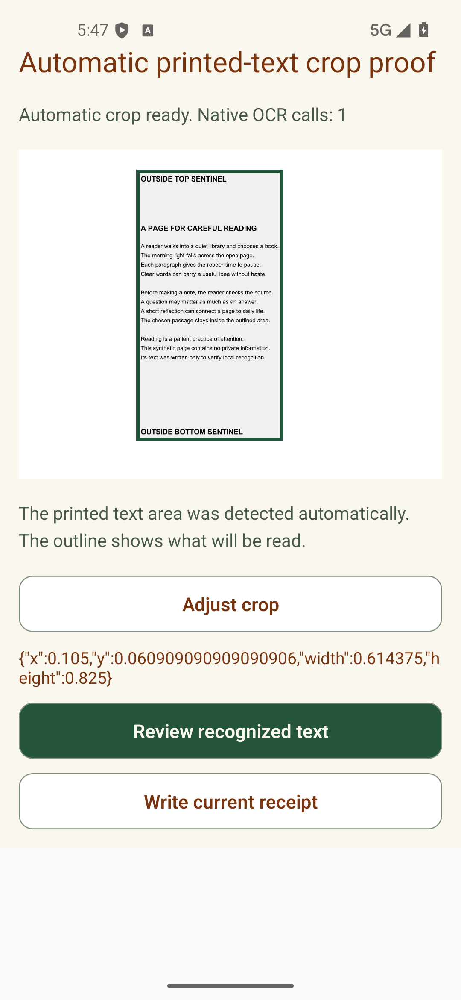

# Automatic printed-text crop — 2026-10-15

The owner explicitly chose automatic cropping around the detected printed text area, with manual adjustment behind one optional **Adjust crop** action. This changes the previous full-image default in [SDD-06 revision 0.20](../../SDD-06-after-book-entry-ui.md).

The native OCR result retains validated text-box frames. After selection, the capture session analyzes the normalized image once, selects the union of those frames with 2% padding per image dimension, and transforms that region before retaining the matching text for review. The default screen shows the selection and **Adjust crop**; handles, edge controls and reset appear only after it is opened. Unchanged automatic review reuses the same recognition result. Manual changes transform the new selection and run fresh OCR on that URI. Rotation invalidates cached text. Missing frames produce an explained full-image preview; unsupported browser/Expo Go/unlinked surfaces retain photo preparation without attempting native recognition.

Source: `captureGeometry.ts`, `captureSession.ts`, `captureAdapter.ts`, `ocrService.ts`, `NoteCrop.tsx`, and the Library `note-compose.tsx` route. Existing scan checkpoints, category/page metadata, cancellation and partial-result acknowledgement remain covered by the focused tests.

Verification actually run:

- Red-first tests demonstrated missing text frames, automatic selection/cache behavior, collapsed controls, rotation cache reuse, and unsupported-surface auto-recognition before implementation/correction.
- Focused Jest: five suites / 67 tests PASS (`captureSession`, `captureAdapter`, `ocrService`, `NoteCrop`, `NoteCaptureJourney`). Scoped Library TypeScript PASS after the review corrections.
- Actual Android API 36 x86_64 execution PASS using the current JavaScript through local Metro and the already-built development APK with unchanged native dependencies. ML Kit returned seven text boxes in 7.635 seconds. Automatic selection was `x=.105, y=.060909090909090906, width=.614375, height=.825`, producing 983×1815 pixels. Independent source rectangle `(168,134)–(1151,1949)` matched every output pixel. The native UI showed **Adjust crop**, with handles/edge controls hidden until expansion.
- Reviewing the automatic result retained exactly one native OCR call. Opening **Adjust crop** and moving the bottom edge inward by 5% selected source rectangle `(168,134)–(1151,1839)` and produced a pixel-identical 983×1705 output. A fresh OCR call used the transformed URI, took 5.594 seconds, and returned exactly the original recognized text minus the excluded bottom sentinel. See [pixel/OCR oracle](./PIXEL-AND-OCR-ORACLE.json), [runtime/source hashes](./NATIVE-RUN.json), and the native JSON receipts.
- Full repository Jest completed its assertions: 2,523 passed, three failed, four pending tests; 296 passed, 33 failed, one pending suites. Thirty failed suites are collection issues: 24 existing temporary Playwright files collected by Jest and six fixture/support files with no tests. The three assertion failures are `LibraryShelf.test.tsx` (sibling transition animation), Library `[bookId].test.tsx` (Private Note review control), and `marketplacePhase9Unit7cPrivateSaveRevisionCorrection.test.ts` (migration source-string expectation). These are outside the crop files changed in this unit and were not corrected here. Every failed filename/assertion is recorded in [JEST-SUMMARY.json](./JEST-SUMMARY.json). Jest also reported open handles after writing its completed result.
- Phase 9 continuity validation PASS (195 definitions, zero duplicates/missing traceability, validator regression probes PASS, 76 Markdown files). `git diff --check` PASS; no trailing whitespace in the changed source/test files; relative links in the SDD/receipt resolve. The earlier manual-crop receipt remains historical proof of its original selection, not proof of the new default.

The fixture is original synthetic readable English text and contains two sentinel labels; automatic cropping intentionally includes all detected text, including those labels. The previous manual-crop receipt separately proves that an explicitly selected region excludes outside text.

Native scope: the harness loaded the unchanged bundled text fixture at the picker-adapter boundary and exercised the production capture session, crop component, image adapter and ML Kit. Mounted composer tests separately cover route integration. Android system gallery/camera UI, live capture, physical-device/OEM behavior, hardware Back and TalkBack were not tested in this unit.

Persistence remains ON HOLD and all four `MANUAL_NOTE_WRITE_GATES` remain false. No database, Storage, provider or migration write, staging, commit, push or deployment occurred. The local emulator used disabled Wi-Fi/cellular data, local Metro, development auth bypass and an unreachable dummy backend. The temporary app route was removed after its source was archived under `native/diagnostic-route-source.tsx`; the emulator and Metro were stopped after evidence capture.

Cleanup/status: the fresh AVD data and Android-user scratch directory were removed after verifying the emulator stopped. Windows refused removal of `.tmp/auto-crop-20261015/temp/hsperfdata_LEGION`; that JDK performance-data directory was left untouched. Test logs remain in this task's scratch directory. The complete Jest process exited with code 1 after its reported failures/open-handle warning. The staged diff is empty; source, tests and evidence remain uncommitted alongside preserved pre-existing worktree changes.

Exact next authorized action: the owner reviews the automatic crop behavior and evidence. Wider native picker/camera/accessibility and persistence acceptance remain pending; Marketplace Phase 9 Unit7C/M46, DOC-13 and ACTIVE are unchanged.
