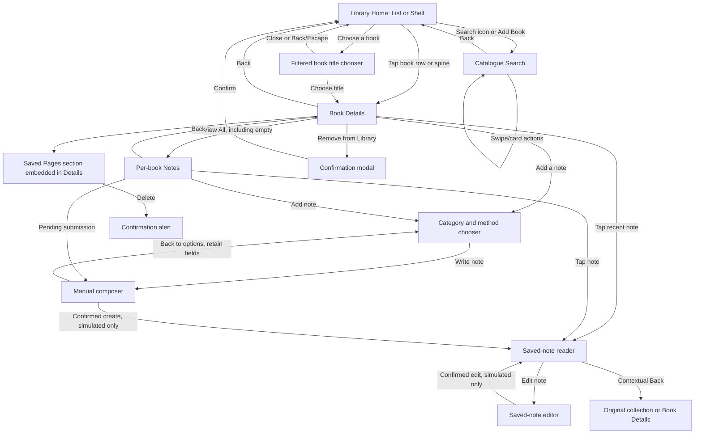

# Library Screens and Interaction Map

**Current retained-reader cache correction — 2026-10-10:** SDD-06 revision 0.8 and [correction evidence](./evidence/sdd06-manual-local-2026-10-10/CORRECTIONS.md) record the two bounded cache fixes. Confirmed note deletion publishes null to the shared actor/book/note record query, removes body/edit/copy controls from retained readers, cancels stale reads and prevents old/late confirmations from restoring deleted data. Retained confirmations apply cache effects once per QueryClient/account lifetime; fresh equal/newer versions survive unrelated operations, remounts and composer refresh. Four new mounted regressions use real QueryClient state with simulated transport. Eight suites pass 104/104 without timeout override; lazy React Native exports are initialized before behavioral test timing. Previous five corrections remain verified. All save gates stay false; no database/native/visual acceptance or new product policy is inferred.

**Previous manual-note correction overlay — 2026-10-10:** SDD-06 revision 0.7 and [correction evidence](./evidence/sdd06-manual-local-2026-10-10/CORRECTIONS.md) record the repeated retry/re-entry follow-up. The earlier 99-test checkpoint left finding 2 partly open: an edit's exact reader key could be lost after another remount. Every edit attempt now retains the resolved original reader context in account-scoped memory; the mounted regression preserves it through two leave/re-entry cycles despite a competing same-note reader. Focused tests pass 100/100; service/router effects remain simulated. Approved Leave still fences confirmation, initialized editors retain fields on refresh failure, Saved Pages separates errors/empty, and private reviews say Private Review. Current route/notes/review/Saved Pages rows below match source; section 6 is explicitly historical. Native navigation/scroll/focus and persistence remain unproved; all manual create/update gates remain false. No category-only policy change, OCR/design expansion or global-navigation change.

**Previous initial manual-note overlay — 2026-10-10:** SDD-06 revision 0.5 and [local receipt](./evidence/sdd06-manual-local-2026-10-10/README.md) own current B01–B05/B08–B12 behavior/evidence. B01 Add opens the optional category/method chooser; preview/list cards open saved readers; compact form -> explicit save -> confirmed reader -> edit preserves contextual return. Notes distinguishes loading/error/empty/filter-empty, retains filter/list context and exposes account-scoped pending submissions. Manual create/update remain visibly gated pending real database/atomic/ownership proof; component simulations do not complete the journey. Existing Saved Pages and management access retained. Scan is disabled for this manual slice; older immediate-OCR/Vault-creation editor descriptions below are historical and not the new entry path. No global navigation, shelves, search or marketplace behavior changed.

**Reviewed:** 2026-10-10 (manual-note correction/source rows); Horizontal tier membership retains 2026-10-05 evidence
**Worktree:** `Bookconnect4_library` / `codex/library-cover-shelf`  
**Purpose:** Trace each current Library route and interactive control to its code-wired result, including no-op controls and missing states. This is the source-of-truth map for planning the Stitch flow; it does not define new product behavior.

## Scope and evidence

### Current horizontal controls (2026-10-05)

In Shelf, **Book layout → Vertical/Horizontal** switches presentation and saves `library_shelfStyle:v1`; absent in List. Data/filter/Home draft are shared. Style switches preserve draft/Undo and reset selection; Save/drag disables switching. Tap opens the actual entry route; hover/focus/press provides motion-safe feedback/caption. Focus and hover are tracked independently: hover-out clears only hover feedback, while keyboard focus continues to drive the caption until blur; focus takes caption priority. A 450ms hold opens loaded-facts Quick look, also available per entry in the chooser; movement/scroll cancels hold/tap, a completed hold consumes release. Close/backdrop/Escape/back dismiss; View details routes by ID. Arrange suppresses browsing actions: tap/chooser selects, selected drag reorders within a tier or transfers only the dragged book to another tier, and edge hold advances only the destination track. Earlier/Later changes the shared order; Undo restores order and tier assignment, Save stores both on-device, and Cancel discards both. Horizontal tier membership uses the v2 local arrangement format and can produce unequal row lengths; older v1 order is read with a balanced initial split. Overflow controls are independent and reflect boundaries. Prior live web evidence covered the former balanced-half drag behavior; this correction's source tests pass, but the current live transfer gesture did not reproduce and remains unverified. The Library tracker records the exact result and next action. Native/assistive/performance acceptance remains unverified; Horizontal contract §§12 and 16 own implementation and handoff.

This map covers the Library route stack, its rendered Library/search/note components, and the app-level tabs visible while using Library. Controls are traced from current source. The app was manually opened during the 2026-10-01 review, but most individual controls and all external service outcomes were not exercised end to end. “Code-wired” therefore describes the handler and intended route/state transition found in source, not a claim that every service call was live-verified.

The currently configured Library routes are:

| Route | Screen / surface | Entry points |
|---|---|---|
| `/(tabs)/library` | Library Home, with List and Shelf modes | App-level Library tab; back/fallback destinations |
| `/(tabs)/library/search` | Catalogue Search / Find and Add Books | Home magnifier; Home `+ Add Book` |
| `/(tabs)/library/[bookId]` | One book’s details and management | Tapping a list row or shelf spine |
| `/(tabs)/library/notes` | Notes for one book | Book Details “View All”, including an empty collection |
| `/(tabs)/library/note` | Saved-note reader (B08) | Book Details previews and Notes cards; identifies book/note/context |
| `/(tabs)/library/note-compose` | Category/manual editor and saved-note edit (B04/B05/B09) | Add note, reader Edit, account-scoped pending re-entry |

Saved Pages is an embedded Book Details section, not a route. The current manual composer is a leaf route; category selection and editor share that route. Manual-book-entry forms, filter/sort sheets and delete confirmations remain overlays/alerts. Section 6 preserves the historical NoteEditor component behavior, which is not the current Book Details/Notes entry path. No Saved Page detail route, global notes route, local-library search route, or reading-stats route currently exists.

## Route flow

All manual create/update gates remain false: Save reports unavailable and retains fields. Confirmed-success edges describe locally tested simulated transitions; Scan is disabled. Existing Saved Pages browse/delete remains available.

## 1. App-level navigation around Library

`app/(tabs)/_layout.tsx` explicitly declares five visible destinations: **My Library**, **Exchange**, **Marketplace**, **Clubs**, and **Profile**. Marketplace store detail is explicitly hidden from the tab bar (`href: null`). These app tabs are shared around the Library stack; they are not a second Library navigation system.

| App tab | Destination |
|---|---|
| My Library | `/(tabs)/library` |
| Exchange | `/(tabs)/exchange` |
| Marketplace | `/(tabs)/marketplace/index` |
| Clubs | `/(tabs)/clubs` |
| Profile | `/(tabs)/profile` |
| Marketplace Store Detail | `/(tabs)/marketplace/store/[storeId]`; hidden from the tab bar and entered from Marketplace flows |

The 2026-10-01 manual browser review showed nine bottom-tab items, including raw route labels `marketplace/cart`, `marketplace/requests/index`, `marketplace/book/[listingId]`, and `marketplace/requests/[requestId]`. This differs from the five visible tabs in the static layout. Record it as a runtime navigation discrepancy to reproduce and resolve; do not design those route labels as Library destinations.

## 2. Library Home (`/(tabs)/library`)

List and Shelf are two modes on this one route. They use the same fetched collection and active filter. The user’s last mode is stored in AsyncStorage key `library_viewMode`; the component initializes as List, then reads the saved mode after mount. The filter selection is in memory and is not persisted by this screen.

| Visible control / element | Current behavior | Result / route | Status or caveat |
|---|---|---|---|
| Shelf / List labeled view buttons | Select `viewMode` and save it to AsyncStorage; selecting the active mode is a no-op | Same Home route, chosen renderer | Selected state is visible and exposed to accessibility. Available in normal/error headers. Keyboard selection and reload persistence checked. |
| Magnifier / Search books | Pushes `/library/search` | Search screen | Code-wired. |
| `+ Add Book` | Calls the same catalogue handler as the magnifier | Search screen | Shown in both normal List and Shelf. Hidden in the Home error header. Both entry routes checked; catalogue had its existing offline state. |
| All / Reading / Completed / Wishlist filter chips | Set active filter; recompute collection and chip count | Same Home route, filtered List or Shelf | Before the collection in both modes; compact chips wrap at narrow widths. `Wishlist` filters ownership=`wishlist`; it is not a reading status. `Want to Read` remains a book status without a Home chip. |
| Compact collection summary | Shows actual filtered item count and active-filter label before the collection in both views | None; informational | Count changes are announced politely. Shelf still retains its existing total-library tile below the cabinet. |
| List book row / cover | Opens that user-book entry | Book Details for its `userBookId` | Code-wired. There are no separate row-level edit or overflow buttons. |
| Pull down on List | Refetches library query | Same List view | The bounded FlatList owns vertical scrolling, its header contains Home controls, and its RefreshControl invokes the query refetch. Structural/callback tests and web scroll ownership checked; native pull-refresh remains unverified. Shelf mode has no refresh control. |
| Shelf entrance | Moves the opaque cabinet from 20px below its settled position over 800 ms | Same Shelf view | Labels and their opaque regions do not fade. Reduced motion starts at zero translation and schedules no entrance movement. SDD-05 §17 and paused-progress regressions own the correction; native rendering remains unverified. |
| Shelf horizontal drag/scroll | Scrolls both book rows together on one track; rows start against the left wooden side with brass support at each nonempty row's free end; wood and planks stay continuous | Same Shelf view, later books become visible | Indicator appears on overflow. Filtering resets scroll and brush state. Saved pages determine 24–44px widths (32px fallback), independent of viewport/row size; small 1–3px gaps and shared offsets keep brush mapping aligned. |
| Shelf book spine: press | Press-in lifts/tilts the book, plays the short `tak` sound and light haptic (unless reduced motion), and updates the contextual caption; release routes on `onPress` | Book Details | Code-wired; press/caption and tap-versus-release behavior have component coverage. No `onLongPress` exists, so the planned reading-stats quick look is not present. |
| Spine hover or keyboard focus | Below the cabinet, the existing chooser control displays the active spine's saved full title and available authors, plus Browse; long titles wrap and a missing author is omitted | Same Shelf view; Browse still opens the title chooser | Source-wired. The authenticated web check confirmed the focus caption and existing book detail route. A standalone pointer-hover run, native press/reduced-motion rendering and screen-reader announcement remain NOT_RUN. No facts, queries or routes are added. |
| Choose a book | Opens a bounded title chooser with the current filtered entries, full titles and available authors | Modal on Shelf | Shown below a nonempty cabinet. Opener/Close are ≥44×44px; separate full-width book buttons are ≥64px high. Supplies larger activation targets alongside 24–44px physical spines; no expanded overlapping spine hit regions. |
| Title chooser book / Close / Back or Escape | Book activation closes and opens that entry's details; dismissal returns to Shelf; data/filter changes close stale contents | Existing Book Details or Shelf | Web keyboard focus trap/return and correct Dune ID checked; native modal/Back behavior has source/unit coverage, without a device claim. No statistics or writes. |
| Finger sweep / pointer hover / keyboard focus | Temporarily lifts the spine; touch brush uses measured viewport origin and each shared book width/height against the left side; touch haptic ticks are rate limited | Same Shelf view | Backing above shorter books and gaps do not resolve to a book. Reduced motion disables transforms/ticks. Only activation opens details. Decorative supports add no input stops. Native tactile quality remains unverified. |
| Shelf empty-filter state | Shows “No books on this shelf” and a hint within the two-tier frame | None | Header Search/Add and filter controls remain available. Empty rows have no decorative brass bookends. |
| Floating Shelf/Search/Notes/Wishlist/Profile pill bar | Removed from Library Home in the vertical unit | None | Unused component remains in the repository; app-level tabs provide navigation. |
| Current Read card | Shows the first actual non-wishlist reading entry; activation opens that entry's details | Book Details for its user-book ID | No progress field is supplied. With no reading entry, shows an informational next-chapter empty message. |
| In your library tile | Shows `books.length` | None | Replaces the unsupported sample New Notes count; includes the same entries as the All chip. |
| Wishlist tile | Shows actual wishlist ownership count; activation selects the Wishlist filter | Same Shelf view, Wishlist selected | Uses the existing filter, without a new query or mutation. |
| Library loading state | Shows a centered spinner | None | No buttons are rendered until the query resolves. |
| Library error `Try Again` | Calls the library query’s `refetch` | Same Home route | Code-wired. Error header retains Search and labeled view choices, but hides `+ Add Book`. |
| Empty List state | Displays empty-library or empty-filter copy | None | The Home header still contains `+ Add Book` for an empty collection. No action exists inside the empty-state panel itself. |

Current filter keys are `all`, `reading`, `completed`, and `wishlist`. The `reading` and `completed` filters exclude wishlist-owned entries. There is no dedicated “Want to Read” chip even though the details screen offers that status.

## 3. Catalogue Search (`/(tabs)/library/search`)

This page searches Google Books with cached/Open Library fallback behavior. It does not search the user’s local collection. Search results stay on this route; result cards do not navigate to a result-detail page.

| Visible control / element | Current behavior | Result / route | Status or caveat |
|---|---|---|---|
| Back arrow | `navigateBackOrFallback` to Library Home | Home | Code-wired. |
| Search text input | Updates query; after 2 characters while focused, loads suggestions; after 3 characters, auto-searches when online; submit searches if that exact query/filter request has not already run | Same Search screen; suggestions or results replace content | Code-wired. Search begins after debounce; no explicit submit button is visible. A changed query clears prior results immediately and ignores late responses. Under 3 characters, the page asks the reader to keep typing instead of claiming there are no matches. |
| Clear `×` | Clears query, results, pagination and suggestions | Same Search screen, discovery/recent state | Code-wired; invalidates an in-flight response. |
| Search suggestion row | Selects the suggestion, closes dropdown, performs search, and may save a recent query | Same Search screen, results | Code-wired. Dropdown includes up to 3 recent terms and API suggestions when available. |
| Recent-search chip | Re-runs that query | Same Search screen, results | Code-wired. The recent-search list is shown when the query/results are empty. |
| Recent-search `×` | Removes that term from local recent history | Same Search screen | Code-wired. It is nested inside the chip; ensure both hit targets behave distinctly in the UI. |
| Active filter chip `×` | Removes just that filter and reruns current query once | Same Search screen, updated results | Code-wired. Chips appear only for active genre, language, or price filters; late results from an older filter are ignored. |
| Filter button | Opens bottom-sheet Filter modal | Overlay over Search | Code-wired when results exist. Choices: genre, language, price. Genre values include All, Fiction, Non-Fiction, Mystery, Romance, Sci-Fi, Fantasy, Biography, History, Self-Help, Business; languages All, English, Hindi, Spanish, French, German; prices All, Free, Paid. Exposed as an accessible button with selected/expanded state. |
| Filter modal option | Changes modal-local selection | Filter modal | Local draft only until Apply; selected state is announced, and reopening syncs to the last applied filters. |
| Filter `Reset` | Clears local draft filters | Filter modal | Does not itself rerun search; Apply is needed. |
| Filter `Apply Filters` | Commits local filters, reruns the query once when query is at least 3 characters, closes sheet | Same Search screen, updated results | Code-wired; one state-driven request avoids an old-filter request racing the new one. |
| Filter backdrop / system close | Closes the modal | Search screen | The modal draft is not applied; reopening restores applied values. |
| Sort button | Opens Sort Results sheet | Overlay over Search | Code-wired when results exist; accessible label and expanded state. |
| Sort option | Applies one of Relevance, Highest Rated, Newest First, Title A–Z and closes sheet | Same Search screen, reordered results | Code-wired; sorting is local over fetched results, and the selected option is announced. |
| Sort backdrop / system close | Closes sheet without selecting a new sort | Search screen | Code-wired. |
| Book-card `Add` | Adds catalogue book to user library; invalidates library query; shows success/error alert | Stays on Search screen | Code-wired. Button shows busy state. “Added” is passive status for books already in library. |
| Book-card heart / Wishlist | Toggles wishlist membership, refreshes wishlist and library data | Stays on Search screen | Code-wired with haptic feedback and error alerts; successful toggle has no visible confirmation. If already in the full library but not a wishlist item, it reports “Already in Library.” |
| Swipe to reveal Add to Library action | Reveals the right-side action; commits add on open, then closes row | Stays on Search screen | Code-wired. Existing library item shows disabled/gray `In Library`. |
| Swipe to reveal Wishlist action | Reveals the left-side action; toggles wishlist on open, then closes row | Stays on Search screen | Code-wired. Label changes to Remove Wishlist when saved. |
| Preview eye button | Opens external preview URL | External browser/link | Only rendered when a preview link exists. Missing URL or open failure yields an alert. |
| Share button | Opens platform share sheet with title/author/link | System share sheet | Code-wired. |
| Pull to refresh | Repeats the current query from page zero | Same Search screen | Code-wired while online with a nonempty query. |
| Scroll to list end | Loads next result page if `hasMore` | Same Search screen, appended results | Automatic pagination; no explicit Next button. |
| `Try Again` in error state | Repeats current search | Same Search screen | Code-wired. |
| `Add it manually` in no-results state | Opens Manual Entry modal, pre-filling title from query | Manual Entry overlay | Only shown after an online nonempty query returns no results; offline state does not imply that saving is available. |
| Manual Entry title / author fields | Edit required title and optional author | Manual Entry overlay | Code-wired text inputs. |
| Manual Entry `Cancel` / system close | Closes and clears title/author draft | Search screen | Code-wired. Tapping outside the modal is not wired to close it. |
| Manual Entry `Save to library` | Validates title, creates basic book, refreshes library/wishlist, closes modal, clears search, shows success/error alert | Search screen | Code-wired. Empty title produces “Title required.” It does not navigate to the new book’s details. |
| Offline banner | Explains that new catalogue searches need a network; cached-result notice can show after cached response | None | Banner is passive and announces as an alert while visible; the translated-away copy is hidden from assistive technology. Existing loaded results may remain visible if connectivity changes. Localhost preview has a special offline bypass in source. |
| Initial discovery / no-results copy | Explains search, offline unavailability, or no matches | None | Initial discovery may show Recent Searches. A short query asks the reader to keep typing; offline search does not claim no matches and does not offer manual save. |

Each result card itself is not a pressable detail link. Its available actions are Add/Added, Wishlist, Preview when available, Share, and swipe actions.

Open Library fallback now receives genre (`subject:`) and supported language filters. Under a language filter, a returned matching nested edition supplies edition metadata. If nested editions are absent, only a work-level title/author is retained when the work language confirms the filter; aggregate ISBN, cover, first-publication year, publisher and page count are omitted. A nonmatching work is excluded, and the page offset still advances over provider rows consumed. Open Library has no pricing data, so Free/Paid is reported as unapplied and the page shows the number of currently loaded results rather than an unfiltered catalogue total. Counts are labeled approximate unless the provider confirms an exact total. Filter changes trigger one request, repeated submission does not repeat an already-fetched query/filter combination, and late responses cannot replace newer query/filter results. These corrections were verified by focused tests and a fresh web export on 2026-10-04; native accessibility and device network transitions remain unverified.

## 4. Book Details (`/(tabs)/library/[bookId]`)

| Visible control / element | Current behavior | Result / route | Status or caveat |
|---|---|---|---|
| Back arrow | Returns to previous route, with Library fallback | Previous route/Home | Code-wired. |
| Cover, title, author, metadata | Displays book information | None | No action. Metadata is conditional when source data exists. |
| Want to Read / Reading / Completed | Immediately writes selected reading status and invalidates library/detail queries | Same Book Details screen | Code-wired, disabled during that mutation. No explicit success/error feedback is wired for mutation failures. |
| Owned / Lent Out / Borrowed / Wishlist | Immediately writes selected ownership | Same Book Details screen | Code-wired, disabled during that mutation. Conditional sections update after query refresh. No explicit success/error feedback is wired for mutation failures. |
| Available for Lending switch | Writes lending availability | Same Book Details screen | Only shown for ownership=`owned`. No explicit success/error feedback is wired for mutation failures. |
| New / Like New / Good / Fair / Poor condition | Immediately writes condition | Same Book Details screen | Only shown for ownership=`owned` or `lent_out`; disabled during mutation. No explicit success/error feedback is wired for mutation failures. |
| 1–5 rating stars | Immediately writes selected rating plus current review/privacy values | Same Book Details screen | Code-wired, disabled during mutation. No visible “clear rating” control. |
| Your Review text field | Edits draft text; saves automatically on blur | Same Book Details screen | No explicit Save button. Save failures show an alert. |
| Public Review / Private Review toggle | Flips `review_is_public` and saves current rating/review | Same Book Details screen | Both labels identify the book review; rating/text/privacy arguments are preserved. |
| Community Reviews list | Shows public reviews, loading, empty, or unavailable message | Same Book Details screen | Current cards are informational; no visible review actions or retry button. |
| `View All` in My Notes | Opens per-book Notes with `userBookId` | Notes route | Visible even when no notes have been loaded. |
| Recent note card tap / long press | Opens that saved note's reader | B08 reader route | Up to the three newest notes; reader supplies Edit and protected Delete. |
| `Add a note` | Opens optional category/method chooser; Write starts a blank manual editor | B04/B05 composer route | Available when empty; no category default; Scan disabled and saving gated. |
| Notes-preview read states | Distinct loading/error/empty; refresh failure retains loaded previews | Same Book Details screen | Retry targets notes; failure is not presented as a confirmed zero count. |
| Saved Pages cards | Show page number, word count, updated date, excerpt | None | Cards are not pressable; no page-reading/detail route exists. |
| Saved Page `Delete` | Opens confirmation alert; confirm deletes the page and refreshes the list | Same Book Details screen | Delete failures show an alert; initial/refresh read errors have separate feedback and retry. |
| `Remove from Library` | Opens confirmation modal | Confirmation overlay | Code-wired. |
| Remove modal `Cancel` / system close | Dismisses modal | Book Details | Disabled while removing. |
| Remove modal `Remove` | Removes user-book entry; invalidates library and returns to previous/Home | Library Home | Code-wired. Failure shows an alert. |
| Detail loading state | Shows centered spinner | None | No controls until load completes. |
| Book-not-found/error state `Go Back` | Returns to previous/Home | Previous route/Home | Code-wired. There is no detail retry button. |

The Book Details page is currently one long scroll, not three tabbed subpages. Status/ownership/condition, rating/review, community reviews, My Notes, Saved Pages, and removal are all on it.

## 5. Per-book Notes (`/(tabs)/library/notes`)

| Visible control / element | Current behavior | Result / route | Status or caveat |
|---|---|---|---|
| Back arrow | Returns to the associated Book Details when `userBookId` exists; otherwise falls back to Library | Book Details/Home | Code-wired. |
| Book title subtitle | Identifies the current book | None | Informational. This route is per-book, not a global notebook. |
| Saved-note total | Shows total loaded saved records, independent of active filter | None | Distinct from pending submissions; no count-by-category claim. |
| All / Quote / Thought / Takeaway / Action / Question | Filters loaded saved notes; All includes uncategorized records | Same Notes screen | Retains filter while viewing/editing; selected state exposed. |
| Note card tap / long press | Opens the selected saved reader | B08 reader route | Edit and protected Delete are reader actions. |
| Pending submission entry | Reopens retained account/book-scoped operation and submitted fields | Composer route | Outcomes can be pending, failed, conflicted or confirmed; no durable restart recovery. |
| Pull to refresh | Refetches notes with a refresh indicator | Same Notes screen | Cached records remain on refresh failure. |
| Add note / Add your first note | Opens optional category/method chooser | B04 composer route | No default category; Scan disabled. |
| Empty / filtered-empty state | Shows No notes yet or a named empty filter | Same Notes screen | Add for true empty; Show all notes for filtered empty. |
| Loading state | Shows spinner | None | Code-wired. |
| Query error | Initial error offers Retry; refresh error retains loaded notes | Same Notes screen | Does not present failed loading as successful empty data. |

`src/components/notes/NotesList.tsx` is exported but is not rendered by either current Library route; its helper-level filter behavior is not an additional live screen/control in this map.

## 6. Historical NoteEditor overlay (pre-SDD-06 entry path)

The table below records retained legacy component behavior and regression evidence. Book Details and Notes now use the composer/reader routes above; this overlay is not their current entry path. Legacy `Save` creates/updates a `reading_notes` record; `Save to Vault` writes a separate saved-page record. Saving one does not implicitly save the other. These historical OCR/Vault controls do not establish availability in the gated manual slice.

| Visible control / element | Current behavior | Result / route | Status or caveat |
|---|---|---|---|
| `Cancel` / header close | Calls `onClose` | Returns to the screen that opened the modal | Code-wired. No unsaved-changes confirmation is shown. |
| Tap backdrop / system close | Calls `onClose` | Returns to the caller | Same unsaved-content loss risk as Cancel. |
| Quote / Reflect / Distill / Apply tag chips | Selects note category and updates field label/placeholder/description | Same editor | Code-wired. |
| Passage / Your thoughts field | Edits note content | Same editor | Quote uses italic passage styling. 500-word limit; Save disabled for empty/over-limit content. |
| Page number field | Edits optional note page number | Same editor | Numeric keypad, max 5 characters. Positive-page validation is specifically enforced by Save to Vault; note Save parses this optional value. |
| `Save` | Saves/updates the note, invalidates notes, closes editor on success | Return to caller | Busy indicator during save; failure is reported by caller alert and editor remains. |
| EN / HI / KN / ML language chips | Selects OCR language hint | Same editor | Language choices affect Scan Page only. |
| `Scan Page` | Requests camera permission, launches camera, OCRs and prefills content; OCR result selects Quote | Back to editor with captured text | If content exists, asks before replacing. Expo Go reports scan unavailable and advises manual paste/Dev Build. Permission denied and OCR errors use alerts; cloud Indic fallback availability is not proven in this local UI review. |
| `Save to Vault (page N)` | Upserts saved page at entered page number, invalidates vault query, closes editor | Book Details Saved Pages section | Only rendered with user/book context; disabled until page number and content are present. Requires positive page. Vault cap is 800 words/4000 characters; an overlong page is trimmed and reported after save. |
| Word counter / truncation message | Displays count and whether OCR text was capped | None | Informational. |

## 7. Saved Pages section (embedded on Book Details)

| Visible control / element | Current behavior | Result / route | Status or caveat |
|---|---|---|---|
| Page number, word count, date, excerpt | Displays saved text metadata and excerpt | None | Informational only. Tapping a page card does nothing. |
| `Delete` | Opens confirmation alert; confirm deletes the saved page and invalidates the vault query | Same Book Details screen | Code-wired. No edit/open action is implemented. |
| Empty message | Says “No saved pages yet.” after a successful empty read | None | Neutral copy; no direction toward deferred creation. |
| Loading state | Shows a small spinner | None | Code-wired. |
| Query error / Retry saved pages | Initial failure shows Couldn't load saved pages; refresh failure retains cached excerpts | Same Book Details screen | Retry rereads the same book; deletion failure does not optimistically remove cached excerpts. |

## 8. Current dead ends and follow-up checks

These are part of the map because they affect what a reader believes a control does:

1. **Resolved in the vertical unit:** inactive Shelf pill navigation is no longer rendered by Home.
2. **Resolved in the vertical unit:** fixed `65%`, `12`, and `148` are removed. Current Read and Wishlist now have actual-data destinations; total library count replaces the unavailable notes metric.
3. **List and Shelf share filtering, but Wishlist and Want to Read are different fields.** Home has a Wishlist ownership filter and no Want to Read reading-status filter.
4. **Search result card body has no detail navigation.** Only the explicit controls and swipe actions work.
5. **Manual Add and catalogue Add stay on Search.** Success does not open the newly added book’s detail page.
6. **Resolved in the manual slice:** View All Notes remains available at zero notes.
7. **Saved Pages has no open/edit/page-detail action or new creation action.** Existing browse/delete is retained; standalone passage creation remains deferred.
8. **Resolved in the manual slice:** Notes and Saved Pages distinguish initial/refresh errors from successful empty reads.
9. **OCR integration remains deferred:** Scan is disabled in the current manual composer. Historical legacy OCR behavior in section 6 is not manual-slice availability evidence.
10. **The app-tab runtime showed four raw Marketplace route labels** in the 2026-10-01 manual browser review, although static `app/(tabs)/_layout.tsx` lists five app tabs plus one hidden store route. Recheck the running build before accepting the global navigation as correct.
11. **Resolved in the vertical unit:** Home uses supported Ionicons `book-outline`; the old `menu-book` type diagnostic is gone.
12. **Book status/ownership/condition/lending writes have no explicit mutation error UI** in their current handlers. The controls are wired to service calls, but a failed write can lack reader feedback.

## Source index

- Routes: `app/(tabs)/_layout.tsx`, `app/(tabs)/library/_layout.tsx`, `app/(tabs)/library/index.tsx`, `app/(tabs)/library/search.tsx`, `app/(tabs)/library/[bookId].tsx`, `app/(tabs)/library/notes.tsx`
- Home/shelf: `src/components/library/LibraryHeader.tsx`, `LibrarySummary.tsx`, `LibraryFilterBar.tsx`, `LibraryBookList.tsx`, `LibraryShelf.tsx`, `BookSpine.tsx`, `LibraryPillNav.tsx`, `LibraryBentoGrid.tsx`, `src/features/books/utils/libraryShelf.ts`
- Detail/vault: `StatusSelector.tsx`, `OwnershipSelector.tsx`, `ConditionPicker.tsx`, `RatingInput.tsx`, `DeleteBookModal.tsx`, `VaultPagesList.tsx`
- Search: `src/components/search/SearchBar.tsx`, `SearchSuggestions.tsx`, `RecentSearches.tsx`, `FilterModal.tsx`, `SortModal.tsx`, `BookCard.tsx`, `SwipeableBookCard.tsx`, `WishlistButton.tsx`, `ManualEntryModal.tsx`
- Notes/editor: `src/components/notes/NoteCard.tsx`, `TagSelector.tsx`, `NoteEditor.tsx`

## Handoff

This map documents source-traced app behavior for design and implementation planning. Current user authorization and sequencing are recorded in the [Library tracker](./TRACKER.md) and owning SDDs; that authority is limited to each stated work unit and does not authorize database changes, deployment, staging, or commit. Proposed pages and transitions absent from the source above must be labeled as proposals.

## 9. Stitch prototype progress (2026-10-02)

Project: [BookConnect Library prototype](https://stitch.withgoogle.com/projects/2331124625547392526). The active prototype contains 22 screens: 17 earlier drafts/experiments plus five refined alternatives (`Library Home — List (Refined)`, `Library Home — Shelf (Horizontal Stacks)`, `Book Notes — List (Refined)`, `Find Books — Results (Refined)`, and `New Note — Editor Sheet (Refined)`). The mismatched `Library Home — Shelf (Refined)` editor image was removed from this prototype’s screen list; it is not the active Shelf destination.

### Preview routes verified

| Source control | Destination | Evidence and limit |
|---|---|---|
| Refined List `Shelf` / Horizontal Stacks `List` | The other home mode | Both directions activated in Stitch Preview; this is prototype navigation, not app-code behavior. |
| Refined List `Search` / `Add Book` | `Find Books — Results (Refined)` | Both actions were connected to the refined catalogue results screen. |
| Refined Search Back arrow | `Library Home — List (Refined)` | Preview returned to the refined List screen after the destination was reapplied. |
| Refined Search `Filter` | Existing `Find Books — Filter Sheet` | Preview opened the filter sheet over catalogue results. |
| Refined Search `Sort` | Existing `Find Books — Sort Sheet` | Preview opened the sort sheet. |
| Refined Notes `Add note` | `New Note — Editor Sheet (Refined)` | Preview opened the editor. Its copy and sample value still need correction. |

### Design content that is not approved as data

- List (Refined) repeats the Library label and Search control across its top and content bars.
- Shelf (Horizontal Stacks) correctly displays flat, horizontal piles resting on continuous planks with the next stacks peeking in from the right. Its collection/category labels are generated mock copy and need to become data-bound or be removed. Long-press was not verified; no stats card appears in the resting view.
- Notes (Refined) includes sample entries and page numbers. Treat them as illustrative; counts and page numbers must come from saved records.
- Search Results (Refined) includes an unverified “7 editions” total and edition metadata. Use provider-returned values only.
- New Note Editor (Refined) still shows unsupported “Permanent Reading Vault / Archival Sync / Indexed” claims and a hard-coded page number. The in-place AI edit did not visibly change the rendered screen. Do not use that copy as an implementation specification.
- Earlier Details, Saved Pages, offline, manual-add, and confirmation screens remain prototype drafts; not every control or empty/error state was rechecked in this pass.

This records a visual prototype and six checked navigation behaviors. It does not change the source-traced route/action map above, prove app parity, validate catalogue data, or implement long-press, scrolling, save, OCR, deletion, or database behavior.

## 10. Horizontal shelf implementation handoff (2026-10-02)

The 2026-10-02 user-directed Horizontal Stacks handoff remains a separate planned implementation option; the later approved vertical Unit 3 checkpoint is recorded in SDD-05 §18 and the Library tracker. Exact Stitch screen `b64af6d9e5b140358fab35e66b30926f` was inspected through its rendered source and standalone preview. Its two tier scrollers are independent; upper-tier keyboard movement was verified, but touch/trackpad smoothness was not. Clicking a visible book did not navigate. Authored source contains no book-tap/long-press handler, dynamic book placement, or filter logic; the List/Shelf script only changes selected styling. These findings do not describe or prove app parity for the later vertical changes in §2.

[HORIZONTAL-SHELF-IMPLEMENTATION.md](./HORIZONTAL-SHELF-IMPLEMENTATION.md) maps the source to actual app requirements: List/Shelf switching, actual filtered entries -> unique flat-book placement, independent tier browsing, book tap -> existing Details, press feedback/cancel, and long press -> truthful cached book quick look -> Close/View details. Sample categories, duplicated volumes, fixed progress, and unsupported analytics must not become user data. Source capture and scrolled screenshot are linked there. Application implementation and parity verification are pending.

## 11. Arrange interactions and shared order (2026-10-03)

**Vertical implementation is included in the scoped local commit containing this handoff; horizontal remains pending.** [SDD-05 §§20–21](./SDD-05-library-reading-room.md#20-arrange-shelf-shared-order-separate-dragging-2026-10-03) owns architecture and LIB-ARR01–05; the [Library tracker](./TRACKER.md) owns verification. Home shows Arrange shelf when Shelf has at least two entries and storage has loaded successfully.

| Control/input | Result | Architecture/requirement |
| --- | --- | --- |
| Arrange | Switch to All books and start a full Library-ID draft | Disable filters, mode/catalogue actions; LIB-ARR01/02/05 |
| Tap a spine or use the full-width chooser | Select a book without opening Details; show its title and Earlier/Later controls | Tap then drag selected spine; chooser reaches off-screen entries; LIB-ARR04 |
| Scroll before pickup | Browse to a book to move | Layout-local native scroll behavior; LIB-ARR03 |
| Drag and successful drop | Show a placement marker, then move the selected ID before the target ID | Separate geometry/gestures per layout; one semantic move; LIB-ARR01/03 |
| Hold dragged book near an edge | Reveal off-screen targets progressively | Vertical shared track; horizontal active tier only; LIB-ARR03 |
| Earlier/Later (keyboard or tap) | Move selected book one canonical position, including across the row boundary | 44px controls and existing chooser; LIB-ARR04 |
| Undo | Reverse one completed move, consume that snapshot | Does not save or leave Arrange; LIB-ARR02 |
| Cancel | Discard the unsaved draft and return to browsing | No order-storage write; LIB-ARR02 |
| Save | Write versioned Library IDs to account-scoped AsyncStorage; exit on success | Same-device/browser persistence; failure retains draft for retry; LIB-ARR02/05 |
| Try again after load failure | Reload saved order; editing stays blocked until loading succeeds | Prevent overwrite of unread/corrupt preference; LIB-ARR05 |
| Gesture cancellation | Clear the active drag without changing draft/history | Normal details/quick-look/brush do not compete in Arrange; LIB-ARR04 |
| Future Shelf-style switch | Project the same draft/order into the other layout | Clear gesture measurements, retain shared draft/Undo; no implicit Save; LIB-ARR01/02 |

Save is the only durable order write. An addition/removal cancels the draft with feedback; new IDs append to surviving saved IDs during reconciliation. Leaving Library cancels an unsaved draft. Exiting Arrange restores book Details and brush feedback. Searchable destinations, extended Undo, horizontal gestures and cross-device sync are deferred. No route, migration or database mutation is added.

### Search reliability and disclosure (2026-10-05)

| Control | Result |
| --- | --- |
| Submit after automatic search | Save successful recent query without a duplicate request; if pending, save on successful completion |
| Record details / Hide record details | Toggle the available catalogue metadata within that result card; no route or write |
| Filter / Sort | Open the existing Library-styled sheet; supported filters are applied, unsupported fallback pricing is explained, and local sort options reorder currently loaded results |

Cache hits and stale rate-limit recovery preserve pagination metadata. Open Library uses returned matching nested-edition metadata for a supported language filter; if nested edition data is absent, only confirmed work-level title/author fields remain and pagination advances by raw provider rows, including omitted works. Unfiltered work records remain separate catalogue results. Newest First compares parsed date values and puts missing/unreadable dates last; all local sort options cover loaded results only. Existing add/wishlist/preview/share actions remain in place. See SDD-05 LIB-SR01–04.

## Planned OCR capture and reading-memory expansion — 2026-10-05

User approved documentation scope only. [SDD-03 section 10](./SDD-03-ocr-vault.md#10-expanded-capture-and-reading-memory-plan-2026-10-05) is authoritative for OCR-P01–13: reliable explicit-consent hybrid OCR; Camera/Choose photo/Paste; crop/rotation; bounded full extraction review and passage selection; separate note/vault limits and overwrite previews; device-only draft recovery; private all-books capture search; attributed text/Markdown export; quiet From your reading resurfacing. These controls/routes are PLANNED/PENDING, not current source-wired behavior. Catalogue Search remains separate. Saved passage detail and Home search/resurfacing entry points require their implementation units; no new app-level tab or photo archive is approved. Planned flow: book -> capture -> prepare -> extract -> review/select -> explicit save -> reopen/search/export/resurface. Resume/Discard drafts and cloud Retry/Cancel preserve reader control. U0–U6 and exact acceptance mapping are in the owning SDD; existing maps of implemented controls remain historical/current evidence only.

## 2026-10-06 — Bounded Search continuation and filter contract

Search continuation pages use the provider chosen by the first successful page, preserving that provider's cursor and totals. A Google continuation failure is surfaced; it cannot silently append Open Library records. Open Library continuations do not retry Google. New first-page searches, refreshes and filter changes may select a provider anew. Explicitly submitted queries shorter than three characters requery on filter apply/remove; unsubmitted short queries keep typing guidance. Open Library fallback and unsupported-filter notices are visible for empty results as well as populated results. This corrects confirmed review defects without adding catalogue features. Acceptance is covered by the 2026-10-06 regression evidence in TRACKER.md; real Google success/native/assistive-technology validation remains unverified.
**2026-10-06 OCR preflight:** [U0 report](./OCR-U0-PREFLIGHT.md) completes the source/API/platform/storage review and records U1 corrections. Expanded controls remain PLANNED. Installed ML Kit 1.5.2 is present and bundles five scripts; loader/result mismatch is proven, native scanning/cloud remains unverified. No current UI capability was added.

### OCR U1 implemented locally — 2026-10-06

NoteEditor now offers explicit Retry with cloud confirmation for the current captured image, preserves bounded full review, prevents silent note trimming, reports safe failures and ignores canceled/account-stale results. Editing/closing clears pending image work. Cloud backend remains disabled pending quota provisioning. Gallery/crop/passage selection and other OCR-P additions remain PLANNED. Runtime proof pending; see [U1 evidence](./ocr-evidence-20261006/README.md) and SDD-03 section 11.

### Android OCR runtime evidence — 2026-10-06

Bounded English native service smoke now PASS in SDK54 development client on Android16/API36 emulator offline; actual sample text/timings and recognition errors recorded in [evidence](./ocr-evidence-20261006/README.md). Temporary diagnostic removed; no new permanent screen/flow. Camera/editor saves, broader language/device/cloud proof and U2–U6 remain pending.

**2026-10-06 OCR R2 correction (implemented):** Overflow retains only first 20,000 characters and explicitly warns that text is missing. Note and vault saves are blocked until Use partial OCR text confirmation; editing invalidates acceptance, confirmation does not autosave, and existing destination limits remain. Scan a smaller area remains the recovery action; gallery/crop/full passage-selection controls remain planned. R3 cloud cancellation is deferred by user; cloud remains disabled. Source regression evidence is in TRACKER.md.

## 2026-10-07 — Approved five-category notes direction

User approved Quote, Thought, Takeaway, Action and Question. Shared app labels now map quote/reflect/distill/apply to Quote/Thought/Takeaway/Action; stored values and default reflect (Thought) preserved. Writing prompts remain optional. Exact-project Supabase MCP verified Bookconnect_reactexpo/ahntbtktjjmvfosgkmgn ACTIVE_HEALTHY; metadata-only readback confirmed reading_notes_tag_check allows only the original four. Question remains designed/pending storage enablement, never silently mapped to reflect or exposed as savable yet. No note contents read or database writes. Concrete migration creation/application/compatibility/verification plan: docs/user/library/NOTE-CATEGORY-ROLLOUT.md. No migration created/applied. Topic tags and answered/done states remain later proposals. Full capture UI approval and Android correction acceptance remain pending independently.

Active scoped unit library_note_labels_complete_question_schema_pending. Exact next action: obtain explicit authorization to create and verify the narrow question constraint-expansion migration plan; application requires separate approval. Marketplace Phase9 Unit7C/M46 and DOC13/ACTIVE unchanged. Existing mixed changes preserved; no stage/commit/push/deploy, database/Storage/provider mutation. Stitch category refinement requested under user-approved design scope; completion evidence recorded at closeout.

## 2026-10-07 — Optional swipe note-review design

User requested left/right note review, a Stitch design and smoothness/book-principle assessment. Proposed left Review again/right Reviewed are session-only outcomes, no deletion/favorite/Action completion/Question answer or memory claim. Visible buttons/Undo/full-note/Exit, no automatic endless requeue, reduced-motion and long-text gesture safety included. Owning proposal docs/user/library/NOTE-REVIEW-DESIGN.md; existing NoteCard and Shelf reduced-motion code inspected. Stitch live picker confirmed Balanced Gemini3.8Flash vs Speed Gemini3.5Flash-Lite; Balanced used. Design generation/inspection is authorized, application/persistence changes are not. Question migration creation approval still pending; earlier approval request not answered by this new design request.

Active scoped unit library_note_review_design_in_progress. Exact next action: inspect/refine concrete Stitch review frames, present gesture semantics/visual proposal for user approval. Marketplace Phase9 Unit7C/M46 and DOC13/ACTIVE unchanged. No app/dependency/migration, database/Storage/provider write, staging, commit, push or deployment. Existing mixed changes preserved; evidence uncommitted.

## 2026-10-10 — Manual composer browser-history correction

A focused note editor with meaningful unsaved fields now protects same-document browser Back/Forward through the existing contextual discard dialog. Keep retains fields and returns focus after web dialog dismissal; Discard replays the requested history destination once. Blank/category-only history exits and internal Back to options remain as before. This routes composer state through an app-start dispatcher because Expo's web linker resets root state before route-local popstate listeners. It remains dormant outside a focused dirty/pending-save composer and does not add history entries. See SDD-06 revision 0.9 and the dated correction receipt for source, test and browser evidence. Edge browser verification does not establish compatibility where the Navigation API is unavailable, persistence, security or native acceptance. All save gates stay closed.
