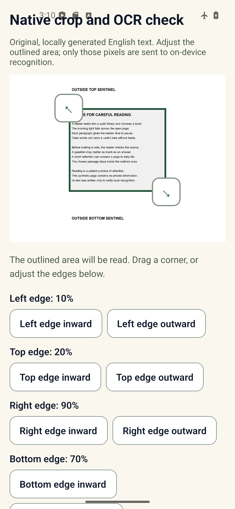
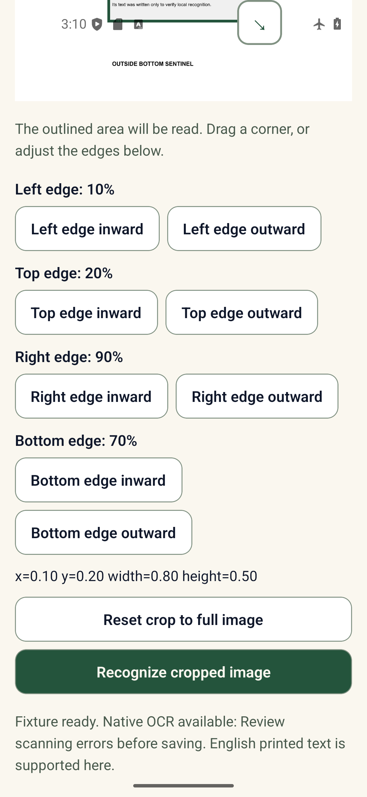
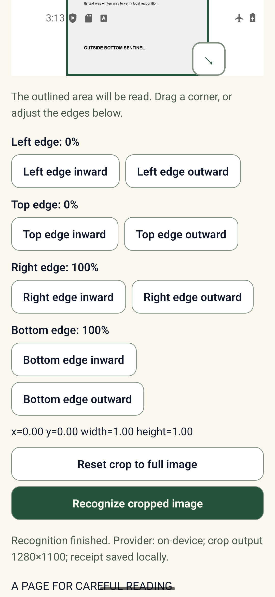

# Android emulator crop and on-device OCR check — 2026-10-15

This supplemental run verified the current Library crop controls against an image containing original, readable English text. It exercised the actual `NoteCrop` screen, the existing image-manipulation adapter, and native on-device ML Kit on Android API 36. It did not change the product requirements or persistence decision.

The existing [synthetic text-page fixture](../sdd06-capture-ocr-2026-10-11/fixtures/english-page.png) is 1600×2200 and includes top and bottom sentinel labels outside the text selection. On the emulator, the four labeled edge controls were used to set left 10%, top 20%, right 90%, and bottom 70%. That produced `x=0.10, y=0.20, width=0.80, height=0.50` and a 1280×1100 crop. An independent pixel oracle compared the emitted native crop with the literal source rectangle `(160, 440)–(1440, 1540)`; they were pixel-identical. The full-image reset control returned to `x=0, y=0, width=1, height=1`.

On-device English OCR recognized all intended text, omitted both outside sentinels, and reported no review overflow. Recognition took 5.695 seconds in this emulator run. The extracted full result is in [capture-proof.json](./native/capture-proof.json); the independently computed pixel comparison is in [PIXEL-ORACLE.json](./PIXEL-ORACLE.json), and environment/source hashes are in [NATIVE-RUN.json](./NATIVE-RUN.json).

The screenshots show the selected area and sentinels, all four crop settings and reset/recognize actions, and the completed native recognition state:

This is meaningful Android runtime coverage: the app used a native Android build, the actual image manipulation path, and on-device ML Kit. The diagnostic route loaded the bundled synthetic fixture directly. Android's system gallery/camera picker, live camera capture, permission denial/cancellation, physical-device/OEM behavior, hardware Back, and TalkBack were not tested. Do not read this as full SDD06-05/06 native acceptance or release acceptance.

The run used a fresh API 36 x86_64 AVD, an offline debug build, local Metro only, a local development-auth bypass, and dummy unreachable Supabase settings. It saved no note and made no database, Storage, provider, migration, or shared-service writes. The temporary diagnostic route and AVD data were removed after copying the evidence here; the large logs and scratch screenshots were also removed. Windows denied removal of one small JDK performance-data directory in the session scratch folder, so it was left untouched. All four `MANUAL_NOTE_WRITE_GATES` remain false; persistence remains on hold. Marketplace Phase 9 remains unchanged.

## Verification actually run

- Android x86_64 debug build succeeded with `:app:assembleDebug --offline -PreactNativeArchitectures=x86_64`; installed APK SHA-256 is recorded in [NATIVE-RUN.json](./NATIVE-RUN.json).
- Native crop output matched the independent literal-pixel oracle exactly; on-device OCR and reset checks passed.
- Focused Jest: 3 suites / 43 tests passed (`captureSession`, `captureAdapter`, and `NoteCaptureJourney`). Scoped Library TypeScript passed.
- Phase 9 continuity validator passed: 195 requirement definitions, zero duplicates or missing traceability, regression probes passed, and 76 Markdown files checked. `git diff --check` passed. Document-size advisories were informational.
- No stage, commit, push, deployment, database/Storage mutation, or migration occurred.

**Exact next action:** owner reviews this native crop/OCR evidence and then separately directs the next acceptance slice. This run does not authorize shared writes or persistence work.
